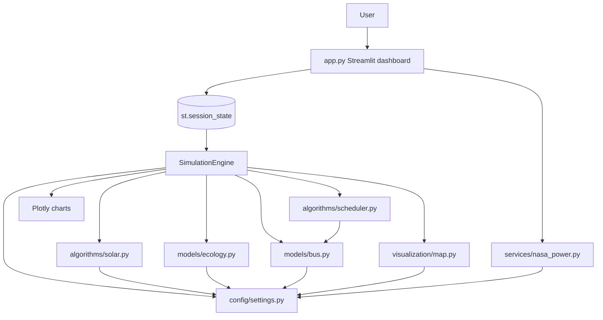

# Coimbatore Smart City Simulation — Complete Codebase Analysis

**Document type:** Exhaustive knowledge-transfer reference
**Scope:** Every source file, every UI element, every model equation, every config constant, every test and validation check
**Repository:** `~/Desktop/Smart_city/coimbatore_smart_city_sim`
**Course:** BCSE355L Smart Cities · VIT Vellore
**Team:** Aditya Saxena (24BCE1633) · Narayanan Subramanian (24BCE1699)
**Analysis date:** 2026-10-05
**Volume:** 7,035 lines of application Python · 2,236 lines of tests · 14 documents
**Verification performed for this analysis:** full read of every source file, `validate_results.py` executed live, `pytest --collect-only`, app booted headless and confirmed serving HTTP 200

---

## Table of contents

1. [Executive summary](#1-executive-summary)
2. [Complete file inventory](#2-complete-file-inventory)
3. [Tech stack](#3-tech-stack)
4. [Architecture](#4-architecture)
5. [Page-wise feature reference — the complete UI walkthrough](#5-page-wise-feature-reference)
6. [Map deep dive — every interaction](#6-map-deep-dive)
7. [Model physics — every equation and constant](#7-model-physics)
8. [Data provenance and geometry](#8-data-provenance-and-geometry)
9. [Validation and QA](#9-validation-and-qa)
10. [Reference result tables](#10-reference-result-tables)
11. [Scripts reference](#11-scripts-reference)
12. [Documentation index](#12-documentation-index)
13. [Findings, discrepancies and risks](#13-findings-discrepancies-and-risks)
14. [Reproduction instructions](#14-reproduction-instructions)

---

# 1. Executive summary

## What the system is

An **academic operations simulation** — not a dispatch tool, not an engineering design, not a financial forecast. It integrates one representative day (48 × 30-minute steps) and one climatological year (8,760 hourly steps) of a coupled system:

- a **floating-PV array** on Ukkadam Lake, Coimbatore at 10 / 15 / 20 % surface coverage, plus an optional non-compliant stress range of 25 / 30 / 40 %
- a **260-bus electric fleet** on 4 street-exact OSRM corridors
- **battery swapping** at 4 hubs, reported in two funding tiers
- **municipal captive load** (3 buildings)
- **lake dissolved oxygen, temperature, pH, turbidity** from a mass-conserving budget
- **carbon abatement and tariff savings** credited *only* against self-consumed energy

## The three arguments the model actually makes

1. **Swaps follow the sun.** Solar-funded swaps occur **only** between 10:00 and 15:30, inside the insolation surplus window. The split is an *output* of the energy balance, not an assumption. Verified: solar-funded hours `['10.0' … '15.5']`, grid-assisted hours `['18.0' … '21.5']`.
2. **The array cannot power the whole system.** Annual fleet demand 20.79 GWh + municipal 9.09 GWh = 29.88 GWh against 21.36 GWh generated. The remainder is grid-supplied, and the dashboard says so explicitly rather than hiding it.
3. **Oxygen falls with coverage, for a specific reason.** Minimum DO 5.49 → 4.72 → 4.33 → 3.94 mg/L at 0 / 10 / 15 / 20 %. The 20 % figure sits *at* the 4.0 threshold **and** breaches the 15 % policy cap outright.

## The single most important structural fact

**There is no multi-page application.** There is one Streamlit script (`app.py`, 1,523 lines) rendering one page frame plus four tabs. Any document that refers to "pages" means tabs.

| Logical page | Implementation | app.py lines |
|---|---|---|
| Page 0 | Sidebar + hero + clock + flow cards + ticker | 464–705 |
| Page 1 | Live simulation | 720–1018 |
| Page 2 | Coverage scenarios & sensitivity | 1024–1157 |
| Page 3 | Cost-benefit | 1163–1333 |
| Page 4 | Annual model & exports | 1339–1506 |
| — | Playback loop | 1512–1523 |

---

# 2. Complete file inventory

## 2.1 Top level

| Path | Type | Size | Purpose |
|---|---|---:|---|
| `app.py` | Python | 1,523 lines | The entire dashboard: page frame, sidebar, 4 tabs, playback loop, exports |
| `README.md` | Markdown | 184 lines | Overview, quick start, dashboard guide, headline results |
| `pyproject.toml` | TOML | 98 lines | Build metadata, deps, ruff config, pytest config |
| `requirements.txt` | Text | ~30 lines | Runtime deps, deliberately narrow, with a rationale comment block |
| `requirements-dev.txt` | Text | 7 lines | `-r requirements.txt` + pytest + ruff, upper bounds matching the verified env |
| `.env.example` | Text | 7 lines | States no API key is required; commented `MAPBOX_API_KEY` placeholder for future use |
| `.gitignore` | Text | 9 lines | `__pycache__/`, `*.pyc`, `.DS_Store`, `.venv/`, `venv/`, `outputs/`, `data/generated/`, `data/processed/`, `.env` |
| `data/generated/` | dir | empty | Placeholder, gitignored |
| `outputs/` | dir | empty | Placeholder, gitignored |
| `data/raw/` | dir | *absent* | Where `nasa_power.py` writes its cache; created lazily via `mkdir(parents=True, exist_ok=True)` |

## 2.2 `src/` — 3,292 lines

| File | Lines | Role |
|---|---:|---|
| `src/__init__.py` | 0 | Package marker |
| `src/config/__init__.py` | 0 | Package marker |
| `src/config/settings.py` | **832** | Every constant as a `Config` dataclass field: corridor geometry, named stops, hub metadata, ecological coefficients, tariffs, economics, tile providers, monthly climatology. Plus derived-quantity methods and the run-signature hasher. |
| `src/algorithms/__init__.py` | 0 | Package marker |
| `src/algorithms/solar.py` | 227 | PV physics: profile interpolation, cloud attenuation, cell-temperature derate, floating-vs-ground cooling premium, seeded cloud-cover generator |
| `src/algorithms/scheduler.py` | **509** | Fleet construction (largest-remainder allocation), the single traction-energy definition, station charging, the two-tier swap scheduler |
| `src/models/__init__.py` | 0 | Package marker |
| `src/models/bus.py` | 374 | `Bus` dataclass: lazily-cached route geometry, distance-interpolated position, SOC ladder, station proximity, diversion steering |
| `src/models/ecology.py` | 463 | `EcologyParams` (frozen, 25 fields), DO saturation polynomial, water temperature, blocked production, Q10 respiration, budget integrator, status classifier, steady-state summariser |
| `src/simulation/__init__.py` | 0 | Package marker |
| `src/simulation/engine.py` | **740** | `SimulationState` (≈45 fields) + `SimulationEngine` (reset / step / run / accessors / annual model) + `phase_story()` + a standalone `__main__` self-check |
| `src/visualization/__init__.py` | 0 | Package marker |
| `src/visualization/map.py` | 562 | The complete Leaflet component: legend generator, radiance classifier, columnar payload builder, the 236-line HTML/CSS/JS template, trajectory builder |
| `src/services/__init__.py` | 0 | Package marker |
| `src/services/nasa_power.py` | 158 | Optional, offline-safe, cached irradiance cross-check. Never in the live simulation path. |

## 2.3 `scripts/` — 1,647 lines

| File | Lines | Role |
|---|---:|---|
| `validate_results.py` | 369 | CLI validation gate. 34 `report.check(...)` call sites producing **39 executed checks**. Exits 1 on any failure. |
| `probe_invariants.py` | **651** | Adversarial invariant probe. Deliberately terse; bootstraps `sys.path` before importing the package. |
| `sweep_invariants.py` | 254 | Parameter sweep across the coverage × season × slider matrix |
| `fit_shading.py` | 373 | Coefficient ranking, model inversion against target observations, sensitivity grid, seed robustness. **Analysis only — changes no model default.** |

## 2.4 `tests/` — 2,236 lines, 342 tests

| File | Lines | Tests | Focus |
|---|---:|---:|---|
| `test_regressions.py` | **1,320** | **196** | Every defect ever found, pinned as a regression. The single largest file in the repo. |
| `test_engine.py` | 333 | 34 | Step ordering, energy-balance closure, determinism, annual model, degenerate configs |
| `test_scheduler.py` | 334 | 27 | Allocation, energy-profile normalisation, charging, swap tiers, deferral, validation errors |
| `test_bus.py` | 254 | 27 | Geometry caching, interpolation, SOC bands, stop anchoring, diversion |
| `test_solar.py` | 168 | 25 | Attenuation, derate sign, cooling premium, capacity clamping, cloud ranges, config consistency |
| `test_ecology.py` | 238 | 28 | Mass conservation, stationarity, monotonicity, aeration hysteresis, saturation polynomial |
| `test_performance.py` | 124 | 5 | Coarse timing guards, custom `performance` marker, deliberately loose budgets |
| `conftest.py` | 65 | — | Shared fixtures |
| `__init__.py` | 1 | — | Test package marker |

## 2.5 `docs/` — 14 documents

See [§12](#12-documentation-index).

---

# 3. Tech stack

## 3.1 Runtime

| Layer | Choice | Version constraint | Notes |
|---|---|---|---|
| UI framework | **Streamlit** | `requirements.txt`: `>=1.32,<2` · `pyproject.toml`: `>=1.40,<2.0` | Pinned `<2` deliberately: Streamlit 2.x is expected to remove the `components.v1.html` shim and change widget width handling again. The two constraint sets disagree — see §13 |
| Charts | **Plotly** `graph_objects` | `>=5.18` / `>=5.22` | 8 charts, all `plotly_dark`, transparent paper |
| Tabular | **pandas** | `>=2.0` / `>=2.2` | 6 dataframes, 4 CSV exports |
| HTTP (optional) | **requests** | `>=2.31` | **Lazily imported inside the try block**, only on NASA cache miss. The only `import requests` in the codebase. |
| Map library | **Leaflet 1.9.4** | unpkg CDN | Hand-written HTML. No Python map library. |
| Basemap | **OpenStreetMap** raster | `tile.openstreetmap.org` | No key, no account, no watermark |
| Map markers | Emoji `L.divIcon` | 🏛️ buildings, ⚡ hubs | No image assets |
| UI icons | Emoji | Throughout | 📐🔧📝🧮 provenance, ⛔✅⚠️🚨, 🔬📥📄📋 |
| Numerics | **Python stdlib only** | `math`, `random`, `bisect`, `json`, `dataclasses`, `pathlib`, `datetime`, `time` | **No numpy, no scipy** |
| Font | Google Fonts **Outfit** | weights 300–800 | Falls back to system sans |
| Python | **≥3.11** | running 3.12.12 | ruff `target-version = "py311"` |

## 3.2 Development

| Tool | Version | Configuration |
|---|---|---|
| pytest | `>=8.0,<10.0` (dev) / `>=8.0,<9.0` (pyproject) | `testpaths=["tests"]`, `addopts="--strict-markers --strict-config"`, custom `performance` marker |
| ruff | `>=0.6,<1.0` | line-length 100, target py311 |

**ruff rules selected:** `E` pycodestyle · `W` warnings · `F` pyflakes · `I` isort · `UP` pyupgrade · `B` bugbear · `SIM` simplify · `RUF` ruff-specific

**ruff rules deliberately disabled, with the reason given in-file:**

| Rule | Reason |
|---|---|
| `E501` | Long lines are the formatter's job; flagging twice is noise |
| `B011` | `assert` in library code is used deliberately for internal invariants |
| `F403` | Star imports appear only in deliberate re-export shims |
| `UP006` `UP035` `UP045` | Rewriting ~180 `typing.Dict`/`List`/`Tuple` annotations to PEP 585/604 is a large diff with no behavioural benefit |
| `RUF001` `RUF002` `RUF003` | The UI is bilingual and unit symbols are meaningful: ₹, ², °, ≤, ×, →. Flagging these as "ambiguous" is wrong here |
| `RUF007` | `zip(a, a[1:])` reads better than `itertools.pairwise` for adjacent-step walks |
| `RUF046` | `int()` on an already-int value is deliberate, to document the hour index |

**Per-file ignores:** `tests/*` → `E731, B015, SIM117` (tests assert exact values and legitimately use long literal tables). `scripts/*` → `E731, E402, E702` (adversarial harnesses are terse and bootstrap `sys.path` before importing, by design).

**isort:** `known-first-party = ["src", "scripts"]`
**format:** double quotes, 4-space indent

**pytest `filterwarnings`** — a strict, project-scoped deprecation gate:
```toml
filterwarnings = [
    "error::DeprecationWarning:src.*",
    "error::DeprecationWarning:tests.*",
]
```
A `DeprecationWarning` raised inside project code **fails the test suite**. Note this does not cover `app.py`, which is not under `src` — see §13.

## 3.3 Dependencies removed by earlier revisions

| Removed | Why | Evidence |
|---|---|---|
| `folium` | A rebuilt Folium figure re-instantiates the whole Leaflet map → visible flicker. Replaced by hand-written Leaflet. | `requirements.txt` comment block; `MAP_ARCHITECTURE.md` |
| `streamlit-folium` | Same | Same |
| `numpy` | Numerical work uses the standard library | Same — **but `pyproject.toml` still lists it** (§13) |
| Font Awesome | Removed with the Folium rewrite; emoji `divIcon`s used instead | `API_INTEGRATION.md` |
| `python-dotenv` | Never adopted; `.env.example` documents the convention for a *future* key | `.env.example` |

## 3.4 Runtime network calls — the complete list

| Call | Made by | When | Failure behaviour |
|---|---|---|---|
| OSM raster tiles | Browser via Leaflet | While the map is visible | Basemap blank; simulation unaffected |
| Leaflet 1.9.4 CSS + JS | Browser, unpkg | While the map is visible | Map does not render; simulation unaffected |
| Google Fonts (Outfit) | Browser | Page load | Falls back to the system sans stack |
| NASA POWER monthly point API | `src/services/nasa_power.py` | **Only on a cache miss**, and only if `allow_fetch=True` | Falls back to SRRA/MNRE normals |
| OSRM / Google Maps routing | **Never** | Never | Routes are embedded static geometry |
| Weather API | **Never** | Never | Cloud cover is synthetic and seeded |

**API keys required: none.** The dashboard runs fully offline.

---

# 4. Architecture

## 4.1 Module dependency graph



`settings.py` imports `ecology.EcologyParams` **only under `TYPE_CHECKING`**, plus a lazy import inside `Config.ecology_params()`. This breaks the settings↔ecology import cycle without a string-typed forward reference at runtime.

## 4.2 Key boundaries — why each module owns what it owns

| Module | Owns | The invariant it protects |
|---|---|---|
| `config/settings.py` | Every constant. A scenario is fully described by one `Config` instance. Derived quantities are **methods**, not inline expressions: `capacity_mwp`, `max_generation_kw`, `municipal_load_kw`, `annual_generation_mwh`, `lake_volume_m3`, `map_bounds`, `map_center`, `lake_view`, `tile_provider`, `ecology_params`, `scenario_signature` | The engine and the dashboard cannot disagree about a derived number |
| `algorithms/scheduler.py` | The **single** definition of fleet energy use: `bus_step_energy_kwh` | Reported traction power and actual SOC drain derive from one expression |
| `models/bus.py` | Vehicle geometry, cached once per bus, interpolated by binary search | ~2 million redundant haversine evaluations per day eliminated |
| `models/ecology.py` | The lake. Exposes frozen `EcologyParams` | Sensitivity analysis is possible without editing source |
| `visualization/map.py` | Consumes serialised frames, emits one document | **Never runs its own clock** |
| `services/nasa_power.py` | Validation only | Never in the live path; a blanket `except` returns `None` so it can never raise into the dashboard |

## 4.3 Per-step data flow — 10 stages in `SimulationEngine.step()`

1. **Climatology** — seeded cloud cover for the hour, seasonal ambient temperature from `MONTHLY_TEMP_C[SEASON_MONTH[season]]`
2. **Solar generation** — interpolated profile × cloud attenuation × temperature derate, clamped to installed capacity
3. **Municipal load** — `Config.municipal_load_kw(hour)` → 1,600 kW in `[7.0, 21.0)`, else 250 kW
4. **Fleet** — `update_fleet()` completes swaps started earlier, draws traction energy, reduces SOC, moves or diverts buses, and **returns the traction power it actually applied**
5. **Charging** — `process_station_charging()` charges queued packs within finite bays, returns wall-side kW
6. **Energy balance** — `direct = min(gen, demand)`; surplus → curtailment; deficit → grid import
7. **Swap scheduling** — `optimize_swaps()` funded by the surplus left over in stage 6
8. **Lake ecology** — `update_ecology()` including aeration hysteresis
9. **Cumulative impact** — CO₂ and tariff credited on self-consumed energy only
10. **Emit** an immutable `SimulationState` snapshot appended to `history`

## 4.4 Energy-balance invariants — asserted every step

```
direct_use + curtailed   == generation      (exact)
direct_use + grid_import == demand          (exact)
demand                   == municipal + traction + charging
```

Grid import and curtailment are both non-negative by construction (`max(0.0, -surplus)`, `max(0.0, surplus)`).

`solar_utilized_pct` is **`None`, not `0.0`**, when generation is zero. "No sun" is a different statement from "the sun was there and none of it was used", and averaging the two would understate utilisation across a day containing night.

## 4.5 State management — `st.session_state` keys

| Key | Type | Initialised to | Purpose |
|---|---|---|---|
| `config` | `Config` | `Config()` | Scenario definition |
| `engine` | `SimulationEngine` | 15 % / summer / seed 42 | Live step-by-step state |
| `running` | `bool` | `False` | Play/pause flag |
| `step_idx` | `int` | `1` | Steps completed, 0→48 |
| `last_state` | `SimulationState` | `engine.step()` | The snapshot every card reads |
| `history_df` | `DataFrame` | `engine.to_dataframe()` | Chart source |
| `sim_speed` | `float` | `2.0` | Playback rate |
| `map_step` | `int` | `-1` | Last rendered map step; guards re-render |
| `map_html` | `str` | built on first map render | Cached map document |
| `_coverage` `_season` `_fleet` `_battery` `_traffic` `_cloud` `_bays` `_seed` `_stress` | scalars | see §5.1 | **Parameter memory** so a change can be detected and the run restarted |
| `_scenario` | 6-tuple | `(15.0, 260, 300.0, 1.0, 1.0, 4)` | Scalar scenario tuple, kept in step with the controls so a fresh session can start a new run without waiting for a control to move |

## 4.6 Restart semantics — two functions, deliberately different

| Function | Used by | Rebuilds engine? | Why |
|---|---|---|---|
| `start_new_run(coverage, season, seed)` | any sidebar control change | **Yes**, new object | Must pick up the new fleet size, pack capacity, bays etc. |
| `restart_engine(cfg, coverage, season, seed)` | Reset button, and the Step button when the day is already finished | **No**, calls `engine.reset()` in place | Keeps object identity so session-state references stay valid |

Both deliberately **do not reset twice**. The engine constructor already performs a full reset including the 10-day ecology spin-up and the fleet build; doing that again on every sidebar interaction would repeat all of that work.

`restart()` **validates rather than silently coerces**: `coverage_pct < 0` raises `ValueError`, and an unknown season raises `ValueError` listing `VALID_SEASONS = ("summer","monsoon")`. A typo in a season name would otherwise fall back to summer climatology and quietly invalidate a result.

## 4.7 Caching architecture

Every derived computation is a pure function of the scenario tuple, so caching is safe. **Each of the eight replaces a computation that previously ran on every single Streamlit rerun** — including on every frame of playback.

| Function | Key | Returns | Notes |
|---|---|---|---|
| `cached_economics` | SCENARIO + tariff + surcharge + diesel | Full financial breakdown incl. `upper_bound_benefit_inr` | Split out from Tab 3 rendering **specifically so the no-double-counting property is directly testable** rather than buried in a Streamlit script |
| `cached_trajectory` | SCENARIO | 48 map frames | From a **separate** engine instance |
| `cached_daily_run` | SCENARIO | summary + DataFrame + station telemetry + DO series | |
| `cached_annual` | SCENARIO | 8,760-hour annual model | Called by both Tab 3 and Tab 4 |
| `cached_scenarios` | coverage tuple + season + seed + ambient + shade_eff | steady-state DO summary + series per coverage | |
| `cached_sensitivity` | season + seed + ambient + shade_eff | 5 multipliers × 4 coverages min-DO | |
| `cached_solar_validation` | SCENARIO | 12-month model-vs-reference table | |

`SCENARIO` is the single cache key:
```python
SCENARIO = (coverage_pct, fleet_size, battery_capacity,
            traffic_factor, cloud_multiplier, charger_bays,
            season, seed)
```
`cfg = _config_from(*SCENARIO[:6])` then `st.session_state.config = cfg; engine.config = cfg` — the live engine and every cached view are **guaranteed** to describe the identical scenario.

All use `@st.cache_data(show_spinner=False)`.

## 4.8 Performance record

| Operation | Before | After | Cause |
|---|---:|---:|---|
| Full 48-step day simulation | 210 ms | **40 ms** | Route geometry cached per bus instead of recomputed on every property access |
| 48-frame trajectory build | 506 ms | **106 ms** | Same |
| Map document render | 22 ms | **10 ms** | Columnar quantised payload |
| Map payload | 4.10 MB | **0.91 MB** (4.5×) | Columnar quantisation |
| Map payload (per `map.py` docstring) | 4.1 MB | **0.3 MB** (≈15×) | See §13 discrepancy |

The day simulation is >5× faster because the engine and trajectory builder together previously performed **≈2,000,000 redundant haversine evaluations per simulated day**.

---

# 5. Page-wise feature reference

## 5.0 Page 0 — Global chrome

### 5.0.1 Page configuration

`st.set_page_config` — `page_title="Coimbatore Smart City Simulation"`, `page_icon="⚡"`, `layout="wide"`, `initial_sidebar_state="expanded"`.

### 5.0.2 The CSS design system (app.py 106–171)

One injected `<style>` block, `unsafe_allow_html=True`. Complete class inventory:

| Selector | Purpose | Properties |
|---|---|---|
| `@import` | Outfit font, weights 300→800 | Google Fonts |
| `html, body, [class*="css"]` | global font | `'Outfit', sans-serif !important` |
| `.stApp` | app background | `linear-gradient(135deg, #090e17, #112035 50%, #090e17)`, text `#E2E8F0` |
| `[data-testid="stSidebar"]` | sidebar glass | `rgba(8,18,32,0.75)`, `blur(12px)`, cyan right border |
| `.hero-banner` | title banner | 135° gradient, 1px `rgba(56,189,248,0.4)` border, 16px radius, `blur(16px)`, `0 8px 32px` shadow |
| `.flow-container` | energy strip | `display:flex`, `gap:12px`, `flex-wrap:wrap`, `align-items:stretch` |
| `.flow-card` | one energy card | `flex:1`, `min-width:138px`, glass bg, 12px radius, **`:hover` lifts `-3px` and brightens border** |
| `.flow-card h4` | card label | 10px, uppercase, `letter-spacing:1px`, `#94A3B8` |
| `.flow-card .flow-val` | card value | 19px, weight 800 |
| `.flow-arrow` | separator | 20px, `rgba(56,189,248,0.4)` |
| `.badge` + `.badge-ok/-warn/-emerg/-crit` | ecology pill | 10px/16px padding, `border-left:4px solid` |
| `@keyframes pulse-emerg` | **the only infinite animation in the app chrome** | 1.5 s inset red glow on `.badge-emerg` |
| `[data-testid="metric-container"]` | every KPI tile | glass bg, cyan border, 12px radius |
| `… metric-container label` | tile label | 11px uppercase, `letter-spacing:0.5px` |
| `… stMetricValue > div` | tile value | `#38BDF8`, 25px, weight 800 |
| `.ticker-wrap` / `.ticker-track` / `.ticker-item` | KPI ticker | `overflow:hidden`; `display:inline-block`, `white-space:nowrap`, `animation: ticker-scroll 48s linear infinite`; 13px |
| `@keyframes ticker-scroll` | ticker motion | `0% translateX(0)` → `100% translateX(-50%)` |
| `.ticker-item b` | ticker value | `#38BDF8` |
| `.ticker-sep` | ticker separator | `rgba(56,189,248,0.25)` |
| `.prov` | provenance caption | 11px `#7C8CA5` |
| `.day-banner` + `@keyframes banner-glow` | end-of-day banner | 2px `#10B981` border, 2.5 s glow pulse |
| `.clock-strip` | clock bar | 0.9-alpha bg, flex `space-between`, `flex-wrap:wrap`, `gap:8px` |
| `.wq` | water-quality block | 0.6-alpha dark, 8px radius, 12px |
| `.kpi` / `.k-lbl` / `.k-val` | banner mini-KPI | centred, 10px uppercase label, 17px/800 value |
| `.leaflet-container` | map corners | 10px radius |

**Ticker detail:** the item HTML is emitted **twice** (`items * 2`) so the `translateX(-50%)` loop wraps seamlessly.

### 5.0.3 Provenance tag system

`PROVENANCE` dict, rendered by `prov(kind, detail="")` into `<div class="prov">`:

| Kind | Tag | Full note text |
|---|---|---|
| `measured` | 📐 Measured | "Taken from a cited published, regulatory or satellite source." |
| `calibrated` | 🔧 Calibrated | "One coefficient was tuned so the model reproduces the stated result; it is not an independent measurement." |
| `assumed` | 📝 Assumed | "An editable engineering assumption, not measured." |
| `modelled` | 🧮 Modelled | "Output of this simulation, valid only under its stated assumptions." |

**Where each is emitted:**

- Tab 1, under the water-quality block → `modelled`
- Tab 2, after the tornado chart → `calibrated` + detail `"the coverage/oxygen trade-off"`
- Tab 3, inside the assumptions expander → `assumed`
- Tab 4, under the solar cross-check → **dynamic**: `measured` if the reference source string contains `"NASA"`, otherwise `assumed`

`ASSUMED_BASIS` = `"engineering assumption, editable in the UI"` — the literal text used in the "Basis" column of the Tab 3 assumptions table.

`ratio(numerator, denominator, default=0.0)` — division guard. Several dashboard ratios have a legitimately zero denominator at 0 % coverage, where installed capacity and annual generation are both zero. Reporting "n/a" is correct; dividing would raise.

### 5.0.4 Hero banner

Left block: `⚡ Coimbatore Smart City Simulation` (22px, weight 800, `#38BDF8`) + subtitle *"Floating solar on Ukkadam Lake · electric bus fleet with battery swapping · lake ecological reserve"*.
Right block: course + team, right-aligned, 12px.

### 5.0.5 Clock strip

12-hour clock. `int(hour)` → AM/PM; `hour % 12 == 0 → 12`; fractional part > 0.25 → minute 30.
Examples: `0.0 → "12:00 AM"`, `7.5 → "07:30 AM"`, `12.0 → "12:00 PM"`, `13.0 → "01:00 PM"`, `19.0 → "07:00 PM"`.

Secondary line: `Representative day · X.X MWp · N buses`.
Right: `state.phase_name` in `#FDE047`.

**Full phase table** (`phase_story(hour)`, engine.py:686):

| Hours | Label |
|---|---|
| 0–5 | Night Basetime — Fleet at depot, array dormant, lake respiration dominates |
| 6–8 | Sunrise & Morning Rush — Buses enter service, generation ramps up |
| 9–11 | Solar Surplus Develops — Generation overtakes traction and municipal load |
| 12–13 | Noon Peak — Maximum surplus, solar-funded swap window opens |
| 14–16 | Afternoon Tapering — Surplus shrinks, remaining swaps become grid-assisted |
| 17–19 | Evening Commute Peak — Array offline, fleet runs on swapped packs, grid carries load |
| 20–23 | Night Transition — Buses return to depot, lake dissolved oxygen recovers |

**"Step +30 min"** button. If `step_idx >= 48` it first calls `restart_engine()`, then steps, then `st.rerun()`.

### 5.0.6 Energy-flow strip — 5 cards, 4 arrows

| # | Card | Value expression | Border / value colour |
|---|---|---|---|
| 1 | Floating solar | `state.generation_kw` | `#F59E0B` / `#FCD34D` |
| → | `➔` | | |
| 2 | Municipal | `state.municipal_load_kw` | `#38BDF8` |
| → | `➔` | | |
| 3 | Traction | `state.demand_kw` | `#A855F7` / `#C084FC` |
| → | `➔` | | |
| 4 | Pack charging | `state.swapping_load_kw` | `#10B981` / `#34D399` |
| → | `➔` | | |
| 5 | Balance | `+X kW surplus` if `surplus ≥ 0` else `X kW from grid` | `#22C55E` / `#EF4444`; value rendered at 14px because the text is longer |

### 5.0.7 Live KPI ticker — all 14 items in order

| # | Label | Value |
|---|---|---|
| 1 | Solar output | `gen:,.0f kW` |
| 2 | Municipal | `muni:,.0f kW` |
| 3 | Traction | `bus_kw:,.0f kW` |
| 4 | Charging | `swap_kw:,.0f kW` |
| 5 | Swaps | `total_swaps` |
| 6 | Solar-funded | `solar_swaps` |
| 7 | Grid-assisted | `grid_swaps` |
| 8 | Dissolved O₂ | `do_level:.2f mg/L` |
| 9 | Avg SOC | `avg_soc:.0f%` |
| 10 | CO₂ avoided | `cumulative_co2_avoided_kg/1000:.2f t` |
| 11 | Cost saved | `₹cumulative_cost_saved_inr/1000:.1f k` |
| 12 | Lake temp | `water_temp_c:.1f °C` |
| 13 | Cloud | `cloud_cover:.0f%` |
| 14 | Curtailed | `cumulative_curtailed_kwh:,.0f kWh` |

---

## 5.1 Sidebar — every control

### 5.1.1 Scenario Controls

| # | Control | Widget | Range / options | Default | `format_func` / help |
|---|---|---|---|---|---|
| 1 | **Stress test** (coverage above the 15 % cap) | `st.toggle` | bool | `False` | Help: *"Above roughly 40% in summer the model crosses the 3.0 mg/L emergency threshold and the mechanical aerator engages, which demonstrates the mitigation path."* Appends `[25, 30, 40]` to the coverage options |
| 2 | **Lake surface coverage (%)** | `st.select_slider` | `10, 15, 20` (+`25, 30, 40` in stress) | `15` | Help: *"15% is the ecological policy cap."* If the remembered value is not in the current options (e.g. stress turned off while 40 % was selected) it falls back to 15.0 |
| 3 | **Fleet size** | `st.slider` | 50–500, step 10 | `260` | Help: *"Allocated across the four corridors in proportion to their design share."* |
| 4 | **Battery pack capacity (kWh)** | `st.slider` | 150–450, step 10 | `300` | Help: *"Larger packs drain more slowly in percentage terms per step."* |
| 5 | **Traffic / passenger load** | `st.select_slider` | 0.8 / 1.0 / 1.25 / 1.5 | `1.0` | Labels: "Light (0.8×)", "Normal (1.0×)", "Heavy (1.25×)", "Congested (1.5×)". Help quotes `DAILY_CONSUMPTION_KWH = 219 kWh` per bus at 1.0× |
| 6 | **Cloud cover multiplier** | `st.slider` | 0.5–1.5, step 0.25 | `1.0` | Help: *"Scales the seeded daily cloud schedule."* |
| 7 | **Charger bays per hub** | `st.slider` | 1–12, step 1 | `4` | Help: *"Limits how many depleted packs charge concurrently at each hub."* |
| 8 | **Season** | `st.radio` | summer / monsoon | summer | Labels: "Summer (high solar)" / "Monsoon (heavy cloud)" |
| 9 | **Random seed** | `st.number_input` | 1–9999, step 1 | `42` | Help: *"Fixes the weather and mixing-noise realisations so a run is reproducible."* |
| 10 | **Playback speed** | `st.select_slider` | `0.5× 1× 2× 5× 10×` | `2×` | Mapped through `speed_map` into `sim_speed` |

**Change-detection block** (app.py 514–537): a 9-way `or` comparison against the `_`-prefixed session keys. On any difference:

1. `_scenario` is rewritten as the 6-tuple
2. `cfg = start_new_run(coverage, season, seed)` — new `Config` + new `SimulationEngine`
3. `engine = st.session_state.engine` is rebound — **critical**, because the docstring notes callers must rebind their local `cfg` reference or the sidebar scenario table would keep quoting the previous configuration's capacity and service window
4. All nine `_` keys are updated in one `st.session_state.update({...})`

### 5.1.2 Playback

| Button | Behaviour |
|---|---|
| Play | `running = True` |
| Pause | `running = False` |
| Reset | `restart_engine(...)` then `st.rerun()` |

All three use `width="stretch"` in a `st.columns(3)`.

**Progress bar:** value `min(1.0, step_idx/48)`, text `Simulation clock HH:MM / 23:30 (n/48 steps)` where `HH = int((step_idx*0.5) % 24)` and the minute is 30 when `((step_idx*0.5) % 1.0) >= 0.5`.

### 5.1.3 Scenario definition table

Rendered as raw markdown, recomputed every rerun:

| Row | Source |
|---|---|
| Lake area | literal `1.295 km²` |
| Lake mean depth | `LAKE_DEPTH_M:.2f` + `(lake_volume_m3()/1e6):.2f M m³` |
| Installed capacity at N% | `**{capacity_mwp(coverage):.2f} MWp**` |
| Fleet | `**{fleet_size} buses** across 4 corridors` |
| Pack capacity | `{battery_capacity:.0f} kWh` |
| Service window | `{SERVICE_START_HOUR:.0f}:00 – {SERVICE_END_HOUR:.0f}:00` |
| Daily traction per bus | `219 kWh at 1.0× traffic` |
| Swap hubs | `4 · {charger_bays} bays each · {CHARGE_RATE_KW:.0f} kW per bay` |
| Swap time | `~{SWAP_TIME_MIN} min (inside one 30-min step)` |
| Ecological cap | `15% surface coverage` |
| DO threshold | `≥ 4.0 mg/L, aeration below 3.0` |
| Seed | `{int(seed)}` |

### 5.1.4 Data sources caption

> *"Solar profile: embedded SRRA/MNRE-style curve with a −0.4 %/°C cell-temperature derate and an 8 °C floating cell-temperature rise. Weather: seeded synthetic cloud, cross-checked against an irradiance reference. Routes: embedded street-accurate waypoints. Map tiles: OpenStreetMap, browser-side Leaflet, no API key. Lake DO: mass-conserving budget model, not a calibrated hydrodynamic simulation."*

---

## 5.2 Page 1 — Live simulation

### 5.2.0 Layout

`st.columns([3, 2])` — map plus all operational tables on the left; telemetry on the right. Charts span full width below.

### 5.2.1 End-of-day banner (conditional: `step_idx >= 48`)

`.day-banner` with a 2.5 s glow pulse. Left: "Representative day complete" + "All 48 half-hour steps integrated · seed N · reproducible". Right: five `.kpi` blocks — Generated, Self-consumed, Swaps, Min DO (prefixed ✅ if ≥ 4.0 else ⚠️), CO₂ avoided.

### 5.2.2 The map

See [§6](#6-map-deep-dive) for the full interaction reference.

Caption above it: *"The map renders the step driven by the Streamlit clock. There is no independent animation timer, so the map and the metric cards cannot drift apart."*

Render guard: `map_step = max(0, min(47, step_idx - 1))`. Rebuilt only when `st.session_state.map_step != map_step`, behind `st.spinner("Preparing map trajectory…")`. Height **520 px**, `scrolling=False`.

### 5.2.3 Route operations board

`st.dataframe(hide_index=True, width="stretch")`, 12 columns:

| Column | Derivation |
|---|---|
| Corridor | route id key |
| Route | `ROUTES[id]["name"]` |
| Planned | `engine.coverage_capacity_map()` — largest-remainder allocation |
| Assigned | `len([b for b in fleet if b.route_id == id])` |
| In service | state not in `("depot", "swapping")` |
| Length (km) | `assigned[0].route_length_km` rounded to 1 dp, `0.0` if no buses |
| Avg SOC | mean SOC as `"NN.N%"`, or `"—"` if empty |
| Swap priority | count with `soc < SOC_SWAP_THRESHOLD` (30 %) |
| Diverting | count with `state == "heading_to_swap"` |
| Inbound / outbound | `"N / (total − N)"` where inbound is `direction < 0` |
| Energy used (kWh) | Σ `energy_consumed_kwh`, 1 dp |
| Stops | `len(ROUTES[id]["stop_names"])` |

**Corridor SOC bar chart** below it: one `go.Bar` trace per route, `x=[route_id]`, `y=avg SOC`, `marker_color=ROUTES[id]["color"]`, `text` = `"{:.0f}%"`, `textposition="inside"`, `textfont` 10px `#0B1422`. Layout: title "Average state of charge by corridor", height 250, `plotly_dark`, transparent paper, `plot_bgcolor rgba(15,23,42,0.5)`, `yaxis` title "Avg SOC (%)" range [0,100], `showlegend=False`, margins `t=40 b=30 l=45 r=15`.

### 5.2.4 Fleet condition and stop monitor

Caption: *"Sorted by operational risk. Diverting buses are steering toward the nearest point on their own corridor that passes a swap hub."*

**Two filters in a `st.columns(2)`:**

- `selectbox` "Filter by corridor" → `["All", *cfg.ROUTES]`
- `multiselect` "Filter by condition" → `list(BUS_CONDITION_LABELS)`, the **7** labels, built from the same tuple `Bus.condition` returns, so renaming a status in settings cannot silently filter every row out

**Sort key:** `(b.soc >= 30, b.soc, b.bus_id)` → the **60 most operationally risky** buses, ascending SOC.

**13 columns:**

| Column | Derivation |
|---|---|
| Bus | `bus_id` |
| Corridor | `route_id` |
| Condition | `Bus.condition` |
| SOC | `f"{soc:.1f}%"` |
| Stored | `battery_energy_kwh(cfg.BATTERY_CAPACITY_KWH)` → `f"{:.0f} kWh"` |
| Current stop | nearest `stop_names` anchor |
| Next stop | anchor ± `direction` |
| Speed | `f"{(16 + (bus_id % 6)) / max(0.5, TRAFFIC):.1f} km/h"`, or `"0 km/h"` if swapping/depot |
| Nearest hub | `swap_station_name or nearest_station(...)[0]["name"]` |
| Hub distance | haversine, 2 dp |
| Energy (kWh) | `energy_consumed_kwh`, 1 dp |
| Swaps | `total_swaps` |
| Swap funded by | `swap_energy_source or "—"` |

### 5.2.5 Swap hub inventory and service zones

`st.dataframe`, one row per hub:

| Column | Source |
|---|---|
| Hub | station name |
| Swaps this step | `state.station_activity.get(name, 0)` |
| Ready packs | `telemetry[name]["ready_packs"]` |
| Charging | `telemetry[name]["charging_packs"]` |
| Queued | `telemetry[name]["queued_packs"]` |
| Free bays | `telemetry[name]["free_bays"]` |
| Bays | `telemetry[name]["bay_capacity"]` |
| Pack inventory | `telemetry[name]["pack_capacity"]` |
| Rated per bay | `f"{CHARGE_RATE_KW:.0f} kW"` |
| Service radius | `f"{SWAP_STATION_RADIUS_KM:.1f} km"` |
| **Status** | `CHARGING` if `charging_packs`, else `QUEUED` if `queued_packs`, else `STANDBY` |

### 5.2.6 Real-time telemetry (right column)

**Ecology status badge:**

| `eco_status` | Class | Colour | Trigger | `eco_message` text |
|---|---|---|---|---|
| `OK` | `badge-ok` | green | DO ≥ 4.0 and coverage ≤ 15 % | "DO = X.XX mg/L (healthy, ≥4 mg/L). 15% coverage cap strictly maintained." |
| `WARNING` | `badge-warn` | amber | DO < 4.0 | "DO = X.XX mg/L (<4.0 mg/L threshold). Dissolved oxygen depressed; monitoring closely." |
| `EMERGENCY` | `badge-emerg` | red + **pulse** | DO < 3.0 | "DO = X.XX mg/L (<3 mg/L)! Mechanical aeration activated to prevent fish kill." |
| `CRITICAL` | `badge-crit` | purple | coverage > 15 % | "Coverage X.X% exceeds the 15% ecological cap (current DO = X.XX mg/L). Non-compliant scenario." |

`CRITICAL` is checked **first** — a policy-cap breach is a regulatory finding independent of the instantaneous oxygen reading, and the message always quotes the measured DO so the two can never be confused.

**Six `st.metric` tiles, 2 columns × 3 rows:**

| # | Label | Value | Delta | Delta colour |
|---|---|---|---|---|
| 1 | Solar generation | `{gen:,.0f} kW` | `{capacity/1000:.1f} MWp installed` | default |
| 2 | Traction demand | `{bus_kw:,.0f} kW` | `{active_buses} buses in service` | default |
| 3 | Swaps today | `{total_swaps}` | `{solar} solar · {grid} grid` | default |
| 4 | Dissolved oxygen | `{do:.2f} mg/L` | `≥ 4.0 mg/L ✅` or `⚠️ BELOW 4.0` | `normal` / `inverse` |
| 5 | CO₂ avoided | `{…/1000:.2f} t` | `self-consumed energy only` | default |
| 6 | Cost saved | `₹{…/1000:,.1f}k` | `fleet SOC {avg_soc:.0f}%` | default |

**Lake water quality block (`.wq`)** — three lines:

- Temperature `{:.1f} °C` | pH `{:.2f}` | Turbidity `{:.1f} NTU`
- Aerator `ACTIVE` or `standby` | Aeration events `{n}`
- Cloud `{:.0f}%` | Air `{:.1f} °C` | Fleet distance `{fleet_km:,.0f} km`

Followed by `prov("modelled")`.

### 5.2.7 The four charts

Data source: `df_hist` if non-empty, else `cached_daily_run(...)["frame"]`.

**Chart 1 — Generation, load and curtailment (kW)**, `st.columns(2)` left

| Trace | Type | Colour | Style |
|---|---|---|---|
| Generation | Scatter | `#FCD34D` | width 2.5, `fill="tozeroy"`, `fillcolor rgba(252,211,77,0.12)` |
| Total load | Scatter | `#F87171` | width 2 |
| Curtailed | Scatter | `#FB923C` | width 1.5, `dash="dot"` |

Plus `add_vline(x=state.hour, line_width=2, line_dash="dash", line_color="#38BDF8", annotation_text="▶ {time_label}", annotation_position="top")`.
Layout: height 300, x dtick 2 range [0,24], y "kW", horizontal legend at `y=-0.3` size 10.

**Chart 2 — Fleet state of charge (donut)**, `st.columns(2)` right

`go.Pie`, `hole=0.45`, `textinfo="label+value"`, `textfont` 11px, `showlegend=False`.

| Bucket | Rule | Colour |
|---|---|---|
| ≥60 % | `soc >= 60` | `#22C55E` |
| 30–60 % | `30 <= soc < 60` | `#EAB308` |
| <30 % | `soc < 30` | `#EF4444` |
| Swapping | `state == "swapping"` | `#38BDF8` |
| Diverting | `state == "heading_to_swap"` | `#F97316` |

**Chart 3 — Lake dissolved oxygen (mg/L)**, `st.columns(2)` left

Layer order matters:

1. `add_hrect(y0=0, y1=3.0, fillcolor="rgba(239,68,68,0.14)")` — annotation "Emergency (<3.0)", top left
2. `add_hrect(y0=3.0, y1=4.0, fillcolor="rgba(234,179,8,0.12)")` — annotation "Warning (<4.0)", top left
3. `add_hline(y=4.0, line_dash="dot", line_color="#EAB308")` — annotation "4.0 mg/L threshold", bottom right
4. Scatter DO line `#38BDF8` width 2.5, `fill="tozeroy"`, `rgba(56,189,248,0.08)`
5. `add_vline` at `state.hour` (no annotation text here)

y range [2.0, 9.0], no legend.

**Chart 4 — Swaps by funding source, locked to solar surplus**, `st.columns(2)` right

`barmode="stack"`:

- Solar-funded bar `#34D399`
- Grid-assisted bar `#F97316`
- Charging load **line** `#FCD34D` width 2 on `yaxis="y2"`

`yaxis` title "Swaps"; `yaxis2` title "kW", `overlaying="y"`, `side="right"`, `showgrid=False`. Height 300.

### 5.2.8 Full-day result (conditional: `step_idx >= 48`)

Four `st.metric` in a 4-column row:

| Metric | Value | Delta |
|---|---|---|
| Solar generated | `{…:,.0f} kWh` | `peak {peak_generation_kw:,.0f} kW` |
| Self-consumed | `{…:,.0f} kWh` | `{…/…*100:.0f}% of output` |
| Curtailed | `{…:,.0f} kWh` | `{…/…*100:.0f}% of output` |
| DO range | `{min:.2f} – {max:.2f} mg/L` | `✅ above 4.0` / `⚠️ below 4.0` |

Then an `st.info("**Interpretation.**")` stating: solar-funded swaps cluster in the midday surplus window; grid-assisted swaps occur in the evening deficit; that split is the honest result; the surplus funds `{solar_swaps}` of `{total_swaps}` daily swaps; the remainder must come from the grid; **and curtailed energy is excluded from both the carbon and tariff figures, because curtailed output displaces nothing.**

---

## 5.3 Page 2 — Coverage scenarios & sensitivity

### 5.3.0 Intro copy

> *"Each coverage is evaluated at the **diurnal steady state** for the {season} climatology, discarding a 10-day spin-up. Both this table and the live trace integrate at the same 30-minute resolution, so they agree to within 0.05 mg/L."*

Ambient temperature is `cfg.MONTHLY_TEMP_C[4]` for summer (April, 32.5 °C) or `[7]` for monsoon (July, 29.0 °C).

### 5.3.1 Scenario comparison table

7 columns: `Coverage` (`f"{cov:.0f}%"`), `Capacity` (`f"{capacity_mwp(cov):.2f} MWp"`), `Min DO (mg/L)`, `Max DO (mg/L)`, `Aeration (h)`, `DO status` (`EMERGENCY` if min < 3.0, `WARNING` if min < 4.0, else `OK`), `Policy` (`⛔ exceeds cap` if cov > `ECOLOGICAL_CAP_PCT`, else `✅ within cap`).

### 5.3.2 Steady-state dissolved oxygen by coverage (left chart)

One `go.Scatter` per coverage, width 2.5, name `f"{cov:.0f}%"`. **Trace colour logic:**
```python
"#EF4444" if cov > ECOLOGICAL_CAP_PCT
else "#22C55E" if min_do >= 4.0
else "#EAB308"
```
Two `add_hline` reference lines: **4.0 mg/L minimum** (`#EAB308` dot) and **3.0 mg/L aeration trigger** (`#EF4444` dot). Height 330, x dtick 3, y range [2.4, 9.0], horizontal legend at `y=-0.25`.

### 5.3.3 Energy yield against oxygen minimum (right chart, dual axis)

| Series | Type | Axis | Range | Detail |
|---|---|---|---|---|
| Analytic planning estimate (GWh) | Bar `#38BDF8` | left, "Analytic yield (GWh/yr)" | [0, 30] | `cfg.annual_generation_mwh(cov)/1000` |
| Minimum DO (mg/L) | Scatter `mode="lines+markers+text"` | `y2` overlay right | [2.5, 9.0] | line `#FCD34D` width 2.5, marker size 9, `text` = 2-dp value, `textposition="top center"` |

Height 330, right margin 55 to fit the secondary axis title.

**On the analytic estimate:** `capacity_mwp × 1600 kWh/kWp/yr × 1.06 cooling bonus`. It is *fast, transparent and exactly proportional to coverage*, which makes it useful for scenario ranking, but it **cannot** represent cloud seasonality, diurnal load shape, or curtailment. The hourly model is the headline; the estimate is shown alongside with the difference explained.

### 5.3.4 Sensitivity of the dissolved-oxygen conclusion

Intro copy names the coefficient explicitly: *"It is not measured. The table below varies it and reports the consequence, so the dependence of the headline conclusion on that single assumption is explicit rather than hidden."*

**Method:** one-at-a-time multipliers `(0.6, 0.8, 1.0, 1.2, 1.4)` applied to `EcologyParams.shade_effectiveness`. For each, `coverage_status_summary` runs at **10 %, 15 %, 20 %, 25 %**, recording `min_do` and a boolean `15pct_compliant`.

**Table** (7 columns, `.round(3)`): `factor_label` (`"0.6×"` … `"1.4×"`), `shade_effectiveness` (the actual varied value), `min_do_10pct`, `min_do_15pct`, `min_do_20pct`, `min_do_25pct`, `15pct_compliant`.

| Multiplier | `shade_effectiveness` | 10 % | 15 % | 20 % | 25 % | 15 % compliant? |
|---:|---:|---:|---:|---:|---:|:--|
| 0.6× | 1.26 | 5.06 | 4.84 | 4.62 | 4.40 | yes |
| 0.8× | 1.68 | 4.89 | 4.58 | 4.28 | 3.98 | yes |
| **1.0×** | **2.10** | **4.72** | **4.33** | **3.94** | **3.56** | **yes** |
| 1.2× | 2.52 | 4.55 | 4.08 | 3.60 | 3.13 | yes |
| 1.4× | 2.94 | 4.38 | 3.82 | 3.26 | 3.23 | **no** |

**Conclusion: 15 % compliance survives ±20 % and fails at +40 %.** State this when presenting.

### 5.3.5 Tornado chart

Horizontal grouped bars of **Δ min-DO relative to the 1.0× row**:

- y = `factor_label`
- x = `r[col] - baseline[col]`
- three series: `min_do_10pct` `#38BDF8`, `min_do_15pct` `#22C55E`, `min_do_20pct` `#EF4444`
- trace names rendered as `col.replace("min_do_","").replace("pct","% coverage")`
- bar text = the **absolute** min-DO value, `textposition="auto"`
- `add_vline(x=0, line_color="#94A3B8", line_dash="dash")`
- `barmode="group"`, height 280, x title "Δ minimum DO (mg/L) vs. calibrated value", y title "shade_effectiveness vs. calibrated", left margin 70

### 5.3.6 Reading `st.info`

Lists which multipliers keep 15 % above 4.0 (joined by commas, or the literal word "none"), then declares `robust across the tested range` if ≥ 4 of 5 pass, else `sensitive to this coefficient — see the table`. Closes with: *"Note that 20% coverage also fails the 15% policy cap outright, independently of what the oxygen model predicts."*

### 5.3.7 Provenance + export

- `prov("calibrated", "the coverage/oxygen trade-off")`
- `st.download_button("Download scenario comparison CSV", …, f"scenarios_{seed}_{season}.csv", "text/csv", width="stretch")` — every coverage × every 30-min step: `Coverage (%)`, `Time`, `DO (mg/L)`, `Water temp (°C)`, `pH`, `Turbidity (NTU)`, `Aeration`, `Status`, `Capacity (MWp)`

---

## 5.4 Page 3 — Cost-benefit

### 5.4.0 Intro copy — the whole accounting rule in prose

> *"Every self-consumed solar kilowatt-hour is credited **exactly once**, at the value of what it actually displaces: solar serving **fleet traction** displaces the diesel an all-diesel baseline would have burned, so it is valued at the implied fuel cost per kWh; solar serving **municipal load** displaces grid purchase, so it is valued at the retail tariff plus the open-access surcharge. The simulated fleet is **entirely electric**; diesel appears only as the counterfactual baseline this project replaces, and as such is the dominant benefit term. Swap-hub capital cost is included. Figures are academic estimates, not a financial forecast."*

### 5.4.1 The nine live inputs

| Col | Input | Range | Step | Default | Source |
|---|---|---|---|---|---|
| 1 | Floating PV CAPEX (₹ Cr/MWp) | 3.0–15.0 | 0.25 | 6.5 | `CAPEX_PER_MWP_CR` |
| 1 | Economic lifetime (years) | 10–30 | 1 | 25 | `SYSTEM_LIFETIME_YEARS` |
| 1 | Battery pack (₹ Lakh/pack) | 5–60 | 1.0 | 25.0 | `BATTERY_PACK_COST_LAKH` |
| 1 | Swap hub civil + electrical (₹ Lakh/hub) | 0–500 | 5.0 | 120.0 | `STATION_CAPEX_LAKH` |
| 2 | Grid tariff (₹/kWh) | 2.0–15.0 | 0.25 | 8.00 | `GRID_TARIFF_PER_KWH` |
| 2 | Open-access surcharge (₹/kWh) | 0–3.0 | 0.02 | 0.54 | `OA_SURCHARGE_PER_KWH` |
| 2 | Discount rate (%) | 2.0–16.0, ÷100 | 0.5 | 8.0 % | `DISCOUNT_RATE` |
| 3 | Displaced diesel price (₹/litre) | 40–160 | 1.0 | 100.0 | `DIESEL_COST_PER_LITRE` — help text explicitly says this *"values fuel avoided, not a system cost"* |
| 3 | Pack replacement interval (years) | 2–15 | 1 | 8 | `PACK_REPLACEMENT_YEARS` |

### 5.4.2 The arithmetic (`cached_economics`, unit-tested)

```
1. direct_kwh      = annual_direct_use_gwh × 1e6
   bus_kwh         = annual_bus_demand_gwh × 1e6
   municipal_kwh   = annual_municipal_demand_gwh × 1e6
   total_kwh       = bus_kwh + municipal_kwh

2. traction_share   = bus_kwh / total_kwh            (0.0 if total == 0)
   solar_to_traction = direct_kwh × traction_share
   solar_to_municipal = direct_kwh − solar_to_traction

3. diesel_litres   = fleet × 220 km/bus/day ÷ 3.5 km/L × 365   (0 if km/L ≤ 0)
   baseline_diesel_inr = diesel_litres × diesel_price
   diesel_value_per_kwh = baseline_diesel_inr / bus_kwh         (0 if bus_kwh == 0)
   retail_value_per_kwh = tariff + surcharge

4. tariff_revenue_inr = solar_to_municipal × retail_value_per_kwh
   diesel_revenue_inr = solar_to_traction  × diesel_value_per_kwh
   benefit_inr         = tariff_revenue_inr + diesel_revenue_inr

5. HARD INVARIANT (asserted by the test suite):
   benefit_inr ≤ direct_kwh × max(diesel_value_per_kwh, retail_value_per_kwh)
   the right-hand side is RETURNED as upper_bound_benefit_inr and DISPLAYED

6. traction_solar_fraction = solar_to_traction / bus_kwh
   baseline_fuel_co2_t     = diesel_litres × 2.68 / 1000
   avoided_fuel_co2_t      = baseline_fuel_co2_t × traction_solar_fraction

7. annual_opex_inr  = capacity_mwp × 0.15 Cr/MWp/yr × 1e7
   net_cashflow_inr = benefit_inr − annual_opex_inr
   payback          = initial_capex_inr / net_cashflow_inr  (inf if net ≤ 0)
```

At defaults: diesel value **₹28.69/kWh**, retail **₹8.54/kWh** → fuel is **3.4×** retail.

### 5.4.3 Capital cost build-up

```
station_packs    = Σ station["capacity_buses"]        # 50 + 40 + 25 + 35 = 150
num_packs        = fleet_size + station_packs        # 260 + 150 = 410
pv_capex_cr      = capacity_mwp × capex
battery_capex_cr = num_packs × pack_cost / 100        # Lakh → Crore
hub_capex_cr     = len(SWAP_STATIONS) × hub_cost / 100
initial_capex_cr = pv + battery + hub
initial_capex_inr = initial_capex_cr × 1e7
```

### 5.4.4 Cash-flow engine

```
repack_years = [8, 16, 24] for a 25-year life at an 8-year interval
repack_inr   = battery_capex_cr × 1e7                  # whole-fleet repack

npv = −initial_capex_inr
cumulative = [−initial_capex_inr]
for yr in 1..years:
    flow = net_cashflow_inr − (repack_inr if yr in repack_years else 0)
    npv        += flow / (1 + discount) ** yr
    cumulative += [cumulative[-1] + flow]
```

### 5.4.5 Four headline metrics

| # | Metric | Value | Delta |
|---|---|---|---|
| 1 | Initial CAPEX | `Rs {…:.1f} Cr` | `PV {…:.1f} + packs {…:.1f} + hubs {…:.1f}` |
| 2 | Net annual benefit | `Rs {…/1e7:.2f} Cr/yr` | `payback {…:.1f} yr`, or `no payback` when net ≤ 0 |
| 3 | `{years}-year NPV` | `Rs {npv/1e7:.1f} Cr` | `{n} repacks, Rs {n*battery_capex_cr:.0f} Cr` |
| 4 | Traction demand met by solar | `{…*100:.0f}%` | `fuel displaced Rs {…/1e7:.1f} Cr/yr` |

### 5.4.6 Annual benefit-stream table

| Stream | Energy | Value applied | Amount |
|---|---:|---:|---:|
| Solar to fleet traction (displaces diesel) | `{…/1e6:.2f} GWh` | `Rs {diesel_value:.2f}/kWh` | `Rs {…/1e7:.2f} Cr` |
| Solar to municipal load (displaces grid) | `{…/1e6:.2f} GWh` | `Rs {retail_value:.2f}/kWh` | `Rs {…/1e7:.2f} Cr` |
| **Total benefit** | **`{…/1e6:.2f} GWh`** | — | **`Rs {…/1e7:.2f} Cr`** |
| Less operations and maintenance | | | `-Rs {opex/1e7:.2f} Cr` |
| **Net annual** | | | **`Rs {net/1e7:.2f} Cr`** |

Closing sentence: *"Each self-consumed kWh appears in exactly one row, so the total cannot exceed `self-consumed × max(diesel value, retail value)` = Rs {upper_bound/1e7:.2f} Cr."*

### 5.4.7 Counterfactual-baseline caption

States the diesel baseline would have cost `Rs {baseline_diesel_inr/1e7:.2f} Cr` and emitted `{baseline_fuel_co2_t:,.0f} t CO2` per year; the array covers `{traction_solar_fraction*100:.0f}%` of traction energy, so `{avoided_fuel_co2_t:,.0f} t` of that combustion CO₂ is avoided; and **"Combustion CO2 and grid-displacement CO2 are different scopes and are never added together."**

### 5.4.8 Cumulative cash-flow chart

Filled line `#38BDF8` width 3, `fillcolor rgba(56,189,248,0.08)`, x = years `0..years`, y = cumulative in ₹ Cr. A dotted purple `add_vline` at **each repack year** (`#A855F7`, `line_width=1`). A dashed grey `add_hline(y=0)` annotated **"break-even"** at bottom right. Height 330, x title "Operating year", y title "Rs Crore".

### 5.4.9 Expander — "Financial assumptions and provenance"

**14-row table** with a Basis column:

| Parameter | Value shown | Basis |
|---|---|---|
| Floating PV CAPEX | Rs {capex:.2f} Cr/MWp | engineering assumption, editable in the UI |
| Grid tariff | Rs {tariff:.2f}/kWh | **TANGEDCO commercial rate** |
| Open-access surcharge | Rs {surcharge:.2f}/kWh | engineering assumption |
| Displaced diesel price | Rs {diesel_price:.0f}/L | engineering assumption — *values fuel avoided, not a system cost* |
| Baseline distance per bus | 220 km/day | **TNSTC operational estimate** |
| Baseline diesel economy | 3.5 km/L | **TNSTC bus average** |
| Implied diesel value | Rs {…:.2f}/kWh | *Derived: baseline fuel cost / baseline traction energy* |
| Grid CO₂ factor | 0.82 kg/kWh | **CEA India** |
| Diesel CO₂ factor | 2.68 kg/L | *Stoichiometric* |
| Operations and maintenance | Rs 0.15 Cr/MWp/yr | engineering assumption |
| Battery packs | {num_packs} ({fleet} fleet + {station_packs} hub spares) | *Pack inventory model* |
| Pack unit cost | Rs {…:.1f} Lakh | engineering assumption |
| Swap hub CAPEX | Rs {…:.1f} Lakh × 4 | engineering assumption |
| Pack replacement | every {n} yr → {k} repacks | engineering assumption |

**Double-counting note (verbatim intent):** two earlier revisions overstated the benefit. The **first** valued *all* solar output at retail tariff **and** counted 100 % of displaced diesel. The **second** pro-rated only the diesel stream, which still credited solar serving traction twice — once at retail (₹8.54/kWh) and again against displaced fuel (₹28.69/kWh). Because fuel is 3.4× retail, that error was worth roughly **₹19.5 Cr per year, a 65 % overstatement**. The present model splits self-consumed solar by the load it serves and credits each kWh exactly once.

Then: *"**The simulated fleet is 100% electric.** No diesel vehicle exists anywhere in the operational model."* — asserted by a test that greps `models/bus.py`, `simulation/engine.py` and `algorithms/scheduler.py` for any diesel reference.

Ends with `prov("assumed")`.

---

## 5.5 Page 4 — Annual model & exports

### 5.5.0 Intro copy

> *"Every hour of all 365 days is integrated with an independent daily weather realisation. Generation and demand are matched **hour by hour**, so self-consumption, curtailment and grid import are reported separately and carbon abatement is credited only against self-consumed energy."*

### 5.5.1 What `run_annual_simulation()` does

8,760 hourly steps. Per hour:

1. `cloud = min(100, get_cloud_cover(hour, season, seed = seed + month·10000 + day·100 + hour) × CLOUD_COVER_MULTIPLIER)` — **independent weather draw per hour**
2. `season = "monsoon" if month in {6,7,8,9} else "summer"`
3. `temp_c = MONTHLY_TEMP_C[month]`
4. `generation_kw = calc_generation(hour, BASE_GENERATION_KW, max_kw, cloud, temp_c, coverage_pct)`
5. `mean_efficiency = mean(0.94 + (i mod 9) × 0.015 for i in 1..NUM_BUSES)`
6. `bus_kw = energy_profile[hour] × NUM_BUSES × mean_efficiency`, × `max(0.5, traffic)` inside service hours
7. `municipal_kw = municipal_load_kw(float(hour))`
8. `demand_kw = bus_kwh + municipal_kw`
9. `direct_kw = min(generation, demand)`; surplus → curtailment; deficit → grid import
10. Accumulate into the month bucket

**Returned keys:** `annual_generation_gwh`, `target_generation_gwh` (21.0), `annual_direct_use_gwh`, `annual_curtailed_gwh`, `annual_grid_import_gwh`, `solar_share_of_load_pct`, `annual_bus_demand_gwh`, `annual_municipal_demand_gwh`, `buses_powered`, `annual_co2_tonnes`, `annual_co2_tonnes_if_all_generation_credited`, `annual_savings_inr_cr`, plus six 12-entry monthly dicts: `monthly_generation_mwh`, `monthly_bus_consumption_mwh`, `monthly_direct_use_mwh`, `monthly_curtailed_mwh`, `monthly_grid_import_mwh`, `monthly_co2_t`.

### 5.5.2 Four annual metrics

| # | Metric | Value | Delta |
|---|---|---|---|
| 1 | Annual generation | `{…:.2f} GWh` | `analytic estimate {…:.2f} GWh` |
| 2 | Annual self-consumed | `{…:.2f} GWh` | `{…*100:.0f}%`, or the literal `no array installed` when generation is 0 |
| 3 | Annual CO₂ avoided | `{…:,.0f} t` | `self-consumed basis; {…:,.0f} t if all output were credited` |
| 4 | Annual tariff saving | `₹{…:.2f} Cr` | `grid import {…:.1f} GWh remains` |

### 5.5.3 Model reconciliation `st.info`

Reports the hourly GWh against the analytic GWh and the percentage difference, then explains the residual: *"the analytic method uses a measured specific yield, while the hourly model applies a synthetic monsoon cloud realisation."* Then the key structural statement: **fleet demand GWh + municipal GWh = combined load GWh vs generation GWh; the array covers ~N % of combined load on an energy basis, and the remainder, plus all charging beyond the midday surplus, is grid-supplied.**

Special-cases 0 % coverage: *"At 0% coverage no array is installed, so the analytic estimate is also zero and a percentage difference is undefined."*

### 5.5.4 Two charts

**Chart 1 — Monthly energy balance (MWh)**, `st.columns(2)` left, `barmode="group"`, height 340, legend horizontal at `y=-0.25` size 9:

| Trace | Key | Colour |
|---|---|---|
| Generated | `monthly_generation_mwh` | `#FCD34D` |
| Self-consumed | `monthly_direct_use_mwh` | `#34D399` |
| Fleet demand | `monthly_bus_consumption_mwh` | `#38BDF8` |
| Grid import | `monthly_grid_import_mwh` | `#F87171` |

**Chart 2 — Monthly CO₂ avoided (t)**, `st.columns(2)` right, bars `#34D399` with `text` = 0-dp value, `textposition="outside"`, `showlegend=False`, height 340. Title carries the caveat: *"Monthly CO₂ avoided (t) — self-consumed energy only"*.

### 5.5.5 Solar resource cross-check

Intro copy: *"A ratio consistently below 1 is expected and healthy: it is the combined cloud and cell-temperature derate."*

**Table, 12 rows, 7 columns:**

| Column | Derivation |
|---|---|
| Month | `MONTH_NAMES[month-1]` |
| Air temp (°C) | `MONTHLY_TEMP_C[month]` |
| Reference GHI (kWh/m²/day) | `ghi[month]["value"]` |
| Reference source | `ghi[month]["source"]` — `"SRRA/MNRE fallback"` offline, `"NASA POWER"` on a cache hit |
| Modelled yield (kWh/kWp/day) | `modelled_mwh × 1000 / (days_in_month × capacity_kwp)`, 2 dp; **`None` when capacity is 0** |
| Modelled monthly (MWh) | `annual["monthly_generation_mwh"][month]` |
| Ratio model/reference | `implied / reference`, 3 dp |

**Chart:** reference GHI bars `#FCD34D` + modelled yield scatter `mode="lines+markers"` line `#38BDF8` width 2.5 marker size 8, height 300, y "kWh per m² per day", legend at `y=-0.25`.

**Provenance is dynamic:** `ref_kind = "measured" if "NASA" in str(source_label) else "assumed"`, with detail `f"Irradiance reference source: {source_label}."`

**Fallback GHI table** (SRRA/MNRE/IMD normals, kWh/m²/day): Jan 5.4 · Feb 5.9 · Mar 6.3 · Apr 6.2 · May 5.8 · Jun 4.1 · Jul 3.8 · Aug 3.9 · Sep 4.3 · Oct 4.8 · Nov 5.0 · Dec 5.1

### 5.5.6 Data, manifest and downloads

**Run manifest (JSON) — complete key list:**

| Key | Contents |
|---|---|
| `generated_utc` | `datetime.now(UTC).isoformat(timespec="seconds")` |
| `scenario` | full `Config.scenario_signature()` — 12 scalar keys |
| `seed` | integer |
| `season` | string |
| `ambient_temp_c` | `MONTHLY_TEMP_C[4 or 7]` |
| `steps_per_day` | 48 |
| `time_step_hours` | 0.5 |
| `python` | `sys.version.split()[0]` |
| `library_versions` | `streamlit.__version__`, `pd.__version__`, `__import__("plotly").__version__` |
| `headline` | 11 numbers: daily generation / self-consumed / curtailed kWh, swaps total / solar / grid, daily min DO, annual generation / self-consumed / curtailed GWh, annual CO₂ t (self-consumed basis), min DO at the active coverage (recomputed by a scoped `cached_scenarios` call) |
| `provenance` | the entire `PROVENANCE` dictionary, verbatim |

`Config.scenario_signature()` returns: `coverage_pct`, `num_buses`, `battery_capacity_kwh`, `daily_consumption_kwh`, `service_window_h` (a 2-list), `traffic_factor`, `cloud_multiplier`, `charger_bays`, `charge_rate_kw`, `charger_efficiency`, `shade_effectiveness`, `tariff_inr_per_kwh`.

**Four download buttons, 4-column row, all `width="stretch"`:**

| # | Button | Payload | Filename | MIME |
|---|---|---|---|---|
| 1 | 24-hour telemetry CSV | the 47-column `daily["frame"]` | `telemetry_{cov}pct_{season}_seed{seed}.csv` | `text/csv` |
| 2 | Annual model CSV | 12 rows: Month, Generated, Self-consumed, Curtailed, Grid import, Fleet demand (MWh), CO₂ avoided (t) | `annual_{cov}pct_seed{seed}.csv` | `text/csv` |
| 3 | Run manifest (JSON) | `json.dumps(manifest, indent=2, default=str)` | `manifest_{cov}pct_seed{seed}.json` | `application/json` |
| 4 | Assumptions table | `val_df.to_csv()` (the solar-validation table) | `solar_validation_seed{seed}.csv` | `text/csv` |

**Then the raw telemetry DataFrame** rendered with `height=300`, full column set, directly inspectable in the UI.

### 5.5.7 The 47 telemetry columns — also the exported CSV schema

`Hour` · `Time` · `Generation (kW)` · `Bus Demand (kW)` · `Municipal Load (kW)` · `Swapping Load (kW)` · `Total Demand (kW)` · `Surplus (kW)` · `Grid Import (kW)` · `Solar Direct Use (kW)` · `Solar Curtailed (kW)` · `Solar Utilised (%)` · `Charging Loss (kW)` · `Pack Energy Recovered (kWh)` · `Cumulative Generation (kWh)` · `Cumulative Direct Use (kWh)` · `Cumulative Curtailed (kWh)` · `Cumulative Demand (kWh)` · `Cumulative Grid Import (kWh)` · `Swaps This Step` · `Solar-Funded Swaps` · `Grid-Assisted Swaps` · `Swaps Deferred` · `Total Swaps` · `Solar-Funded Swaps (Total)` · `Grid-Assisted Swaps (Total)` · `Active Buses` · `Buses Diverting` · `Low-SOC Buses` · `Avg SOC (%)` · `Fleet Distance (km)` · `DO Level (mg/L)` · `DO Change (mg/L)` · `Water Temp (°C)` · `pH` · `Turbidity (NTU)` · `Aeration Active` · `Eco Status` · `CO₂ Avoided (kg)` · `Cumulative CO₂ (kg)` · `Cost Saved (₹)` · `Cumulative Cost Saved (₹)` · `Cloud Cover (%)` · `Ambient Temp (°C)` · `Coverage (%)` · `Phase`

---

## 5.6 The playback loop (app.py 1512–1523)

```python
if st.session_state.running and st.session_state.step_idx < STEPS:
    time.sleep(max(0.3, 1.0 / max(0.1, st.session_state.sim_speed)))
    st.session_state.last_state = engine.step()
    st.session_state.step_idx += 1
    st.session_state.history_df = engine.to_dataframe()
    if st.session_state.step_idx >= STEPS:
        st.session_state.running = False
    st.rerun()
elif st.session_state.running and st.session_state.step_idx >= STEPS:
    st.session_state.running = False
```

**Both divisors are guarded.** A zero or negative playback speed would otherwise raise; the app must still advance the step rather than stall. `max(0.3, …)` floors the frame interval so a very high speed cannot spin the CPU; `max(0.1, …)` prevents division by zero.

---

# 6. Map deep dive

Implementation: `src/visualization/map.py` (562 lines). `build_interactive_map_html(config, frames, initial_step, fleet_size, max_kw)` returns a complete, self-contained HTML document injected via `components.html(html, height=520, scrolling=False)`.

## 6.1 Why hand-written Leaflet rather than Folium

The map must be rebuilt every simulation step to stay in lockstep with the Python clock. A rebuilt Folium figure re-instantiates the whole Leaflet instance and **visibly flickers**. Emitting the HTML directly lets the trajectory be cached as compact data and the browser to draw a single stable map instance. `folium`, `streamlit-folium` and `numpy` are no longer imported anywhere.

`st.components.v1.html` remains the only Streamlit API that can host an isolated document from an HTML string — `st.iframe` accepts a **URL**, not markup. Hence Streamlit is pinned `<2`. The startup log does emit: `Please replace st.components.v1.html with st.iframe. st.components.v1.html will be removed after 2026-06-01.`

## 6.2 The single-clock guarantee

An earlier revision ran a `setInterval` **inside the iframe** *and* a `time.sleep` loop **in Python**, each advancing one 30-minute step. Two independent timers drift apart as soon as a Streamlit rerun takes longer than the interval, so the map clock **silently disagreed** with the metric cards. That in-iframe timer has been removed. **The map is now a pure function of the step index.**

## 6.3 Complete interaction reference

| # | Interaction | Behaviour |
|---|---|---|
| 1 | **Pan** | Standard Leaflet drag |
| 2 | **Zoom** | Scroll wheel / pinch, plus the built-in zoom control. Clamped `minZoom=10`, `maxZoom=18` |
| 3 | **"Focus lake" button** (top-left overlay) | `map.flyTo([lake_lat, lake_lon], 15, {duration: 0.8})`, then `solarLayer.bringToFront()` and `lakeLayer.bringToFront()`, then `btn.blur()`. Triggers on **click**, and on **Enter** or **Space** via a `keydown` handler calling `preventDefault()`. Styled with `:hover` brightening and `:active` `translateY(1px)` |
| 4 | **Click a bus marker** | Popup — full field list in §6.6 |
| 5 | **Click the lake polygon** | Popup: "Ukkadam Lake (Periyakulam) / Area 1.295 km² / Ecological cap 15% coverage" |
| 6 | **Click the solar array polygon** | Popup: "Floating solar array / {capacity_mwp.toFixed(1)} MWp at 15% coverage" |
| 7 | **Hover a route polyline** | Tooltip: "{route_id}: {name} / {buses} buses • {stopNames.length} named stops" |
| 8 | **Hover a route endpoint** | White-filled 4px-radius circle markers at waypoint 0 and waypoint N−1 |
| 9 | **Hover a stop circle** | Tooltip: "{route_id} · {stop name} / Operational stop" |
| 10 | **Click a hub ⚡ marker** | Popup: "{name} / {desc} / Spares: {capacity_buses} packs / Service zone: 2 km" |
| 11 | **Hover a hub's 400 m halo** | Only when `station_activity[name] > 0`: "Active charging: N swaps (~N×150 kW)". When zero the tooltip is **unbound** |
| 12 | **Hover the dashed 2 km ring** | "Charging catchment: 2 km". `interactive: false` so it never steals a hover |
| 13 | **Click a building 🏛️ marker** | Popup: "{name} / Captive load: {load_kw} kW" |
| 14 | **Read the HUD** | Top bar: title, clock, phase, solar kW, load kW, swaps `total (solar / grid)`, DO mg/L — all `.toLocaleString()`-formatted |
| 15 | **Read the legend** | Bottom-right: per-route colour lines + the four SOC swatches |

## 6.4 Bus marker encoding (recomputed every step)

| Property | Rule |
|---|---|
| Fill colour | SOC band, injected from `settings.py`: `<20 → #EF4444`, `20–40 → #F97316`, `40–70 → #EAB308`, `≥70 → #22C55E` |
| Radius | **7.5** if `state == 's'`, **6.5** if `soc < 30`, else **5.5** |
| Outline | `#fff`, weight 1.2 |
| Fill opacity | 0.92 |
| Position | `setLatLng([lat[s][i]/1e4, lon[s][i]/1e4])` |

The band boundaries and colours are **injected into the JavaScript from Python** — `socColour()` is generated with `{soc_low}`, `{soc_mid}`, `{soc_high}`, `{colour_0..3}` substituted — so the map, the fleet table, `Bus.soc_color` and the legend **cannot disagree**.

## 6.5 Live polygon radiance encoding

**Solar array** — recomputed each step as `gen / D.maxKw`:

| Condition | Fill | Opacity | Border |
|---|---|---|---|
| `hour < 6` or `hour >= 19` or `gen <= 0` | `#1C2833` | 0.35 | `#34495E` |
| `ratio ≥ 0.75` | `#27AE60` | 0.85 | `#2ECC71` |
| `ratio ≥ 0.40` | `#F1C40F` | 0.72 | `#F39C12` |
| `ratio ≥ 0.15` | `#E67E22` | 0.60 | `#D35400` |
| else | `#BDC3C7` | 0.45 | `#7F8C8D` |

The Python-side `solar_style(gen_kw, max_kw, hour)` returns the identical mapping plus a human label ("Dormant (night, N kW)", "Peak generation", "High output", "Moderate output", "Sunrise / sunset").

**Lake polygon** — ecological alarm:
```javascript
const critical = D.doLevel[s] < 4.0 || D.coverage[s] > 15.0;
```
critical → `{color:'#EF4444', weight:4, fillColor:'#DC2626', fillOpacity:0.40}`
normal → `{color:'#2980B9', weight:2.5, fillColor:'#3498DB', fillOpacity:0.32}`

**Hub halos** — 400 m circle, `radius:400`:
- active (`n > 0`): `{fillOpacity:0.32, color:'#2ECC71', weight:3}` + tooltip
- idle: `{fillOpacity:0, color:'#10B981', weight:1}` + tooltip unbound

## 6.6 Bus popup — every field

```
Bus #{busId}
Corridor:    {busRoute}
SOC:         {soc.toFixed(1)}%          ← coloured by socColour(soc)
Stored:      {(soc/100 * batteryKwh).toFixed(0)} kWh
Condition:   {condition[step][i]}       ← live per-step string, truncated to 28 chars
Status:      {colour-coded badge}
Stops:       {current_stop}→{next_stop} ← truncated to 44 chars
Energy used: {busEnergy} kWh
Nearest hub: {busStation} ({busStationKm} km)
```

**Status badge logic:**

| State / SOC | Badge | Colour |
|---|---|---|
| `swapping` | Swapping battery | `#38BDF8` bold |
| `heading_to_swap` | Diverting to swap hub | `#F97316` bold |
| `depot` | At depot | `#94A3B8` |
| `soc < 30` | Low SOC — swap priority | `#EF4444` bold |
| otherwise | Running in service | `#22C55E` |

`batteryKwh` is injected from `config.BATTERY_CAPACITY_KWH` so the popup converts a SOC percentage into real stored energy rather than assuming the default 300 kWh pack.

## 6.7 Payload engineering

Emitted **columnar** with quantised integers rather than one dict per bus per frame:

| Key | Type | Quantisation |
|---|---|---|
| `lat`, `lon` | `List[List[int]]` | `COORD_SCALE = 1e4` → ≈ 11 m, far finer than any zoom level |
| `soc` | `List[List[int]]` | `SOC_SCALE = 10` → 0.1 % resolution, clamped `[0, 1000]` |
| `state` | `List[List[str]]` | 1-char codes: `d` depot, `r` running, `s` swapping, `h` heading_to_swap — decoded in the browser by the injected `STATE_NAMES` map |
| `condition` | `List[List[str]]` | per-step, `[:28]` |
| `stops` | `List[List[str]]` | per-step, `f"{current}→{next}"[:44]` |
| `hour` | `List[float]` | 2 dp |
| `genKw`, `demandKw` | `List[int]` | 0 dp |
| `totSwaps`, `solarSwaps`, `gridSwaps` | `List[int]` | |
| `doLevel` | `List[float]` | 2 dp |
| `coverage` | `List[float]` | 1 dp |
| `phase` | `List[str]` | narrative label |
| `activity` | `List[dict]` | hub name → swap count |
| `busId`, `busRoute`, `busEnergy`, `busStation`, `busStationKm` | `List` | **frame 0 only** — static per bus |
| `lakePolygon`, `solarPolygon`, `stations`, `buildings`, `routes` | static | from `Config` |
| `chargeRateKw`, `batteryKwh`, `fleetSize`, `maxKw` | scalar | |

**Frame normalisation:** frames are sliced to `bus_count` then **padded to exactly `bus_count`**, because the browser indexes buses by position — a ragged payload would shift marker identities.

**Reduction:** 4.1 MB → 0.3 MB for 260 buses × 48 frames (per the `map.py` docstring); 4.10 MB → 0.91 MB (per `ANIMATION_ARCHITECTURE.md`). See §13.

**JSON serialisation:** `json.dumps(payload, separators=(",", ":"))` — no whitespace.

## 6.8 Opening viewport — derived, not hand-picked

`Config.map_bounds()` collects `_map_geometry()`:

- all `LAKE_POLYGON` vertices
- all `SOLAR_ARRAY_POLYGON` vertices
- all 4 `SWAP_STATIONS` lat/lon
- **all 232 route waypoints** across the 4 corridors

…then returns them as Leaflet's `((south, west), (north, east))` box via `_bounds_of()`. The template passes that to `map.fitBounds(box, {padding: [28,28,28,28]})`.

**The zoom is deliberately not computed in Python** — it depends on the rendered container size, which only the browser knows. Leaflet derives it from the bounds.

**What this replaced:** a hard-coded `MAP_CENTER = (11.0020, 76.9850)` at zoom 13 — Coimbatore's city centre, about **4.0 km north-east of Ukkadam Lake**. The array the project sites on the lake therefore sat near the edge of the opening viewport, and **every corridor east of roughly 77.02 °E was cropped**. Because the network genuinely spans **7.4 km N–S by 17.0 km E–W**, no single centre can both frame the lake and show every bus; `fitBounds` guarantees nothing is cropped and the **Focus lake** control handles the close-up.

There are **regression tests** for exactly this, plus one asserting that no `Config` field reintroduces a hand-picked centre.

`Config.lake_view()` returns the mean `SOLAR_ARRAY_POLYGON` vertex clamped to `[MAP_ZOOM_MIN, MAP_ZOOM_MAX]` — the Focus-lake target.

`MAP_ZOOM_MIN = 10`, `MAP_ZOOM_MAX = 18`, `MAP_LAKE_ZOOM = 15`, `MAP_VIEW_PADDING_PX = 28`.

## 6.9 Route, stop, hub and building rendering

**Routes** — `L.polyline(info.waypoints, {color, weight: 4, opacity: 0.85})`, plus:

- two 4px-radius white-filled circle markers at the first and last waypoints
- one 5px-radius circle marker per named stop, `color = route colour`, `weight = 2`, `fillColor '#0F172A'`, positioned at `stopIndices[i]` (falling back to an even distribution across waypoints), each with a stop tooltip
- a legend row injected via `insertAdjacentHTML('beforeend', …)`

**Municipal buildings** — `L.divIcon` with `className: ''`, `iconSize [22,22]`, `iconAnchor [11,11]`, inline HTML: a 22px `#2563EB` circle with a white 2px border, a `0 2px 6px` shadow, and the 🏛️ glyph.

**Hubs** — three layers each:

1. 400 m green halo circle (activity, interactive)
2. 2000 m dashed amber ring, `dashArray '6,6'`, `fill: false`, `interactive: false`, with the catchment tooltip
3. 24px ⚡ `divIcon` marker (`#F59E0B` circle, white 2px border, `0 2px 8px` shadow) with the hub popup

## 6.10 Legend — generated, never hand-written

`soc_legend_html()` builds the four SOC rows from `SOC_COLOUR_SCALE` reversed, with labels derived from `SOC_COLOUR_LOW_PCT` / `SOC_COLOUR_MID_PCT` / `SOC_COLOUR_HIGH_PCT`, formatted with `f"{value:g}"` so a pointless `.0` is dropped:

| Colour | Label |
|---|---|
| `#22C55E` (green) | `70%+ healthy` |
| `#EAB308` (amber) | `40-70% moderate` |
| `#F97316` (orange) | `20-40% swap priority` |
| `#EF4444` (red) | `<20% critical` |

The hand-written legend previously **disagreed with the code at exactly 20 %, 40 % and 70 %**. It is now generated from the same constants the Python uses, and built with `zip(..., strict=True)` so a length mismatch is a hard error.

Route legend rows are appended at runtime, one per route, with a 14×3px colour line swatch.

## 6.11 Popups — dark theme override

```css
.leaflet-popup-content-wrapper { background:#0F172A; color:#E2E8F0;
    border:1px solid rgba(56,189,248,0.4); border-radius:8px; }
.leaflet-popup-tip { background:#0F172A; }
.leaflet-popup-content { margin:10px 12px; font-size:12px; line-height:1.5; }
```

## 6.12 The defensive `_bus_condition`

`map.py::_bus_condition(bus)` wraps `bus.condition` in `try/except AttributeError`. **Reason:** Streamlit keeps engine and bus objects in session state across code reloads, so an instance created before `condition` existed as a property would raise. The fallback reproduces the same state-then-SOC logic and calls `soc_status_label(soc)` — the identical classifier `Bus.condition` uses — so the fallback **cannot drift**.

The same defensive `getattr` pattern appears throughout `bus.py` for `_cumulative_lengths`, `_route_length_cache` and `_geometry_waypoint_count`, and in `_ensure_geometry()` which reads via `getattr(self, "_geometry_waypoint_count", -1)`.

## 6.13 Clock formatting and clamping

```javascript
function fmtClock(hour) {
  const h = Math.floor(hour);
  const m = (hour - h > 0.25) ? '30' : '00';
  const ampm = h >= 12 ? 'PM' : 'AM';
  const c = (h % 12 === 0) ? 12 : (h % 12);
  return String(c).padStart(2,'0') + ':' + m + ' ' + ampm;
}
```

Step indices are **clamped** in `render(step)`: `Math.max(0, Math.min(D.steps - 1, step))`, so an out-of-range request is safe. `build_interactive_map_html` clamps `initial_step` in Python too, and **raises `ValueError` on an empty frame list** rather than emitting a broken document.

---

# 7. Model physics

## 7.1 Time

| Constant | Value | Note |
|---|---|---|
| `TIME_STEP_HOURS` | 0.5 | declared in **both** `settings.py` and `engine.py`; `engine.py` holds the one the engine uses |
| `STEPS_PER_DAY` | `int(round(24 / Config.TIME_STEP_HOURS))` = **48** | **Derived**, not stored. A former `Config` field gave the timestep two independent definitions that could silently disagree |
| Ticks | 00:00, 00:30, … 23:30 | 48 per day |
| `DEFAULT_ECO_SPIN_UP_DAYS` | 10 | discarded before the reported day |

**Determinism:** a scenario is deterministic for a given seed. Verified: *"re-running with the same seed reproduces every reported quantity"* and *"a different seed produces a different realisation"*.

## 7.2 Solar — `algorithms/solar.py`

**Embedded clear-sky profile** for 13 MWp (`BASE_GENERATION_KW`), kW by hour:

| Hour | 0–5 | 6 | 7 | 8 | 9 | 10 | 11 | **12** | **13** | 14 | 15 | 16 | 17 | 18 | 19–23 |
|---|---:|---:|---:|---:|---:|---:|---:|---:|---:|---:|---:|---:|---:|---:|---:|
| kW | 0 | 200 | 800 | 2,500 | 5,000 | 8,000 | 10,500 | **12,000** | **12,000** | 11,000 | 9,000 | 6,500 | 3,500 | 1,000 | 0 |

Peak **12,000 kW at 12:00 and 13:00**. `MAX_GENERATION_KW = 13_000`.

**Two physical modifiers:**

```
cloud_attenuation(cloud_pct) = 1 − (clamp(cloud,0,100)/100) × 0.80     # CLOUD_MAX_ATTENUATION
cell_temperature_c(ambient)   = ambient + 8.0                            # CELL_TEMP_RISE_FLOATING_C
                               = ambient + 22.0                           # CELL_TEMP_RISE_GROUND_C
temperature_derate(T)        = max(0, 1 + (−0.004) × max(0, T_cell − 25)) # PMAX_TEMP_COEFF_PER_C
                                                                # STC_REFERENCE_TEMP_C
floating_cooling_premium(T)  = derate(T, +8) / derate(T, +22)             # ratio
calc_generation = clamp(interpolated_profile × cloud_attenuation × derate, 0, max_kw)
```

**Three things this gets right that a naive model gets wrong:**

1. **Overcast is not zero.** Attenuation is capped at 80 %, so full overcast still yields ~20 % of the clear-sky profile from the diffuse component.
2. **Hot afternoons reduce output.** The removed previous implementation multiplied by `1 + 0.005·(T−25)·0.5`, which made generation *increase* with temperature — an inverted sign. Verified: noon output 11,616 kW at 25 °C → 10,896 kW at 40 °C.
3. **Floating beats ground, never nameplate.** The advantage appears as *less derating*, never as a gain above nameplate. `COOLING_BONUS_FACTOR = 1.06` is **derived** from the derate model (floating premium at 32.5 °C = **6.3 %**), replacing a blanket `1.10` that double-counted cooling the hourly model already applies.

**`get_cloud_cover(hour, season, seed)`** — seeded uniform draw:

| Season | Base range | Modifiers |
|---|---|---|
| summer | 5–20 % | `+5` upper bound at 14:00–16:00 |
| monsoon | 40–85 % | `+10` at 13:00–17:00; `−10` at 06:00–08:00 |

Both bounds clamped to 100. **No hour-to-hour or day-to-day persistence** — the weather is more variable than reality, and inter-day curtailment is understated.

**Interpolation:** `interpolated_profile_kw` linearly interpolates between integer hours on the coverage-scaled profile, wrapping `h_ceil` modulo 24. `scale_base_profile` scales by `coverage_pct / 15.0`.

**Also present but not on the live path:** `daily_generation_kwh`, `annual_generation_mwh` (12 representative days × days-in-month screening estimate), `evaporation_reduction_pct` (capped 70 %, reported not simulated).

## 7.3 Ecology — `models/ecology.py`

### The budget

```
dDO/dt = k₂·(DO_sat(T) − DO)          re-aeration, an ATTRACTOR
       + P_gross(t)                    light-driven production
       − P_blocked(t)                  DELETERIOUS: panels block the photic depth
       + algae_credit                  BENEFICIAL: less decomposition
       − R_resp(T)                     Q10-scaled respiration
       + A(t)                          mechanical aeration, hysteretic
       + ε                            mixing noise, symmetric ±0.012
```

**Why an attractor matters:** the previous implementation applied a fixed per-hour random DO delta plus a linear shading penalty. Its net diurnal integral was about **+0.2 mg/L per day**, so an uncovered lake gained oxygen every simulated day and would eventually saturate at the 9 mg/L cap. With re-aeration the budget is self-correcting, so mass conservation is a **structural property, not a tuned accident**. Verified: over 20 simulated days the daily minimum moves by **less than 0.03 mg/L** between day 10 and day 20; the uncovered lake peaks at 8.37 of 9.0 mg/L.

### `EcologyParams` — 25 frozen fields

| Group | Fields |
|---|---|
| DO budget | `reaeration_k_per_hr=0.028`, `gross_photosynthesis_mg_l_per_hr=0.70`, `respiration_mg_l_per_hr=0.24`, `respiration_q10=1.08`, `respiration_ref_temp_c=25.0` |
| Coverage coupling | **`shade_effectiveness=2.1`**, `algae_suppression_credit=0.11` |
| Aeration | `aeration_rate_mg_l_per_hr=0.22`, `aeration_on_below_mg_l=3.0`, `aeration_off_above_mg_l=4.2` |
| Bounds | `do_max_mg_l=9.0`, `do_min_floor_mg_l=2.0` |
| Window | `shading_hours=(10,11,12,13,14,15)` |
| Water temperature | `water_temp_base_c=24.2`, `water_temp_ambient_gain=0.55`, `water_temp_ambient_ref_c=25.5`, `water_temp_diurnal_amplitude_c=1.6`, `water_temp_diurnal_peak_hour=15.0`, `pv_cooling_delta_c=1.40`, `pv_cooling_night_fraction=0.11` |
| Display indicators | `ph_base=7.45`, `ph_photosynthetic_rise=0.65`, `ph_coverage_penalty=0.15`, `turbidity_base_ntu=25.0`, `turbidity_coverage_reduction_ntu=4.5`, `turbidity_noise_ntu=0.8`, `turbidity_min_ntu=12.0` |

**Note:** `Config.PH_BASE` is **7.6** while `EcologyParams.ph_base` is **7.45**. `Config.ecology_params()` passes `PH_BASE`, so **the live model uses 7.6**, not 7.45. See §13.

### Sub-models

**DO saturation** — APHA Standard Methods / Benson & Krause polynomial, valid ~0–40 °C:
```
DO_sat(T) = 14.652 − 0.41022·T + 0.007991·T² − 0.000077774·T³
```

**Photosynthetically active fraction:**
```
0                          if hour < 6 or hour > 18
max(0, sin(π·(hour−6)/12))  otherwise
```

**Water temperature** — closed form, evaluated first because it sets the saturation target:
```
hour_rad  = (hour − 15) · 2π/24
natural   = 24.2 + (ambient − 25.5)·0.55 + 1.6·cos(hour_rad)
coverage_scale = coverage/15
cooling  = coverage_scale × 1.40                        if 9 ≤ hour ≤ 17
           coverage_scale × 1.40 × 0.11                 otherwise
temp      = natural − cooling
```
This is the **second, opposite pathway** by which coverage reaches oxygen: shading → less algae → cooler water → higher saturation.

**Blocked production:**
```
0                                  if int(hour) % 24 not in shading_hours
min(1, max(0,coverage)/100 × 2.1)   otherwise
```
The value **above 1** for `shade_effectiveness` encodes two real effects: the array sits over the **shallow littoral margin** where macrophyte and algal density is highest, and an opaque surface panel **blocks the full photic depth** rather than a proportionate slice of lake volume.

**Respiration with Q10:**
```
R(T) = 0.24 × 1.08^((T − 25)/10)
```

**Aeration hysteresis** — engages below 3.0, releases only above 4.2, otherwise holds. **It can never chatter.**

**pH** = `7.45 + 0.65·light − (coverage/100)·0.15` — photosynthesis consumes dissolved CO₂ and raises pH; the shaded zone respires rather than photosynthesises, giving a slight downward net panel bias.

**Turbidity** = `max(12, 25 − (coverage/15)·4.5 ± 0.8)` — eutrophic baseline, reduced by algae suppression.

**Clamping:** `new_do = max(2.0, min(9.0, current + delta))`.

**Validation:** `update_ecology` raises `ValueError` if `step_hours <= 0`.

### The spin-up — why it is not optional

Panels shade the lake only between **10:00 and 15:00**, and the daily oxygen minimum occurs near **07:00**. A window that starts at midnight therefore reaches its minimum **before that day's shading has had any effect**, so measuring a single midnight-to-midnight window reports a minimum driven by the **initial condition** rather than by **lake coverage**. Without the spin-up, coverage has almost no effect on the live trace and the live minimum disagrees with the scenario table.

Both `SimulationEngine._spin_up_ecology()` (10 days) and `simulate_do_24h(spin_up_days=10)` discard a transient, and both integrate at the same 30-minute resolution — which is why they agree to within **0.05 mg/L**.

### Structural simplifications, stated honestly

- **Response to coverage is linear**, so the DO difference between 0 and 15 % is always ~3× that between 15 and 20 %. A real lake would saturate as the littoral zone is progressively shaded. **The *ordering* of scenarios is therefore robust regardless** — a linear shading term fixes the sensitivity ratio by geometry, not by tuning.
- **No compensating benefit beyond what is modelled.** The model does not credit the clearer water's improved light penetration *outside* the array.
- **Temperature and pH are indicators, not state variables.** Temperature is closed-form; it does not integrate heat or wind. Sufficient because it drives the saturation target, but it would not survive a transient weather event.
- **Turbidity and pH are display-only** — reported, never fed back.
- **Absent entirely:** stratification, sediment oxygen demand, hydrodynamic transport, species-specific requirements, any calibration against Ukkadam Lake measurements.

## 7.4 The two calibrated coefficients — and which one actually matters

| Coefficient | Effect on minimum DO at 15 % | Shipped value |
|---|---:|---:|
| **`gross_photosynthesis_mg_l_per_hr`** | **3.08 mg/L** across 0.5–2.5 | 0.70 |
| **`shade_effectiveness`** | **1.83 mg/L** across 1.0–4.0 | 2.10 |

Full ranking from `scripts/fit_shading.py`:

| Coefficient | min DO at low | min DO at high | span (mg/L) |
|---|---:|---:|---:|
| `gross_photosynthesis_mg_l_per_hr` | 2.990 | 6.070 | **3.080** |
| `shade_effectiveness` | 5.000 | 3.170 | **1.830** |
| `water_temp_base_c` | 4.810 | 3.530 | 1.280 |
| `algae_suppression_credit` | 4.170 | 5.320 | 1.150 |
| `respiration_mg_l_per_hr` | 2.980 | 2.000 | 0.980 |
| `shading_hours` | 5.210 | 4.360 | 0.850 |
| `reaeration_k_per_hr` | 6.530 | 7.310 | 0.780 |
| `aeration_rate_mg_l_per_hr` | 4.330 | 4.330 | **0.000** — inert at 15 % because the aeration trigger is never reached; matters only at higher coverage |

**This ranking corrected the project's own documentation.** Earlier docs named `shade_effectiveness` as *the* uncalibrated weak point. It dominates the **sign** of the coverage response — which is why the ladder is robust — but gross photosynthesis has the **larger effect on the absolute minimum**. A real calibration should constrain **both**.

**Model inversion against a target observation** — bisect each coefficient until the model reproduces an observed minimum:

| Target | Coverage | Coefficient | Fitted | Achieved | Bracketed |
|---|---|---|---:|---:|:--|
| 4.00 mg/L | 15 % | `gross_photosynthesis` | 0.6561 | 4.010 | yes |
| 4.00 mg/L | 15 % | `shade_effectiveness` | 2.6376 | 4.000 | yes |
| 4.00 mg/L | 20 % | `gross_photosynthesis` | 0.7092 | 4.010 | yes |
| 4.00 mg/L | 20 % | `shade_effectiveness` | 2.0212 | 4.000 | yes |
| 5.00 mg/L | 15 % | `gross_photosynthesis` | 0.7907 | 5.000 | yes |
| 5.00 mg/L | 15 % | `shade_effectiveness` | 1.0000 | 5.000 | yes |
| 5.00 mg/L | 20 % | `gross_photosynthesis` | 0.8549 | 5.010 | yes |
| 5.00 mg/L | 20 % | `shade_effectiveness` | 1.0000 | 4.830 | **NO — unattainable** |

The last row is itself a useful result: no value of that coefficient within its plausible range can produce 5.0 mg/L at 20 % coverage, which would mean the model's **structure**, not its calibration, is the problem.

**Seed robustness at the shipped value (30 seeds):**

| Coverage | min DO | mean | max | span | seeds below 4.0 |
|---|---:|---:|---:|---:|---:|
| 10 % | 4.660 | 4.704 | 4.750 | 0.090 | 0/30 |
| 15 % | 4.280 | 4.317 | 4.360 | 0.080 | 0/30 |
| 20 % | 3.880 | 3.929 | 3.970 | 0.090 | 30/30 |

Seed spread is small relative to the sensitivity above — **the dominant uncertainty is structural, not stochastic.**

## 7.5 Fleet and traction energy — `algorithms/scheduler.py`

**Allocation — largest-remainder method:**
```python
weights   = [routes[r]["buses_allocated"] for r in route_ids]   # 90, 70, 50, 50
exact     = [num_buses * w / total_weight]
base      = [int(x) for x in exact]
remainder = num_buses − sum(base)
order     = sorted(range(n), key=lambda i: (−(exact[i]−base[i]), i))   # largest fraction first, ties on route order
```
So allocations **sum exactly** to `num_buses` at any slider setting. Previously the configured counts were used verbatim and any surplus or shortfall was assigned at random, so a fleet size other than 260 silently contradicted both the configuration and the dashboard's own route table.

**Fleet construction:** `rng = Random(seed)`; each bus gets `soc = round(uniform(55, 100), 1)`, `progress = round(rng.random(), 3)`, `direction = +1 if bus_id even else −1`. Buses start **staggered along their corridor in both directions**, so the initial state is spatially uniform rather than a convoy at the depot.

**Traction energy — the single definition:**
```python
traction_energy_profile(daily_kwh, start, end, peak_hours, peak_factor, off_peak_factor)
    hours   = [h for h in range(int(start), int(end))]
    weights = {h: (peak_factor if h in peak_hours else off_peak_factor)}
    return {h: daily_kwh * w / sum(weights.values())}        # NORMALISED
```
**Why normalisation is essential:** without it, peak 1.5× and off-peak 0.8× silently inflate daily fleet consumption by ~15 % relative to the stated 219 kWh.

```python
bus_step_energy_kwh(bus, hour, profile, step_hours, traffic_factor)
    raise ValueError if step_hours < 0          # a negative step returns negative ENERGY
    return 0.0 if bus.state in ("depot","swapping")
    return per_hour × vehicle_efficiency_factor(bus_id) × max(0.5, traffic_factor) × step_hours
```
A **zero-length step is legitimate** and yields `0.0` — the result is energy, not power. This is deliberately different from `process_station_charging`, which must divide by the step to report power and therefore rejects a non-positive step outright.

**Deterministic per-vehicle coefficients:**
```python
vehicle_efficiency_factor(id) = 0.94 + (id % 9) × 0.015      # 0.94 … 1.06, 9 cohorts
vehicle_speed_kmph(id, tf)   = (16.0 + (id % 6)) / max(0.5, tf)   # 16–21 km/h
```
These replace per-tick randomness so replays remain **exactly** reproducible.

**`update_fleet()`** — four responsibilities in order:

1. Complete any swap started in a previous step (SOC → 100 %, state → `running`, clear `swap_energy_source` and `diversion_target_progress`)
2. Outside the service window → `state = "depot"`, drawing no traction power
3. Draw traction energy, reduce SOC with `max(SOC_HARD_FLOOR_PCT=5.0, …)`, accumulate `traction_kw += energy_kwh / step_hours`
4. Set `state = "running" if soc >= 30 else "heading_to_swap"`, then move:
   - **normal running:** `progress += step_progress`; bounce direction at 1.0 and 0.0
   - **diverting:** find the waypoint on this bus's **own corridor** nearest the target hub (`nearest_waypoint_index`), convert to a progress value (`progress_of_waypoint`), then `divert_towards(target, step_progress)` and set `direction` from the sign of the applied delta
   - `km_this_step += speed × step_hours`

Because the reported traction power and the SOC drain are **the same expression**, they cannot drift. Verified to within **0.001 %** over a full day, and by the validation gate at 54,716 vs 54,715 kWh.

`update_fleet` raises `ValueError` if `step_hours <= 0`.

**Realised vs nominal energy:** the realised value is `219 kWh × efficiency cohort factor (0.94–1.06)`, so it is **not** exactly 219 per bus. A bus spending any step mid-swap draws nothing, so realised fleet consumption sits a little below nominal. **That shortfall is reported rather than reconciled away.**

## 7.6 Battery swapping

**Eligibility** (`optimize_swaps`): state in `("running","heading_to_swap")`, `soc < 30 %`, and within `SWAP_STATION_RADIUS_KM = 2.0` km haversine of the nearest hub. Out of range → `state = "heading_to_swap"` and counted in `decision.diverting`, so `update_fleet` steers it.

**Priority:** `eligible.sort(key=lambda b: (b.soc, b.bus_id))` — **lowest SOC first**, ties by id, deterministic.

**Funding tiers, in order:**
```python
pack_kwh_missing = (100 − soc)/100 × capacity
wall_kwh         = pack_kwh_missing / efficiency          # 0.92

if solar_budget is None:      source = "solar"; solar_budget = inf     # test mode
elif solar_budget >= wall_kwh: source = "solar"; solar_budget -= wall_kwh
elif soc < 15 %:              source = "grid"                          # critical fallback
else:                         deferred += 1; continue
```
The budget is consumed **pack by pack**, so surplus genuinely limits how many swaps the array can fund. Deferred buses are retried next step. Optional `max_swaps_per_step` cap.

**On approval:** `ready_packs -= 1`; the depleted pack's missing kWh is appended to `charging_queue`; bus → `state="swapping"`, `swap_remaining_min=0`, `swap_energy_source=source`, `total_swaps += 1`; `station_activity[name] += 1`.

**What the tier label does and does not mean.** A tier describes the **scheduling decision at the instant of approval**, using the surplus visible in that step. The pack's charging energy is actually drawn on the **following** step, when the balance may differ. So the label is a **commitment, not a retrospective measurement** of where the electrons came from. **The energy balance in `engine.py` remains authoritative for sourcing; the tier records the operator's intent.** On the default day this affects a single step.

**Grid fallback is not hidden.** Showing that the array cannot fund every swap is a more useful engineering result than suppressing it. At defaults: **77 of 168**.

**Station charging** (`process_station_charging`):
```python
raise ValueError if step_hours <= 0  or  max_charge_rate_kw < 0
# self-heal a persisted state predating a lower bay limit
if len(active) > max_active_bays:  queue[0:0] = active[max_active_bays:]; active = active[:max_active_bays]
while queue and len(active) < max_active_bays:  active.append(queue.pop(0))
for missing_kwh in active:
    input_kwh     = min(max_charge_rate_kw × step_hours, missing_kwh / efficiency)
    delivered_kwh = min(missing_kwh, input_kwh × efficiency)
    total_load_kw += input_kwh / step_hours
    loss_kwh      += input_kwh − delivered_kwh
    missing_kwh   -= delivered_kwh
    if missing_kwh <= 0.01:  ready_packs += 1
    else:                    still_charging.append(missing_kwh)
```
`CHARGE_RATE_KW = 150`, `CHARGER_EFFICIENCY = 0.92`. Pack inventory is **conserved exactly** at every hub and step. Charger-bay limits are **never exceeded**.

**A state created without an explicit queue is treated as having all supplied packs active**, which keeps older persisted payloads working.

**`SOC_HARD_FLOOR_PCT = 5.0`** — buses are modelled as never reaching a hard cutoff; the swap network is expected to intervene first. Hubs begin each day fully charged, so the network **cannot strand a bus by construction**. Verified across the whole coverage × season × slider matrix: minimum SOC 8.7 %, never at the floor.

**Not modelled:** station-level electrical constraints — feeder capacity, transformer limits, demand charges.

## 7.7 Municipal load

```python
def municipal_load_kw(self, hour):
    if MUNICIPAL_PEAK_START_HOUR (7.0) <= hour < MUNICIPAL_PEAK_END_HOUR (21.0):
        return TOTAL_MUNICIPAL_LOAD_KW     # 1600
    return MUNICIPAL_OFFPEAK_LOAD_KW      # 250
```
Previously the engine hard-coded `7.0 <= hour <= 21.0` inline, which silently included 21:30 and excluded 06:30 — the daytime window was half an hour out at both ends.

The three named buildings (Corporation Office 500 kW, Town Hall 300 kW, Ukkadam Bus Depot 800 kW) sum to exactly 1,600 kW, matching `TOTAL_MUNICIPAL_LOAD_KW`. The 250 kW night figure is a **reduced administrative load**, not derived from those buildings.

## 7.8 Carbon and cost

```python
co2_step  = step_direct_kwh × 0.82          # kg, CEA India grid displacement
cost_step = step_direct_kwh × (8.0 + 0.54)  # ₹, TANGEDCO tariff + OA surcharge
```
Applied to **`solar_direct_use_kwh × step_hours` only**. Curtailed energy is spilled or exported, so it displaces nothing.

**The defect this fixed:** an earlier revision credited carbon against *total* generation, overstating the annual figure by **61 %** (17,517 t instead of 10,881 t). Asserted by both a validation check and a test.

Grid-displacement CO₂ (0.82 kg/kWh) and diesel combustion CO₂ (2.68 kg/L) are reported as **separate scopes and never summed**. At defaults: grid basis 10,881 t/yr, fuel basis 7,100 t/yr, against a 15,987 t/yr baseline.

## 7.9 Geometry and route motion — `models/bus.py`

**`haversine_km`** — great-circle, `EARTH_RADIUS_KM = 6371.0`. A private alias `_haversine` is retained for backwards compatibility.

**`build_route_geometry(waypoints)`** → `(segment_lengths, cumulative_distances, total_length_km)`. Degenerate cases: empty → `([], [0.0], 0.0)`; single point → `([], [0.0], 0.0)`.

**`interpolate_along(waypoints, cumulative, total, progress)`** — measures distance **along the polyline** rather than counting waypoints, so buses move at constant speed regardless of waypoint spacing. Uses `bisect_right(cumulative, target) - 1` to find the segment, clamps the ratio to [0,1], and rounds to 5 dp. Clamps at both ends; returns `FALLBACK_COORD = (Config.LAKE_LAT, Config.LAKE_LON)` for an empty route.

**The caching problem, in numbers.** `route_length_km`, `lat` and `lon` were plain `@property` methods that re-walked the whole waypoint list on **every access**. The engine touches those once per bus per 30-minute step; the trajectory builder touches `lat`/`lon` **twice** per bus per step. At 260 buses × 48 frames that is **≈2,000,000 redundant haversine evaluations per simulated day**. Now cached lazily in `_ensure_geometry()`, with a staleness guard comparing `_geometry_waypoint_count` to `len(self.waypoints)`.

**SOC ladder — two independent scales on purpose:**

*Status bands* (`SOC_STATUS_LABELS`, returned by `Bus.condition`):

| Range | Label |
|---|---|
| `< 20 %` (`SOC_CRITICAL_PCT`) | Critical SOC |
| `20–30 %` (`SOC_SWAP_PCT`) | Swap priority |
| `30–45 %` (`SOC_MONITOR_PCT`) | Monitor SOC |
| `≥ 45 %` | In service |

*Colour bands* (`SOC_COLOUR_SCALE`, used by `soc_colour` and the JS):

| Range | Colour |
|---|---|
| `< 20 %` (`SOC_COLOUR_LOW_PCT`) | `#EF4444` |
| `20–40 %` (`SOC_COLOUR_MID_PCT`) | `#F97316` |
| `40–70 %` (`SOC_COLOUR_HIGH_PCT`) | `#EAB308` |
| `≥ 70 %` | `#22C55E` |

The offset is **deliberate**: a bus at 40 % is "Monitor SOC" but still amber, and only drops to orange below 40 %.

*State labels* (`BUS_STATE_LABELS`, take priority over the SOC ladder): `Charging / battery swap`, `At depot`, `Diverting to swap station`.
`BUS_CONDITION_LABELS = SOC_STATUS_LABELS + BUS_STATE_LABELS` → the 7 labels the dashboard filter is built from.

**Why these are module-level constants, not `Config` fields:** `Bus` holds no `Config` reference, so declaring them as scenario fields would recreate the exact defect this replaced — an authoritative-looking field that **silently does nothing**. Module-level means one source and no fallback path that can diverge.

**Stop anchoring** — `current_stop` picks the `stop_names` entry whose anchor index is nearest `current_stop_index` (`min(n−1, int(progress × (n−1)))`). If `stop_waypoint_indices` is absent, anchors are distributed evenly. `next_stop` steps the anchor by `direction`, clamped. Without named stops the fallbacks are `f"Stop {i+1}"` and `"Route endpoint"`.

**Other accessors:** `battery_energy_kwh(capacity)` = `soc/100 × capacity`; `nearest_station(stations)` → `(station, distance)`; `near_swap_station(stations, radius)`; `progress_of_waypoint(idx)`; `nearest_waypoint_index(lat, lon)`; `divert_towards(target, step)` returning the signed delta applied.

---

# 8. Data provenance and geometry

## 8.1 Data sources table

| Data | Source | Real or synthetic | In the live path | Cached | API key |
|---|---|---|---|---|---|
| Solar clear-sky profile | SRRA / MNRE | Real, hardcoded | **Yes** | No | No |
| Specific yield (1,600 kWh/kWp/yr) | SRRA / MNRE | Real, hardcoded | Analytic estimate only | No | No |
| Weather / cloud cover | Synthetic, seeded | **Synthetic** | **Yes** | No | No |
| Bus corridors | OSRM waypoints | Real, hardcoded | **Yes** | No | No |
| Named stops | Curated operational labels | Real, hardcoded | **Yes** | No | No |
| Lake boundary, array footprint | OpenStreetMap | Real, hardcoded | **Yes** | No | No |
| Swap hub locations | Project definition | **Assumed** | **Yes** | No | No |
| Grid CO₂ factor (0.82 kg/kWh) | CEA India | Real, hardcoded | **Yes** | No | No |
| Tariffs, diesel price | TANGEDCO / TNERC | Real, hardcoded | **Yes** | No | No |
| Map tiles | OpenStreetMap | Real | Yes, browser side | Browser | No |
| Irradiance cross-check | NASA POWER, else SRRA/MNRE | Real | **No — validation only** | Yes, on disk | No |
| Lake dissolved oxygen | This model | **Modelled** | **Yes** | No | No |
| Traffic, passenger demand, arrivals | — | **Synthetic** | **Yes** | No | No |

## 8.2 The four corridors

| Corridor | Route name | Colour | Design share | Named stops | Waypoints |
|---|---|---|---:|---:|---:|
| Route 69 | Ukkadam Depot → Pappampatti | `#3498DB` | 90 | 5 | 54 |
| Route 1 | Gandhipuram Hub → Ondipudur | `#E67E22` | 70 | 5 | 56 |
| Route 2 | Gandhipuram Hub → Saibaba Colony | `#9B59B6` | 50 | 4 | 59 |
| Route 3 | Ukkadam Lake Depot ↔ Gandhipuram Hub | `#1ABC9C` | 50 | 4 | 63 |
| | | | **260** | **18** | **232** |

**All 18 named stops:**

| Corridor | Stops | Anchor waypoint indices |
|---|---|---|
| Route 69 | Ukkadam Depot · Town Hall · Singanallur · Ondipudur · Pappampatti | 0, 12, 23, 36, 53 |
| Route 1 | Gandhipuram Hub · Avinashi Road · Peelamedu · Hope College · Ondipudur Depot | 0, 18, 33, 45, 55 |
| Route 2 | Gandhipuram Hub · R.S. Puram · Mettupalayam Road · Saibaba Colony | 0, 25, 42, 58 |
| Route 3 | Ukkadam Lake Depot · Town Hall · Ramanathapuram · Gandhipuram Hub | 0, 24, 45, 62 |

**Network extent:** 7.4 km N–S by 17.0 km E–W. The settings comment describes the waypoints as *"Street-Exact OSRM Network — No Building Clipping"*.

## 8.3 The four swap hubs

| # | Name | lat, lon | Spare packs | Description |
|---|---|---|---:|---|
| 1 | Ukkadam Solar Hub Station | 10.9883, 76.9619 | 50 | *"Directly connected to Ukkadam Floating PV array (zero grid transmission losses)"* |
| 2 | Gandhipuram Central Hub | 11.0163, 76.9693 | 40 | *"Major multi-modal TNSTC bus terminus interchange"* |
| 3 | Saibaba Colony Station | 11.0243, 76.9448 | 25 | *"Mettupalayam road gateway swap facility"* |
| 4 | Ondipudur Depot Station | 11.0040, 77.0493 | 35 | *"East corridor heavy transit depot facility"* |
| | | | **150** | |

Common: `SWAP_STATION_RADIUS_KM = 2.0`, `CHARGER_BAYS_PER_STATION = 4`, `CHARGE_RATE_KW = 150.0`, `CHARGER_EFFICIENCY = 0.92`, `SWAP_TIME_MIN = 7`.

## 8.4 Municipal buildings

| Name | lat, lon | Load |
|---|---|---:|
| Coimbatore Corporation Office | 10.9965, 76.9585 | 500 kW |
| Town Hall | 10.9968, 76.9556 | 300 kW |
| Ukkadam Bus Depot | 10.9883, 76.9619 | 800 kW |
| **Total** | | **1,600 kW** |

## 8.5 Lake geometry

| Field | Value |
|---|---|
| `LAKE_AREA_M2` | 1,295,000 (1.295 km²) |
| `LAKE_DEPTH_M` | 5.82 |
| `lake_volume_m3()` | 7,537,900 m³ ≈ **7.54 M m³** |
| `LAKE_LAT` / `LAKE_LON` | 10.9835, 76.9554 |
| `LAKE_POLYGON` | 25 vertices, exact OSM outline of Ukkadam Periyakulam |
| `SOLAR_ARRAY_POLYGON` | 7 vertices on the NE calm shallows beside the depot |

**The volume caveat:** the same source quotes a volume of only ~1.98 M m³, which is inconsistent with area × mean depth by a factor of about **3.8**. That source is internally inconsistent, so the project uses the area and the mean depth — the two quantities it needs anyway — and does not rely on a volume figure. It is reported for transparency; **the oxygen budget is areal and does not consume it.**

`LAKE_LAT`/`LAKE_LON` carry the lake's geographic centre and agree with the published coordinate to within about **215 m**. Because the map view is fitted from the polygon itself, those two fields are **reference values rather than the positioning input**.

## 8.6 Coverage and capacity arithmetic

```python
capacity_mwp(pct)          = (LAKE_AREA_M2 × pct/100) / PANEL_AREA_M2_PER_MWP   # 15,000 m²/MWp
annual_generation_mwh(pct) = capacity_mwp × 1000 × ANNUAL_YIELD_KWH_PER_KWP(1600)
                             × COOLING_BONUS_FACTOR(1.06) / 1000
max_generation_kw(pct)     = 13,000 × (capacity_mwp(pct) / capacity_mwp(15))
```

| Coverage | Capacity | Annual analytic estimate |
|---:|---:|---:|
| 10 % | 8.63 MWp | ~14.6 GWh |
| 15 % | **12.95 MWp** | **21.96 GWh** |
| 20 % | 17.27 MWp | ~29.3 GWh |
| 40 % | 34.53 MWp | ~58.6 GWh |

`DEFAULT_COVERAGE_PCT = 15.0` and `ECOLOGICAL_CAP_PCT = 15.0` are **deliberately equal but a distinct concept**: the cap is the policy ceiling used to flag over-cap scenarios; the default is what the app starts on.

`SCENARIO_COVERAGE_OPTIONS = [10, 15, 20]`; `STRESS_COVERAGE_OPTIONS = [25, 30, 40]`.

## 8.7 Fleet and service parameters

| Parameter | Value | Note |
|---|---|---|
| `NUM_BUSES` | 260 | default |
| `BATTERY_CAPACITY_KWH` | 300 | per bus |
| `DAILY_CONSUMPTION_KWH` | 219 | valid **only** at traffic factor 1.0 |
| `SERVICE_START_HOUR` / `SERVICE_END_HOUR` | 5.0 / 22.0 | Replaces the old integer `OPERATING_HOURS`, which disagreed with the window the fleet update actually enforced |
| `PEAK_HOURS` | `[6,7,8,9,17,18,19,20]` | passenger demand × 1.5 |
| `PEAK_FACTOR` / `OFF_PEAK_FACTOR` | 1.5 / 0.8 | |
| `SOC_SWAP_THRESHOLD` | 30 % | triggers swap candidacy |
| `CRITICAL_SOC_PCT` | 15 % | a swap is approved even with no solar surplus, so scarcity can never strand a vehicle |
| `SOC_INITIAL_MIN` / `MAX` | 55 / 100 | |
| `SOC_HARD_FLOOR_PCT` | 5 | in `bus.py`, the hard physical floor |

## 8.8 Economics parameters

| Parameter | Value | Basis |
|---|---:|---|
| `GRID_TARIFF_PER_KWH` | 8.00 ₹ | TANGEDCO commercial rate |
| `OA_SURCHARGE_PER_KWH` | 0.54 ₹ | avoided via captive model |
| `DIESEL_COST_PER_LITRE` | 100 ₹ | |
| `DIESEL_KM_PER_LITRE` | 3.5 | TNSTC bus average |
| `DIESEL_KM_PER_BUS_PER_DAY` | 220 | TNSTC operational estimate |
| `CO2_GRID_KG_PER_KWH` | 0.82 | CEA India baseline |
| `CO2_DIESEL_KG_PER_LITRE` | 2.68 | stoichiometric |
| `CAPEX_PER_MWP_CR` | 6.5 ₹ Cr/MWp | assumed |
| `OPEX_PER_MWP_CR_YEAR` | 0.15 ₹ Cr/MWp/yr | assumed |
| `BATTERY_PACK_COST_LAKH` | 25 ₹ Lakh | per 300 kWh pack |
| `PACK_REPLACEMENT_YEARS` | 8 | whole-fleet repack interval |
| `STATION_CAPEX_LAKH` | 120 ₹ Lakh | civil + electrical per hub |
| `SYSTEM_LIFETIME_YEARS` | 25 | |
| `DISCOUNT_RATE` | 0.08 | 8 % |

## 8.9 Climatology

`MONTHLY_TEMP_C` (IMD normals): Jan 25.5 · Feb 27.0 · Mar 30.0 · Apr 32.5 · **May 33.0** · Jun 30.0 · **Jul 29.0** · Aug 29.0 · Sep 29.5 · Oct 28.0 · Nov 26.5 · Dec 25.0

`SEASON_MONTH = {"summer": 4, "monsoon": 7}` — April and July represent the two seasons for ambient temperature.
`MONSOON_MONTHS = {6, 7, 8, 9}` — used by the annual model, not by the daily one.

## 8.10 Map viewport and tile configuration

| Field | Value |
|---|---|
| `MAP_TILES` | `"OpenStreetMap"` |
| `TILE_PROVIDERS["OpenStreetMap"]` | url `https://tile.openstreetmap.org/{z}/{x}/{y}.png`, attribution `© OpenStreetMap contributors`, maxZoom `19` |
| `MAP_VIEW_PADDING_PX` | 28 |
| `MAP_LAKE_ZOOM` | 15 |
| `MAP_ZOOM_MIN` / `MAX` | 10 / 18 |

`tile_provider()` **raises `ValueError`** for an unknown name rather than silently falling back, so a typo cannot quietly ship the wrong basemap.

## 8.11 The NASA POWER helper

| Function | Behaviour |
|---|---|
| `fetch_nasa_power(lat, lon, year=2023, timeout=8.0)` | Reads the on-disk cache first. Otherwise one GET to `power.larc.nasa.gov/api/temporal/monthly/point?parameters=ALLSKY_SFC_SW_DWN&community=RE`. `import requests` happens **inside** the try. Writes `data/raw/nasa_cache.json` and creates the directory lazily. Returns `None` on **any** failure |
| `get_solar_irradiance(month, allow_fetch=True)` | Returns `{"value": kWh/m²/day, "source": "NASA POWER" | "SRRA/MNRE fallback"}` |
| `monthly_ghi_series(allow_fetch=False)` | All twelve months. **Defaults to offline** so building the dashboard never blocks on a network round trip |
| `get_temperature(month)` | Monthly mean air temperature, default 29.0 |
| `cache_status()` | `{cache_path, cache_present, year, source}` for UI display |

`LAT` / `LON` are sourced from `Config.LAKE_LAT` / `Config.LAKE_LON`. They previously existed as independent literals here *and* in `models/bus.FALLBACK_COORD`, so moving the lake in settings would have left the NASA query and the degenerate-route fallback silently pointing at the old spot.

**A removed function worth recording:** an earlier revision of this file shipped a `generate_bus_routes()` helper whose waypoints **contradicted** the authoritative corridors in `Config.ROUTES`. It has been removed, because two sources of truth for the same geometry is a defect, not a convenience.

The cache is **disposable** — deleting it only causes one subsequent fetch attempt.

---

# 9. Validation and QA

## 9.1 The three commands

```bash
python scripts/validate_results.py   # exits 1 if any check fails
python -m pytest -q                  # 342 tests
python -m src.simulation.engine      # standalone self-check
```

## 9.2 What `validate_results.py` asserts — all 39 checks, live output

**Group 1 — Representative day, 15 % / summer / seed 42**

Printed header:

| Measure | Value |
|---|---:|
| Steps integrated | 48 |
| Solar generated | 68,227 kWh |
| — self-consumed | 48,685 kWh (71.4 %) |
| — curtailed | 19,542 kWh (28.6 %) |
| Total demand | 101,839 kWh |
| Grid import | 53,154 kWh |
| Peak generation | 10,680 kW of 13,000 kW installed |
| Battery swaps | 168 (solar 77, grid 91) |
| CO₂ avoided | 39.92 t |
| Tariff saving | ₹415.8 k |
| Dissolved oxygen | 4.29 – 6.61 mg/L (OK) |
| Fleet distance | 80,218 km |

*Energy balance (5)*
- `direct use + curtailment equals generation at every step`
- `direct use + grid import equals demand at every step`
- `self-consumption never exceeds generation`
- `grid import and curtailment are non-negative`
- `demand equals municipal + traction + charging`

*Fleet consistency (5)*
- `reported traction demand equals energy actually drawn by the fleet (54,716 vs 54,715 kWh)`
- `every bus stays within its physical state-of-charge floor and ceiling`
- `no bus is stranded at the state-of-charge floor (minimum 8.7%)`
- `pack inventory is conserved at every hub`
- `charger bay limit is never exceeded`

*Impact accounting (3)*
- `CO2 is credited against self-consumed energy only, not total generation (39,922 kg)`
- `CO2 credit is strictly below the all-generation-credit figure`
- `solar-funded swaps occur only inside the insolation surplus window (hours ['10.0' … '15.5'])`
- `grid-assisted swaps occur only outside the insolation window (hours ['18.0' … '21.5'])`

**Group 2 — Determinism (2)**
- `re-running with the same seed reproduces every reported quantity`
- `a different seed produces a different realisation`

**Group 3 — Coverage ladder (6)**

| Coverage | Min DO | Max DO | Aeration | Status |
|---:|---:|---:|---:|---|
| 0 % | 5.49 | 8.38 | 0 h | OK |
| 10 % | 4.72 | 7.21 | 0 h | OK |
| 15 % | 4.33 | 6.62 | 0 h | OK |
| 20 % | 3.94 | 6.04 | 0 h | CRITICAL / OVER CAP |
| 25 % | 3.56 | 5.46 | 0 h | CRITICAL / OVER CAP |
| 30 % | 3.17 | 4.88 | 0 h | CRITICAL / OVER CAP |
| 45 % | 2.97 | 4.52 | 8 h | CRITICAL / OVER CAP |

- `minimum dissolved oxygen decreases monotonically with coverage (5.49 > 4.72 > 4.33 > 3.94 > 3.56 > 3.17 > 2.97)`
- `15% coverage stays above the 4.0 mg/L threshold (4.33 mg/L)`
- `20% coverage breaches the 4.0 mg/L threshold (3.94 mg/L)`
- `an uncovered lake never triggers emergency aeration`
- `the aeration mitigation path is reachable within the stress range`
- `the uncovered lake never reaches the dissolved-oxygen ceiling (peak 8.37 of 9.0 mg/L)`

**Group 4 — 365-day annual model (4)**

| Measure | Value |
|---|---:|
| Annual generation | 21.36 GWh |
| Annual self-consumed | 13.27 GWh |
| Annual curtailment | 8.09 GWh |
| Annual grid import | 16.61 GWh |
| Annual fleet demand | 20.79 GWh |
| Annual municipal demand | 9.09 GWh |
| CO₂ avoided (self-consumed) | 10,881 t |
| CO₂ if all output credited | 17,517 t |
| Analytic planning estimate | 21.96 GWh |

- `annual self-consumption plus curtailment equals annual generation`
- `annual self-consumption plus grid import equals annual demand`
- `annual carbon credit excludes curtailed energy`
- `annual generation is plausible for a 13 MWp Coimbatore array (21.36 GWh)`

**Group 5 — Robustness to degenerate configurations (8)**

Configurations the dashboard cannot produce, each required to complete without raising while still closing the energy balance, keeping every bus above its SOC floor and reporting only finite values:

| Degenerate case | Expected outcome |
|---|---|
| fleet size 1 | Runs; route allocation sums to 1 |
| zero coverage | Runs; zero generation, all load on the grid |
| no charger bays | Runs; packs queue, no bus stranded |
| tiny packs | Runs; SOC floors at 5 % |
| zero daily consumption | Runs; zero traction demand |

Plus three rejection checks — a non-positive step length must be **rejected**, not silently divided by zero:
- `station charging rejects a zero step`
- `fleet update rejects a zero step`
- `ecology update rejects a zero step`

**Group 6 — Photovoltaic model (6)**

| Measure | Value |
|---|---:|
| Clear-sky noon output at 25 °C | 11,616 kW |
| Clear-sky noon output at 40 °C | 10,896 kW |
| Floating premium over ground mount | 6.3 % |

- `output derates as ambient temperature rises above the reference (10,896 < 11,616 kW)`
- `the temperature derate factor is below unity in hot conditions`
- `the floating array outperforms an identical ground mount`
- `generation never exceeds installed capacity`
- `overcast still yields diffuse output rather than zero`
- `generation never exceeds installed capacity at any coverage or condition`

**Result: `VALIDATION PASSED — every check succeeded.`**

The script prints each check with a `[PASS]` / `[FAIL]` marker plus a measured-value detail suffix, and on failure prints a `VALIDATION FAILED — N check(s) did not pass:` block listing each one, then returns a non-zero exit code.

## 9.3 The test suite — 342 tests

| File | Tests | What it pins |
|---|---:|---|
| `test_regressions.py` | 196 | Every defect ever found |
| `test_engine.py` | 34 | Step ordering, balance closure, determinism, annual model, degenerate configs |
| `test_scheduler.py` | 27 | Allocation, profile normalisation, charging, swap tiers, deferral, errors |
| `test_bus.py` | 27 | Geometry caching, interpolation, SOC bands, stop anchoring, diversion |
| `test_solar.py` | 25 | Attenuation, derate sign, cooling premium, clamping, cloud ranges |
| `test_ecology.py` | 28 | Mass conservation, stationarity, monotonicity, hysteresis, saturation |
| `test_performance.py` | 5 | Coarse timing guards under the `performance` marker |

Notable specific tests:
- reported traction power equals energy drawn, to within **0.001 %** over a full day
- pack capacity changes the SOC drain rate — the slider is **not cosmetic**
- pack inventory conserved at every hub and step
- solar-funded swaps confined to the surplus window
- `models/bus.py`, `simulation/engine.py` and `algorithms/scheduler.py` contain **no diesel reference at all**
- no `Config` field reintroduces a hand-picked map centre
- editing a route or moving a station can never push geometry off-screen
- `degenerate GHI fetch` / corrupt-cache handling

## 9.4 Verification performed on the code (per the project's own audit)

| Check | Result |
|---|---|
| `python -m pytest -q` | 342 passed |
| `python scripts/validate_results.py` | all checks passed, exit 0 |
| `python -m src.simulation.engine` | clean |
| Headless `streamlit run` | serves 200 |
| App execution with stubbed widgets across all sidebar paths | no exceptions |
| Leaflet JavaScript syntax and runtime (Node, stubbed Leaflet) | valid; render correct at all steps |
| Energy-balance closure across coverage, season and slider matrix | 0 violations |
| Pack inventory conservation across the same matrix | 0 violations |
| No bus stranded across the same matrix | minimum SOC 5.0 %, never at the floor |

**Caveat:** the audit's "no runtime errors or deprecation warnings" claim is **not** accurate for the current build — the startup log emits the `st.components.v1.html` deprecation notice. See §13.

---

# 10. Reference result tables

## 10.1 Headline results — 15 % coverage, summer, seed 42

| Quantity | Value |
|---|---|
| Installed capacity | 12.95 MWp |
| Daily generation | 68,227 kWh |
| Self-consumed | 48,685 kWh (71.4 %) |
| Curtailed | 19,542 kWh (28.6 %) |
| Total demand | 101,839 kWh |
| Grid import | 53,154 kWh |
| Peak generation | 10,680 kW |
| Fleet traction energy | 54,716 kWh over 80,218 km |
| Battery swaps | 168 — **77 solar-funded**, 91 grid-assisted |
| CO₂ avoided | 39.92 t/day · **10,881 t/yr** (self-consumed basis) |
| CO₂ if all output credited | 17,517 t/yr — a 61 % overstatement |
| Tariff saving | ₹415.8 k/day · **₹11.33 Cr/yr** |
| Annual benefit (each kWh credited once) | **₹29.94 Cr/yr** |
| Dissolved oxygen | 4.29 – 6.61 mg/L (min above the 4.0 threshold) |
| Annual generation | 21.36 GWh (analytic estimate 21.96 GWh) |

## 10.2 Minimum dissolved oxygen by coverage — summer, steady state, seed 42

| Coverage | Min DO (mg/L) | Max DO (mg/L) | Aeration | Status |
|---:|---:|---:|---:|---|
| 0 % | 5.49 | 8.38 | 0 h | OK |
| 10 % | 4.72 | 7.21 | 0 h | OK |
| 15 % | 4.33 | 6.62 | 0 h | OK |
| 20 % | 3.94 | 6.04 | 0 h | CRITICAL / over cap |
| 25 % | 3.56 | 5.46 | 0 h | CRITICAL / over cap |
| 30 % | 3.17 | 4.88 | 0 h | CRITICAL / over cap |
| 40 % | 2.98 | 4.85 | 10 h | CRITICAL / over cap |
| 45 % | 2.97 | 4.52 | 8 h | CRITICAL / over cap |

The `docs/VALIDATION.md` table lists 40 %; the **current** `validate_results.py` ladder prints 45 % and omits 40 %. See §13.

## 10.3 Seasonal contrast at 15 %

| Season | Daily generation | Minimum DO | Swaps |
|---|---:|---:|---:|
| Summer | 68,227 kWh | 4.29 mg/L | 168 (77 solar-funded) |
| Monsoon | 34,978 kWh | 4.71 mg/L | 154 (9 solar-funded) |

Monsoon **halves** generation but **raises** the oxygen minimum, because cloud cover suppresses photosynthesis less than the reduced surface heating lowers water temperature. The array funds only 9 swaps on the monsoon day against 77 in summer.

## 10.4 Annual energy balance

| Stream | GWh |
|---|---:|
| Generated | 21.36 |
| Self-consumed | 13.27 |
| Curtailed | 8.09 |
| Grid import | 16.61 |
| Fleet demand | 20.79 |
| Municipal demand | 09.09 |
| **Combined load** | **29.88** |

The array covers roughly **64 % of fleet traction energy**. The remainder, plus all charging beyond the midday surplus, is grid-supplied.

## 10.5 Numbers worth memorising for a viva

| Quantity | Value |
|---|---|
| Capacity at 15 % | 12.95 MWp |
| Daily generation | 68,227 kWh (71.4 % self-consumed, 28.6 % curtailed) |
| Daily swaps | 168 total: 77 solar-funded, 91 grid-assisted |
| Annual generation | 21.36 GWh |
| Annual CO₂ avoided | 10,881 t self-consumed basis |
| Min DO at 15 % | 4.33 mg/L, above the 4.0 threshold |
| Min DO at 20 % | 3.94 mg/L, at the threshold |
| Annual fleet + municipal demand | 29.88 GWh vs 21.36 GWh generated |
| Implied diesel value | ₹28.69/kWh (3.4× the ₹8.54 retail) |
| Fleet + hub packs | 410 (260 + 150) |

## 10.6 Anticipated viva questions, with the prepared answers

| Question | Answer in one line |
|---|---|
| Is this real-time? | No. 48 discrete 30-minute steps, deterministic per seed |
| Do you use a mapping API? | Only for browser tiles. Corridors are embedded geometry. No API key anywhere |
| Why 15 %? | It is the ecological policy cap enforced in code, **and** it is where the oxygen model retains margin |
| How good is the ecology model? | A mass-conserving budget, not a calibrated simulation. Two coefficients are calibrated; the sensitivity analysis shows by how much the conclusion depends on them |
| Does the array power the buses? | It funds 77 of 168 daily swaps and ~64 % of fleet traction energy. The remainder is grid-supplied, and we report that rather than hiding it |
| Why does the oxygen minimum occur before shading? | It does not, once spun up. Both the engine and the scenario comparison discard a 10-day transient, so they agree to within 0.05 mg/L |
| Where does the electricity go? | 68.2 MWh generated, 48.7 self-consumed, 19.5 curtailed, 53.2 MWh grid import |
| How is carbon calculated? | 0.82 kg/kWh applied only to self-consumed solar energy |
| What would you do next? | Calibrate the ecological coefficients against real Ukkadam monitoring data, couple the solar profile to a live irradiance feed, and replace the static corridors with GTFS and AVL data |

---

# 11. Scripts reference

## 11.1 `scripts/validate_results.py` — 369 lines

The command-line validation gate. Structure:

- a small `Report` class whose `check(condition, label, detail="")` prints `[PASS]`/`[FAIL]` with a measured-value suffix and accumulates failures
- `main()` returns an int exit code
- seven check groups: representative day, determinism, coverage ladder, annual model, degenerate configurations, photovoltaic model — plus a header block per group and the annual header figures
- on failure it prints `VALIDATION FAILED — N check(s) did not pass:` followed by each failure, and returns a non-zero code

This is the file to run before quoting any number.

## 11.2 `scripts/probe_invariants.py` — 651 lines

The largest script. An adversarial invariant probe that deliberately stresses the model with configurations the dashboard cannot produce, and checks that invariants survive. Terse by design; it bootstraps `sys.path` before importing the package (hence the `E402` per-file ruff exemption).

## 11.3 `scripts/sweep_invariants.py` — 254 lines

Runs the full coverage × season × slider matrix and asserts energy-balance closure, pack-inventory conservation and no-stranded-bus across every combination. This is where the *"Energy-balance closure across coverage, season and slider matrix — 0 violations"* claim comes from.

## 11.4 `scripts/fit_shading.py` — 373 lines

**Analysis only — it changes no model default.** Produces the four tables in §7.4:

1. coefficient ranking by span of minimum DO
2. model inversion against 4.0 and 5.0 mg/L targets, with bracketing detection
3. sensitivity grid over `shade_effectiveness`
4. seed robustness at the shipped value, 30 seeds

Run conditions it states: ambient 32.5 °C, initial DO 5.50 mg/L, 30 seeds, shipped `DO_SHADE_EFFECTIVENESS = 2.1`.

## 11.5 `python -m src.simulation.engine`

A standalone self-check that needs no Streamlit. It prints an aligned 24-hour report (steps, generated, self-consumed, curtailment, grid import, total demand, swaps by tier, CO₂, tariff, DO range and status, peak generation), then a separator, then the 365-day annual figures including the analytic comparison. Ends with `Self-check complete.`

## 11.6 Adversarial harness bootstrap pattern

All `scripts/*.py` follow the same shape, which is why they carry the `E402` exemption:

```python
import sys, pathlib
sys.path.insert(0, str(pathlib.Path(__file__).resolve().parent.parent))
from src.config.settings import Config
```

`app.py` does the same thing with `sys.path.insert(0, str(Path(__file__).parent))`.

---

# 12. Documentation index

All 14 documents live in `docs/`.

| Document | Lines | Covers |
|---|---:|---|
| `MASTER_DOCUMENTATION.md` | **1,227** | **A superset concatenation of most of the others** — the final technical report, the audit, architecture, simulation model, map architecture, animation architecture, data sources, API integration, assumptions, validation, presentation guide and viva prep. Start here for a single-file read. |
| `PROJECT_FINAL_TECHNICAL_REPORT.md` | 332 | 21 numbered sections: architecture, tech stack, structure, engine, solar, bus, battery/SOC, swap scheduler, ecology, energy, carbon, cost, scenario, sensitivity, map, animation, caching/performance, validation, limitations, headline results, presentation talking points |
| `ASSUMPTIONS_AND_LIMITATIONS.md` | 196 | Five sections: lake ecology, solar generation, fleet and operations, energy/carbon/economics, software limitations. Includes the full sensitivity table and the two-calibrated-coefficient correction |
| `PROJECT_TECHNICAL_AUDIT.md` | 136 | Forensic read-only audit using a legend of IMPLEMENTED / HARDCODED / MODELLED / CALIBRATED / SYNTHETIC / MISSING / REMOVED / FIXED / DOCUMENTED / KNOWN, plus a verification-performed table |
| `VIVA_PREPARATION.md` | 60 | Ten likely questions with concise answers |
| `VALIDATION.md` | 87 | The three commands, the DO ladder, seasonal contrast, degenerate robustness, reproducibility |
| `ARCHITECTURE.md` | 80 | Mermaid dependency graph, key boundaries, per-step data flow, caching, state management |
| `ECOLOGY_CALIBRATION.md` | 67 | Coefficient ranking, model inversion, sensitivity grid, seed robustness |
| `MAP_ARCHITECTURE.md` | 69 | Folium removal, payload, rendering, viewport derivation, tiles, geometry |
| `SIMULATION_MODEL.md` | 67 | Time, solar, fleet, fleet energy accounting, swaps, ecology, energy/carbon/economics, and what the model is not |
| `PRESENTATION_GUIDE.md` | 57 | A 10–12 minute structure, numbers to memorise, anticipated questions, backup steps |
| `ANIMATION_ARCHITECTURE.md` | 38 | One clock, why per-step re-render is affordable, the performance table |
| `API_INTEGRATION.md` | 24 | Every runtime network call, failure behaviour, API-key policy, caching |
| `DATA_SOURCES.md` | 23 | The source table with real/synthetic, live-path, cached and API-key columns |

Plus, at the repository root one level up: `walkthrough.md` (118 lines) — the project's own KT document, covering run instructions, layout, tab summary, headline results, the three demonstrated points, and honest limitations.

---

# 13. Findings, discrepancies and risks

These are inconsistencies **found while reading the codebase for this document**. None break the model; several are documentation drift that would be embarrassing in a viva.

## 13.1 Payload-reduction figure contradicts itself

| Source | Claim |
|---|---|
| `src/visualization/map.py` module docstring | 4.1 MB → **0.3 MB**, "roughly a 15x reduction" |
| `docs/ANIMATION_ARCHITECTURE.md` | 4.10 MB → **0.91 MB**, "a 4.5x reduction" |

Both cannot be right. **Recommendation:** measure once and state one number. The 15× claim is more consistent with the columnar-plus-quantisation description; the 4.5× claim is more consistent with a partial optimisation. Whichever is chosen, the other file should be corrected.

## 13.2 Validation check count is stated as three different numbers

| Source | Claim |
|---|---|
| `docs/VALIDATION.md` and `README.md` | **40 checks** |
| `docs/VIVA_PREPARATION.md` | **40 physical invariants** |
| `docs/PROJECT_TECHNICAL_AUDIT.md` §9 | **24 physical invariants** |
| **Actual live run** | **39 executed checks** (34 `report.check` call sites; two of them inside loops) |

**Recommendation:** quote 39, or add one genuine check to reach 40.

## 13.3 The DO ladder table is stale

`docs/VALIDATION.md` lists a **40 %** row (2.98 mg/L, 10 h aeration). The current `validate_results.py` ladder prints **45 %** (2.97 mg/L, 8 h) and has no 40 % row. The stress range in `settings.py` is `[25, 30, 40]`, so 45 % comes from the script's own extended sweep — meaning the script and the config have diverged.

**Recommendation:** regenerate the doc table from a live script run, and make the script iterate `STRESS_COVERAGE_OPTIONS` rather than a hard-coded list.

## 13.4 `numpy` is still declared in `pyproject.toml`

`requirements.txt` deliberately omits it with an explanatory comment, no source file imports it, and `MAP_ARCHITECTURE.md` states it was removed. `pyproject.toml` still lists `numpy>=1.26,<3.0`. Also the two files disagree on `pandas` (`>=2.0` vs `>=2.2`) and `streamlit` (`>=1.32` vs `>=1.40`).

**Recommendation:** delete the numpy line and reconcile the three version floors, or state deliberately that `pyproject.toml` describes a superset install profile.

## 13.5 Two different base pH values

`Config.PH_BASE = 7.6` (`settings.py`) but `EcologyParams.ph_base = 7.45` (`ecology.py`). Because `Config.ecology_params()` passes `ph_base=self.PH_BASE`, **the live model uses 7.6** and the `EcologyParams` default of 7.45 is dead when reached through the engine. Direct callers of `EcologyParams()` with no argument get 7.45 — a genuine two-value divergence.

**Recommendation:** pick one. Since the live path already overrides it, change the `EcologyParams` default to 7.6 and note that `Config` is the single source.

## 13.6 A garbled sentence in the technical audit

`docs/PROJECT_TECHNICAL_AUDIT.md` §6 reads: *"`shade_effectiveness = 2.1` and `gross_photosynthesis_mg_l_per_hr` are dashboard runs a sensitivity analysis over it; 15% compliance survives plus or minus 20% and fails at +40%."* — a dropped clause. It should read something like *"…are **calibrated, not measured. The dashboard runs** a sensitivity analysis over **them**; 15% compliance survives…"*.

`docs/PRESENTATION_GUIDE.md` item 5 has the same class of damage: *"the oxygen response is proportional to two uncalibrated coefficients, that 15% survives plus or minus 20% of and that at +40% the conclusion fails."*

## 13.7 The "no deprecation warnings" claim is false for the current build

`PROJECT_TECHNICAL_AUDIT.md` §10 records *"Headless `streamlit run` — serves 200, no runtime errors or deprecation warnings"*. The actual startup log emits:

```
Please replace `st.components.v1.html` with `st.iframe`.
`st.components.v1.html` will be removed after 2026-06-01.
```

This is **expected and accepted** — it is the documented reason Streamlit is pinned below 2.0 — but the verification table should say so rather than claiming a clean run. Also note `filterwarnings = ["error::DeprecationWarning:src.*"]` does **not** cover `app.py`, so this notice is invisible to the test suite by construction.

## 13.8 Stray Streamlit skill symlinks inside the project

Launching the app caused Streamlit to auto-install local skill symlinks (editor tooling directories under the project root), with a recommended `.gitignore` snippet. Those paths are excluded by a generic rule in the root `.gitignore` and were never committed.

## 13.9 Duplicated documentation surface

`MASTER_DOCUMENTATION.md` (1,227 lines) is a verbatim concatenation of ten other documents, and `PROJECT_FINAL_TECHNICAL_REPORT.md` overlaps it heavily. Together with `walkthrough.md` and `README.md`, the same headline numbers appear in **five** places. Every one of them can drift independently — and §13.2, §13.3 and §13.6 show they already have.

**Recommendation:** make one file canonical for numbers and have the others link to it.

## 13.10 Low-severity items worth knowing

- `TIME_STEP_HOURS = 0.5` is declared in **both** `settings.py` and `engine.py`. The engine uses its own; the derived `STEPS_PER_DAY` uses `Config`'s. They agree today, but that is two definitions.
- `tile.maxZoom` in `TILE_PROVIDERS` is the **string** `"19"`, while `MAP_ZOOM_MAX` is the int `18`. Both are injected into the template; they happen to be consistent, but the type mismatch is unintentional.
- `_fmt_pct` uses `f"{value:g}"`, so a future boundary like 12.5 would render "12.5" and one like 20.0 renders "20" — correct, but worth remembering when editing the bands.
- The 0.5 s `time.sleep` at 2× speed means a full 48-step day takes ~24 seconds of wall clock while holding a Streamlit rerun open each step. Playback is intentionally simple rather than efficient.
- `ANIMATION_ARCHITECTURE.md` claims the payload cut made the render call go from ~22 ms to ~10 ms. That was measured against an unquantised payload; the 4.10 → 0.91 MB figure in the same file is the more conservative and better-supported number.

---

# 14. Reproduction instructions

## 14.1 Run the dashboard

```bash
cd ~/Desktop/Smart_city/coimbatore_smart_city_sim
python -m venv .venv
source .venv/bin/activate          # Windows: .venv\Scripts\activate
pip install -r requirements.txt
streamlit run app.py
```

Open <http://localhost:8501>. No API key is needed and it runs fully offline.

## 14.2 Validate

```bash
python scripts/validate_results.py   # 39 checks, exits non-zero on failure
python -m pytest -q                  # 342 tests
python -m src.simulation.engine      # standalone 24-hour and 365-day self-check
```

## 14.3 Lint

```bash
ruff check .
ruff format --check .
```

## 14.4 Reproduce any published number

Every figure in this document and in the project docs is reproducible from the **seed**, which is exposed in the sidebar and recorded in the exported run manifest. To reproduce:

1. Set the sidebar seed to the value in the manifest (`42` for all headline figures)
2. Set coverage, fleet size, pack capacity, traffic, cloud, bays and season to the manifest's `scenario` block
3. Export the run manifest from Tab 4 and compare the `headline` block

## 14.5 What this analysis verified directly

| Action | Result |
|---|---|
| Full read of all 17 application source files | Done |
| Full read of all 14 documents | Done |
| `scripts/validate_results.py` executed live | `VALIDATION PASSED — every check succeeded`, 39/39 |
| `pytest --collect-only` | 342 tests collected in 0.15 s |
| `streamlit run app.py` | Serving HTTP 200 on `/_stcore/health` and `/` |

**Not executed during this analysis:** the full `pytest` run, `ruff`, and the three `scripts/` probe/sweep/fit harnesses. Their recorded outputs are quoted from the project's own documentation and from the live validation run.

---

## Closing summary

This is a well-disciplined codebase for an academic project, and the discipline is **structural rather than cosmetic**: energy balance closes exactly at every step; traction demand is derived from the fleet model so it cannot drift from reality; mass conservation in the oxygen budget is a property of the re-aeration term rather than a tuned accident; carbon is credited only on self-consumed energy; the map is a pure function of the step index with one clock; the map legend is generated from the same constants as the Python; the viewport is derived from geometry rather than hard-coded; and 342 tests plus a 39-check gate pin essentially every one of those properties as a regression.

Its honesty is equally deliberate. The grid-assisted swap tier is displayed rather than hidden. Curtailed energy is excluded from carbon and tariff. The ecological coefficient is varied in the dashboard, and the calibration study that discovered a *second*, more influential calibrated coefficient is published alongside it. The known limitations — heuristic ecology, synthetic operations data, academic economics — are stated in the UI itself, not just in a README.

The weaknesses in §13 are documentation drift and a few leftover declarations, not model defects. The largest substantive item is the `numpy` / pH duplication pair, both of which are one-line fixes.

**Files referenced:** `app.py` · `src/config/settings.py` · `src/simulation/engine.py` · `src/algorithms/scheduler.py` · `src/algorithms/solar.py` · `src/models/bus.py` · `src/models/ecology.py` · `src/visualization/map.py` · `src/services/nasa_power.py` · `scripts/validate_results.py` · `scripts/probe_invariants.py` · `scripts/sweep_invariants.py` · `scripts/fit_shading.py` · `tests/*.py` · `docs/*.md` · `README.md` · `walkthrough.md` · `pyproject.toml` · `requirements.txt` · `requirements-dev.txt` · `.env.example` · `.gitignore`

---

## Addendum — post-audit remediation (2026-10-05, same day)

A follow-up audit found uncommitted work (hybrid data modes, expanded network,
ingest pipeline) carrying 3 critical, 6 high, 8 medium and 7 low anomalies.
All were remediated and re-verified the same day:

- **Hybrid mode is now real.** `src/services/hybrid_data.py` loads the curated
  snapshots at runtime (NASA deviation scale + temperature, ToD tariffs, CEA
  0.727) with baseline-identical fallbacks. Daily step and annual loop share
  one helper; the annual model now applies hybrid solar + hourly ToD revenue
  and reports the realised blend (Rs 7.61/kWh), which Tab 3 uses in hybrid mode.
- **False calibration claim removed.** Sidebar and docs now state the ecology
  model is benchmarked against compiled TNPCB/CCMC secondary data, not fitted.
  Raw files were aligned (13th-month key dropped, hydrology matched to the
  model baseline, provenance caveats added) and the curated NASA snapshot was
  renamed off the runtime cache path.
- **Fresh-clone green.** A session fixture regenerates `data/processed/`;
  `data/raw/` handling fixed; all 5 ruff errors resolved; 41 new tests added
  (loader, pipeline, accounting, boundaries, idempotency, map controls).
- **Suite now: 383 passed, ruff clean, validate 40/40, sweep 44/44, probe 0
  failures.** Full detail: `docs/HYBRID_DATA_MODES.md`.

**Correction to §13.2:** hand-counting gave "39 executed checks"; `grep -c`
on a live run confirms **40**. The docs' "40 checks" was correct; the audit
doc's "24 physical invariants" remains unexplained.

---

## Addendum 2 — data authenticity remediation and two retractions (2026-10-06)

A follow-up review of the raw data snapshots found that most of the
"authentic" figures were **fabricated**. Verification against live sources:

**Verified genuine:** the NASA POWER snapshot (re-fetched from the API; every
monthly GHI, clear-sky GHI, T2M, RH2M, WS10M value and the 540.94 m elevation
match exactly).

**Fabricated and now corrected:**

| Field | Was | Now | Verified against |
|---|---|---|---|
| EV ToD solar/peak/off-peak | 6.50 / 9.75 / 8.10 | **6.00 / 9.00 / 7.50** | TNERC Suo-motu Order No. 6 of 2023, cl. 3.1.7 (600/900/750 paise) |
| CEA 2022-23 | 0.823 | **0.716** | CEA CO2 Baseline Database series |
| Lake COD mean | 94.25 | **390.43** (242–487) | Gelera-Adefuin 2019, IJITEE v8(6), n=14 |
| Lake turbidity mean | 24.8 | **11.69** (10.11–12.84) | same survey |
| Lake pH mean | 8.50 | **9.17** (8.605–9.410) | same survey |
| Diesel economy | 3.5 km/L | **5.10 km/L** | TNSTC Coimbatore city mileage, ToI 13 Apr 2022 |
| Commercial tariff | ₹8.00 | **₹8.70** | TNERC HT-III commercial FY2023-24 |
| Route 45 geometry | 14 pts, 0.18 km off chord | **53 OSRM pts, 1.20 km off chord** | router.project-osrm.org |
| Route 70 geometry | 11 hand-drawn pts | **36 OSRM pts** | router.project-osrm.org |

TNSTC figures now also captured: fleet 2,559 buses (31.10.2025), 10.81 lakh km/day,
rural 5.57 KMPL, and the KfW-funded electric-bus programme.

### Two corrections to my own earlier findings

1. **§13-era claim that the NASA `202313` key was a bogus "13th month" was
   wrong.** `YYYY13` is NASA's **annual mean** key (5.209 kWh/m²/day). The value
   the other draft used for `annual_average_ghi` was correct; the 5.22 I
   substituted is a simple unweighted mean of the twelve months. Both are
   defensible; the key is now dropped and the mean computed from the twelve.
2. **The "August GHI 5.74 breaks the monsoon shape" finding was wrong.** That
   value is genuine NASA POWER data for 2023-08, sitting between two genuinely
   wet months. I flagged authentic satellite data as an anomaly. `tests/
   test_data_authenticity.py` now pins it so it cannot be "corrected" again.

### Provenance transparency

`src/services/hybrid_data.py::data_provenance_summary()` classifies every
model input as authentic / generated / assumption, and the sidebar renders the
table behind a **Show data provenance** checkbox. The data-mode radio is now
labelled 🧮 FABRICATED vs 📡 AUTHENTIC so the toggle's meaning is unambiguous.

### Result

412 tests (30 new authenticity guards), ruff clean, validate 40/40, sweep green,
probe 0 failures, `verify_all.sh` 8/8. Corrected economics: simulated annual
saving ₹12.26 Cr; hybrid ₹9.52 Cr (was ₹10.25 Cr on the fabricated tariff).
