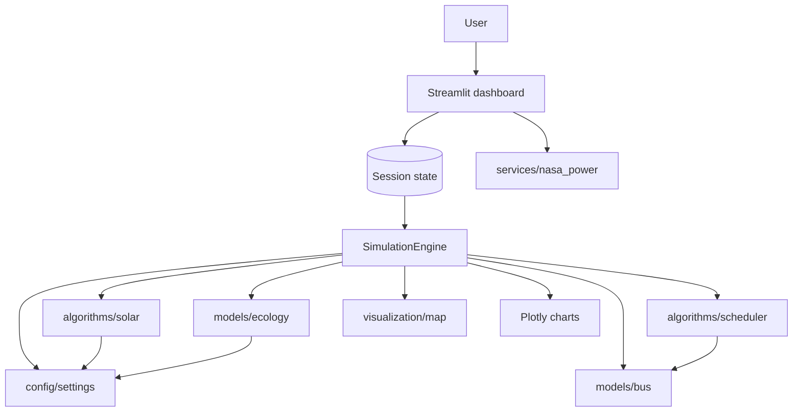

# Architecture

## System overview

The Streamlit dashboard drives a 48-step, 24-hour simulation. `SimulationEngine` is the
single source of truth for operational state; the dashboard keeps that engine in
Streamlit session state and renders charts, tables, CSV downloads and a Leaflet map.

The map is deliberately decoupled from the operational engine. The engine advances the
live fleet, while the map consumes a precomputed 48-frame trajectory produced by a
*separate* engine instance built from the same configuration. Stepping or resetting the
live engine while building the map would desynchronise the map from the sidebar clock,
the metric cards and the charts, all of which read the live engine.

## Module dependency graph

## Key boundaries

- `config/settings.py` owns every constant: scenario parameters, corridor geometry, named
  stops, hub metadata, ecological coefficients and tariffs. A scenario is fully described
  by one `Config` instance, which is why `Config.scenario_signature()` can hash a run.
  Derived quantities (`capacity_mwp`, `max_generation_kw`, `municipal_load_kw`,
  `ecology_params`) are methods rather than inline expressions, so the engine and the
  dashboard cannot disagree about them.
- `algorithms/scheduler.py` owns the single definition of fleet energy use.
  `bus_step_energy_kwh` is the only place traction energy is computed; both the reported
  traction power and the state-of-charge drain derive from it.
- `models/bus.py` owns vehicle geometry. Route segment lengths and cumulative distances
  are computed once per bus and cached, and interpolation is a binary search over them.
- `models/ecology.py` owns the lake. It exposes `EcologyParams` so the dashboard can run
  a sensitivity analysis without editing source.
- `visualization/map.py` consumes serialised frames and emits one self-contained
  document. It never runs its own clock.

## Data flow per step

1. Climatology: seeded cloud cover for the hour, seasonal ambient temperature.
2. Solar generation from the embedded profile with cloud and temperature modifiers.
3. Municipal load from the configured daytime window.
4. Fleet: draw traction energy, reduce SOC, move or divert buses; return the power applied.
5. Charging: packs queued by earlier steps charge within finite bays; return wall power.
6. Energy balance: direct use, curtailment, grid import.
7. Swap scheduling, funded by the surplus left over in step 6.
8. Lake ecology, including mechanical-aeration hysteresis.
9. Cumulative energy and impact, credited on self-consumed energy only.
10. Emit an immutable `SimulationState` snapshot.

## Caching

Every derived computation is a pure function of the scenario tuple, so `app.py` wraps
them in `@st.cache_data`: the map trajectory, the reference-day run, the annual model,
the scenario ladder, the sensitivity table and the solar cross-check. Previously each of
these recomputed on every Streamlit rerun, including on every frame of playback.

## State management

`st.session_state` holds the `Config`, the `SimulationEngine`, `step_idx`, the running
flag, the current `SimulationState`, the history DataFrame, the rendered map HTML and
the last rendered map step. Any sidebar control change resets the engine and invalidates
the map, because the scenario tuple is part of every cache key.
