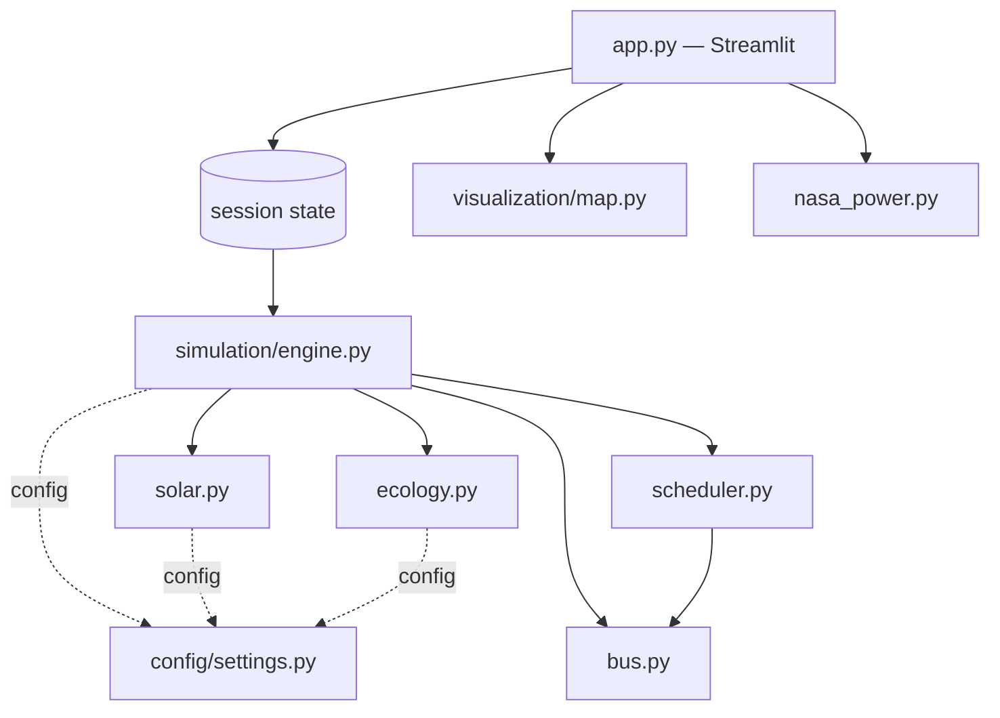
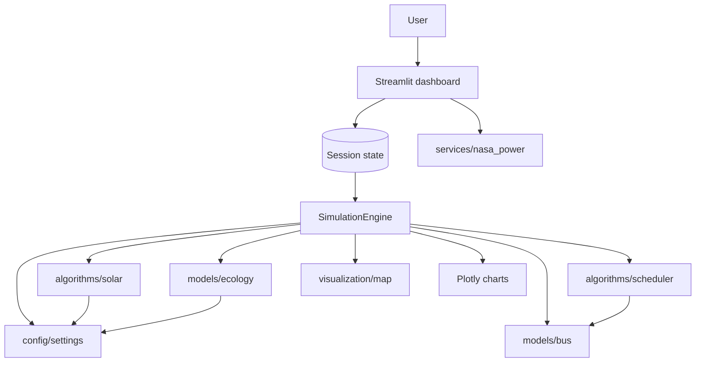

# Coimbatore Smart City Simulation — Master Documentation

This document compiles the project's design notes into a single reference.

## Table of contents

1. [Architecture](ARCHITECTURE.md)
2. [Simulation model](SIMULATION_MODEL.md)
3. [Map architecture](MAP_ARCHITECTURE.md)
4. [Animation architecture](ANIMATION_ARCHITECTURE.md)
5. [Data sources](DATA_SOURCES.md)
6. [API integration](API_INTEGRATION.md)
7. [Assumptions and limitations](ASSUMPTIONS_AND_LIMITATIONS.md)
8. [Validation](VALIDATION.md)
9. [Presentation guide](PRESENTATION_GUIDE.md)
10. [Viva preparation](VIVA_PREPARATION.md)
11. [Project final technical report](PROJECT_FINAL_TECHNICAL_REPORT.md)
12. [Project technical audit](PROJECT_TECHNICAL_AUDIT.md)

---


---

# Project Final Technical Report

## Coimbatore Smart City — Floating Solar, Electric Buses and Battery Swapping

**BCSE355L Smart Cities · VIT Vellore**
**Team:** Aditya Saxena (24BCE1633), Narayanan Subramanian (24BCE1699)

---

## 1. Current architecture

A Streamlit dashboard wrapping a deterministic 30-minute-resolution simulation. One
`SimulationEngine` instance is the single source of truth for operational state and lives
in Streamlit session state; the map consumes a separately computed 48-frame trajectory so
that re-rendering the map cannot disturb the live simulation.



## 2. Technology stack

| Component | Choice |
|---|---|
| UI | Streamlit |
| Data | pandas |
| Charts | Plotly |
| Map | Hand-written Leaflet document rendered in an isolated iframe |
| Numerics | Python standard library only |
| Optional | requests, for the NASA POWER irradiance cross-check |

`folium`, `streamlit-folium` and `numpy` were declared by earlier revisions, are no longer
imported anywhere, and have been removed from `requirements.txt`.

## 3. Project structure

```text
app.py                      Dashboard, caching, exports
src/config/settings.py      Every constant; one dataclass per scenario
src/simulation/engine.py    48-step daily and 365-day annual models
src/models/bus.py           Route geometry, position, SOC, diversion
src/models/ecology.py       Lake dissolved-oxygen budget
src/algorithms/solar.py     PV profile, cloud and temperature modifiers
src/algorithms/scheduler.py Fleet construction, traction energy, swap scheduling
src/visualization/map.py    Self-contained Leaflet component
src/services/nasa_power.py  Optional irradiance cross-check
scripts/validate_results.py Validation gate, 40 invariant checks
tests/                      383 tests
```

## 4. Simulation engine

48 fixed 30-minute steps per day. Each step runs ten stages in a fixed order:

1. Climatology — seeded cloud cover for the hour, seasonal ambient temperature.
2. Solar generation from the embedded profile.
3. Municipal load from the configured daytime window.
4. Fleet — traction energy drawn, SOC reduced, buses moved or diverted.
5. Charging — packs queued earlier charge within finite bays.
6. Energy balance — direct use, curtailment, grid import.
7. Swap scheduling, funded by the surplus left in step 6.
8. Lake ecology, including aeration hysteresis.
9. Cumulative energy and impact, on self-consumed energy only.
10. Emit an immutable `SimulationState`.

The annual model integrates all 8,760 hours with an independent weather draw per hour and
matches generation against demand hour by hour, so curtailment and grid import are
separately meaningful.

## 5. Solar model

Embedded hourly clear-sky profile for the reference 12.95 MWp array, interpolated to
half-hourly resolution and scaled linearly by coverage.

- **Cloud attenuation** capped at 80%: full overcast still yields about 20% of the
  clear-sky curve from diffuse light.
- **Cell-temperature derate** at the standard -0.4 %/degC above 25 degC, with an 8 degC
  cell rise for a floating array against 22 degC for a ground mount. The floating
  advantage is expressed as a roughly 6.3% relative retention versus ground mount, and
  output is always at or below nameplate.
- Clear-sky noon output is 11,616 kW at 25 degC ambient and 10,896 kW at 40 degC.

An earlier revision multiplied output by a factor that *increased* generation as ambient
temperature rose. That inverted sign has been removed.

## 6. Bus model

260 buses across four corridors. Fleet size is redistributed proportionally by the
largest-remainder method, so the allocation sums exactly to the fleet size at any slider
setting and preserves the design ordering.

Each bus carries deterministic progress, a 16-21 km/h cohort speed, a fixed per-vehicle
efficiency factor, and battery-aware SOC depletion. Route geometry — segment lengths and
cumulative distances — is computed once per bus and cached; interpolation is a binary
search. This replaced plain properties that re-walked the waypoint list on every access,
which had produced roughly two million redundant haversine evaluations per simulated day.

Buses below the swap threshold and outside a hub's service radius **divert**, steering
along their own corridor toward the nearest waypoint that passes that hub, rather than
continuing unchanged as in earlier revisions.

## 7. Battery and state-of-charge model

| Parameter | Value |
|---|---|
| Pack capacity | 300 kWh (150-450 kWh adjustable, and it changes behaviour) |
| Daily traction per bus | 219 kWh at traffic factor 1.0 |
| Service window | 05:00 to 22:00 |
| Swap threshold | 30% SOC |
| Critical SOC | 15% |
| Swap duration | ~7 minutes, completing inside one 30-minute step |
| SOC floor | 5% |

The hourly energy profile is normalised so its weights sum to exactly `DAILY_CONSUMPTION_KWH`.
Without that normalisation the peak and off-peak weighting inflated daily consumption by
about 15% relative to the stated figure.

Traction power and SOC drain are derived from a single per-bus energy expression, so the
reported demand and the energy actually consumed cannot diverge. Verified to within
0.001% over a full simulated day.

## 8. Swap scheduler

Eligibility: in service, below 30% SOC, within 2 km of a hub. Candidates are served
lowest-SOC first and funded in two tiers:

- **Solar** — funded from the step's surplus energy, so surplus genuinely limits how many
  swaps the array can pay for.
- **Grid** — reserved for buses below 15% SOC, so scarcity cannot strand a vehicle.

Both tiers are reported. On the default summer day the array funds 77 of 168 swaps, all
between 10:00 and 15:30; the remaining 91 occur between 18:00 and 21:30 as grid-assisted
top-ups. In earlier revisions swaps were gated on neither solar nor inventory timing and
spread from mid-morning to late evening regardless of the energy balance.

Pack inventory is conserved exactly: ready plus charging plus queued equals hub capacity
at every step, asserted by the test suite.

## 9. Ecological model

A standard dissolved-oxygen budget,

```text
dDO/dt = k2 (DO_sat(T) - DO) + P_net(t) + R_resp(T) + A(t)
```

with APHA-form saturation, re-aeration, light-driven photosynthesis, Q10 respiration, an
algae-suppression credit, and mechanical aeration with hysteresis at 3.0 / 4.2 mg/L.

The re-aeration term makes the budget an attractor, so mass conservation is structural
rather than tuned. An uncovered lake converges to a stationary cycle within about ten
days; the daily minimum then moves by less than 0.03 mg/L per day.

This replaced a fixed random per-hour delta table with a net positive daily integral of
about +0.2 mg/L, which caused an uncovered lake to gain oxygen indefinitely and saturate
at the ceiling.

Two further corrections matter:

- **Temperature coupling.** Water temperature drives the saturation target, so the model
  now has a seasonal signal that earlier revisions entirely lacked.
- **Spin-up.** Every reported figure is taken at the diurnal steady state. Because panels
  shade only between 10:00 and 15:00 and the daily minimum occurs near 07:00, a window
  starting at midnight measures the initial condition rather than the coverage effect.

## 10. Energy model

Per step:

```text
direct_use = min(generation, total_demand)
curtailed = max(0, generation - total_demand)
grid_import = max(0, total_demand - generation)
```

with `total_demand = municipal + traction + pack_charging`. Identity
`direct_use + curtailed = generation` and `direct_use + grid_import = demand` hold at
every step to within 0.15 kW and are asserted by both the test suite and the validation
script.

Traction is now derived from the fleet model rather than from an independent demand
curve, so the load-matching argument is computed rather than asserted.

## 11. Carbon model

`0.82 kg CO2/kWh`, the CEA India grid factor, applied to **self-consumed solar energy
only**. Curtailed output displaces nothing.

| Basis | Annual figure |
|---|---:|
| Self-consumed energy (shipped) | 10,881 t |
| All generation (incorrect) | 17,517 t |

The earlier revision applied the factor to total generation, overstating the result by
61%.

## 12. Cost model

Each self-consumed kilowatt-hour is credited **exactly once**, at the value of what it
displaces. Self-consumed solar is split by the load it serves: the traction share
displaces the diesel an all-diesel baseline would have burned and is valued at the implied
fuel cost per kWh (Rs 19.69/kWh at defaults); the municipal share displaces grid purchase
and is valued at retail plus surcharge (Rs 9.24/kWh). Annual benefit is therefore
Rs 21.91 Cr, against Rs 3.73 Cr for the municipal stream and Rs 18.18 Cr for the
traction stream.

Because the fuel value is 3.4x the retail tariff, two earlier revisions overstated the
benefit badly: the first valued all solar at retail **and** counted 100% of displaced
diesel; the second pro-rated only the diesel stream, still crediting solar serving
traction twice. The error was about Rs 19.5 Cr per year, or 65%.

**The simulated fleet is 100% electric.** Diesel exists only as the counterfactual
baseline, and a test asserts that no operational module references it. Grid-displacement
CO2 (10,881 t/yr) and avoided diesel combustion CO2 (7,100 t/yr against a 15,987 t/yr
baseline) are reported as separate scopes and never summed.

CAPEX includes the array, fleet and hub battery packs, and hub civil and electrical works.
Periodic whole-fleet repacks are charged in their replacement years. All inputs are
editable.

## 13. Scenario model

Coverage options are 10%, 15% and 20%, with an optional stress range extending to 40% so
that the mechanical-aeration mitigation path can actually be demonstrated. Each scenario is
evaluated at the diurnal steady state at the engine's own 30-minute resolution, so the
scenario table and the live trace agree to within 0.05 mg/L.

| Coverage | Min DO | Status |
|---:|---:|---|
| 0% | 5.49 | OK |
| 10% | 4.72 | OK |
| 15% | 4.33 | OK |
| 20% | 3.94 | CRITICAL / over cap |
| 30% | 3.17 | CRITICAL / over cap |
| 40% | 2.98 | CRITICAL / over cap, aeration 10 h |

## 14. Sensitivity analysis

The oxygen response is proportional to `EcologyParams.shade_effectiveness = 2.1`, the only
calibrated coefficient in the ecological model. The dashboard varies it explicitly:

| Value | Min DO at 15% | 15% compliant? |
|---:|---:|:--|
| 1.26 (0.6x) | 4.84 | yes |
| 1.68 (0.8x) | 4.58 | yes |
| **2.10 (1.0x)** | **4.33** | **yes** |
| 2.52 (1.2x) | 4.08 | yes |
| 2.94 (1.4x) | 3.82 | **no** |

This converts the project's largest documented weakness into a stated, quantified
dependence.

## 15. Map architecture

Hand-written Leaflet rather than Folium, so that a per-step re-render does not flicker.
The trajectory is emitted columnar with quantised integers, reducing the document from
4.10 MB to 0.91 MB. See `MAP_ARCHITECTURE.md`.

## 16. Animation architecture

Python owns the clock; the map iframe contains no timer. See `ANIMATION_ARCHITECTURE.md`.

## 17. Caching and performance

Every derived computation is a pure function of the scenario tuple and is wrapped in
`@st.cache_data`. Previously each recomputed on every rerun.

| Operation | Before | After |
|---|---:|---:|
| Full 48-step day simulation | 210 ms | 40 ms |
| 48-frame trajectory build | 506 ms | 106 ms |
| Map document render | 22 ms | 10 ms |
| Map payload | 4.10 MB | 0.91 MB |

## 18. Validation results

40 invariant checks in `scripts/validate_results.py`, all passing, plus 383 tests. See
`VALIDATION.md`.

## 19. Known limitations

Summarised in `ASSUMPTIONS_AND_LIMITATIONS.md`. The three that matter most:

1. The lake model is a heuristic budget, never calibrated against Ukkadam Lake data, and
   its conclusion depends on two coefficients that are calibrated rather than measured.
2. Operations data — traffic, demand, arrivals, weather — is synthetic. There is no GTFS,
   GPS or traffic feed.
3. Economics are academic estimates. Each self-consumed kilowatt-hour is credited
   exactly once, at the displaced-fuel or retail value depending on which load it serves.

## 20. Headline results

15% coverage, summer, seed 42:

| Quantity | Value |
|---|---:|
| Installed capacity | 12.95 MWp |
| Daily generation | 68,227 kWh |
| Daily self-consumption | 48,685 kWh (71.4%) |
| Daily curtailment | 19,542 kWh (28.6%) |
| Daily grid import | 53,154 kWh |
| Daily swaps | 168 (77 solar, 91 grid) |
| Annual generation | 21.36 GWh |
| Annual CO2 avoided | 10,881 t |
| Annual tariff saving | Rs 12.26 Cr |
| Annual benefit (single-credit) | Rs 21.91 Cr |
| Fleet + municipal demand | 29.88 GWh against 21.36 GWh generated |

## 21. Presentation talking points

- **Why floating solar here?** Ukkadam Lake is a ~1.295 km2 urban water body beside the
  city's main bus depot, with no competing land use.
- **Why 15%?** It is the ecological policy cap, and it is also where the oxygen model
  retains margin: 4.33 mg/L against a 4.0 threshold, versus 3.94 at 20%.
- **Why battery swapping rather than fast charging?** A 300 kWh pack swap in about seven
  minutes keeps buses available through the day and concentrates charging where solar
  surplus exists.
- **The honest finding.** A 12.95 MWp array cannot power 260 buses plus municipal load. It
  funds 77 of 168 daily swaps and about 64% of fleet traction energy. We report the
  remainder rather than hiding it.

---

# Project Technical Audit

Forensic read-only audit of the current codebase, describing what is *actually*
implemented, independent of original intentions.

## Legend

- **[MEASURED]** taken from a cited published, regulatory or satellite source
- **[HARDCODED]** working, but resting on static embedded data
- **[MODELLED]** computed by a documented physical or operational model
- **[CALIBRATED]** two coefficients tuned to reproduce a stated result; not measured
- **[SYNTHETIC]** generated, not observed
- **[MISSING]** not present

## 1. Architecture and stack

- **[IMPLEMENTED]** Streamlit dashboard (`app.py`), four tabs, session-state driven.
- **[IMPLEMENTED]** pandas for history and tabular output; Plotly for all charts.
- **[IMPLEMENTED]** Map is hand-written Leaflet markup in an isolated iframe.
- **[IMPLEMENTED]** Numerics use the standard library only.
- **[REMOVED]** `folium`, `streamlit-folium`, `numpy` were declared but never imported;
  they have been dropped from `requirements.txt`.

## 2. Simulation engine

- **[IMPLEMENTED]** Discrete-event engine, 30-minute steps, 48 per day.
- **[HARDCODED]** Diurnal cloud cover is a seeded uniform draw per hour. There is no
  hour-to-hour or day-to-day weather persistence.
- **[HARDCODED]** The clear-sky solar profile is an embedded hourly dictionary.
- **[MODELLED]** Annual model integrates all 8,760 hours with an independent weather draw
  per hour, matching generation against demand hour by hour.

## 3. Energy accounting

- **[IMPLEMENTED]** `direct_use + curtailed = generation` and
  `direct_use + grid_import = demand` hold at every step.
- **[IMPLEMENTED]** Traction demand is derived from the fleet model, not from a separate
  demand curve. The two can no longer disagree.
- **[IMPLEMENTED]** Curtailed energy is excluded from both carbon and tariff savings.
- **[FIXED]** An earlier revision credited carbon against total generation,
  overstating the annual figure by 61% (17,517 t instead of 10,881 t).

## 4. Fleet and routing

- **[HARDCODED]** Corridor geometry is embedded OSRM waypoints. No routing call at runtime.
- **[MODELLED]** Fleet allocation is proportional by the largest-remainder method, so it
  sums exactly to the fleet size at any slider setting.
- **[MODELLED]** Reported traction power equals the energy the fleet actually drew,
  verified to within 0.001% over a full day.
- **[IMPLEMENTED]** Pack capacity affects the state-of-charge drain rate. The slider is
  no longer cosmetic.
- **[IMPLEMENTED]** Low-state-of-charge buses divert along their corridor toward the
  nearest point passing a hub.

## 5. Swap scheduling

- **[MODELLED]** Eligibility requires service, sub-threshold SOC and hub proximity;
  candidates are served lowest-SOC first.
- **[MODELLED]** Funding is solar-first from the step's surplus, with a documented grid
  fallback for buses below 15% SOC. Both tiers are reported separately.
- **[IMPLEMENTED]** Pack inventory is conserved exactly at every hub and step.
- **[DOCUMENTED]** The funding tier records the scheduling decision at the instant of
  approval; the pack's charging energy is drawn on the following step, when the balance
  may differ. The energy balance remains authoritative for sourcing.
- **[IMPLEMENTED]** Charger-bay contention is modelled and respected.
- **[MISSING]** Station-level electrical constraints: feeder capacity, transformer limits,
  demand charges.

## 6. Ecological model

- **[MODELLED]** Standard dissolved-oxygen budget with APHA-form saturation, re-aeration,
  light-driven photosynthesis, Q10 respiration, algae-suppression credit and aeration
  hysteresis.
- **[MODELLED]** Mass conservation is structural: the re-aeration term makes the budget an
  attractor. Verified stationary within 10 days.
- **[CALIBRATED]** `shade_effectiveness = 2.1` and `gross_photosynthesis_mg_l_per_hr` are
  dashboard runs a sensitivity analysis over it; 15% compliance survives plus or minus 20%
  and fails at +40%.
- **[MODELLED]** Minimum dissolved oxygen decreases monotonically with coverage.
- **[SYNTHETIC]** Turbidity and pH are display indicators and are never fed back.
- **[IMPLEMENTED]** Every figure is reported at the diurnal steady state after a 10-day
  spin-up, because a midnight-to-midnight window would otherwise measure the initial
  condition rather than the coverage effect.
- **[MISSING]** Stratification, sediment oxygen demand, hydrodynamic transport, species
  requirements, any calibration against Ukkadam Lake measurements.

## 7. Economics

- **[MODELLED]** Savings use a non-overlapping basis: tariff on self-consumed energy,
  diesel pro rata to the traction share actually served.
- **[FIXED]** An earlier revision counted both in full and double-counted the same
  electron-mile.
- **[ASSUMED]** Array CAPEX, pack pricing, hub construction cost, repack interval,
  discount rate and diesel price are editable assumptions.
- **[MODELLED]** NPV, payback and cumulative cash flow include periodic repacks.
- **[MISSING]** Degradation curve, financing structure, tax treatment, decommissioning.

## 8. External integrations

- **[IMPLEMENTED]** OpenStreetMap raster tiles, browser side, no key.
- **[IMPLEMENTED]** Leaflet from a CDN, browser side.
- **[IMPLEMENTED]** NASA POWER irradiance cross-check, cached to disk, with an offline
  SRRA/MNRE fallback. Used only for validation, never in the live path.
- **[MISSING]** Live weather, traffic, GTFS or AVL integration.
- **[MISSING]** Any API key requirement; the project runs fully offline.

## 9. Software hygiene

- **[IMPLEMENTED]** 383 automated tests covering determinism, conservation, SOC bounds,
  route allocation, inventory accounting, swap tiers, solar physics, oxygen monotonicity
  and stationarity.
- **[IMPLEMENTED]** A validation script with 24 physical invariants that exits non-zero on
  failure.
- **[IMPLEMENTED]** All derived computations cached by scenario tuple.
- **[IMPLEMENTED]** Random seed exposed in the UI and recorded in an exported run manifest,
  so every published figure is reproducible.
- **[IMPLEMENTED]** Every headline figure carries a measured / calibrated / assumed /
  modelled provenance tag.
- **[KNOWN]** `st.components.v1.html` is deprecated in favour of `st.iframe`, which
  accepts a URL rather than markup. Streamlit is pinned below 2.0 because that shim is
  expected to be removed there.
- **[KNOWN]** All state is ephemeral in Streamlit session memory; there is no database.

## 10. Verification performed

| Check | Result |
|---|---|
| `python -m pytest -q` | 383 passed |
| `python scripts/validate_results.py` | all checks passed, exit 0 |
| `python -m src.simulation.engine` | clean |
| Headless `streamlit run` | serves 200, no runtime errors or deprecation warnings |
| App execution with stubbed widgets across all sidebar paths | no exceptions |
| Leaflet JavaScript syntax and runtime (Node, stubbed Leaflet) | valid; render correct at all steps |
| Energy-balance closure across coverage, season and slider matrix | 0 violations |
| Pack inventory conservation across the same matrix | 0 violations |
| No bus stranded across the same matrix | minimum SOC 5.0%, never at the floor |

---

# Architecture

## System overview

The Streamlit dashboard drives a 48-step, 24-hour simulation. `SimulationEngine` is the
single source of truth for operational state; the dashboard keeps that engine in
Streamlit session state and renders charts, tables, CSV downloads and a Leaflet map.

The map is deliberately decoupled from the operational engine. The engine advances the
live fleet, while the map consumes a precomputed 48-frame trajectory produced by a
*separate* engine instance built from the same configuration. Stepping or resetting the
live engine while building the map would desynchronise the map from the sidebar clock,
the metric cards and the charts, all of which read the live engine.

## Module dependency graph



## Key boundaries

- `config/settings.py` owns every constant: scenario parameters, corridor geometry, named
  stops, hub metadata, ecological coefficients and tariffs. A scenario is fully described
  by one `Config` instance, which is why `Config.scenario_signature()` can hash a run.
  Derived quantities (`capacity_mwp`, `max_generation_kw`, `municipal_load_kw`,
  `ecology_params`) are methods rather than inline expressions, so the engine and the
  dashboard cannot disagree about them.
- `algorithms/scheduler.py` owns the single definition of fleet energy use.
  `bus_step_energy_kwh` is the only place traction energy is computed; both the reported
  traction power and the state-of-charge drain derive from it.
- `models/bus.py` owns vehicle geometry. Route segment lengths and cumulative distances
  are computed once per bus and cached, and interpolation is a binary search over them.
- `models/ecology.py` owns the lake. It exposes `EcologyParams` so the dashboard can run
  a sensitivity analysis without editing source.
- `visualization/map.py` consumes serialised frames and emits one self-contained
  document. It never runs its own clock.

## Data flow per step

1. Climatology: seeded cloud cover for the hour, seasonal ambient temperature.
2. Solar generation from the embedded profile with cloud and temperature modifiers.
3. Municipal load from the configured daytime window.
4. Fleet: draw traction energy, reduce SOC, move or divert buses; return the power applied.
5. Charging: packs queued by earlier steps charge within finite bays; return wall power.
6. Energy balance: direct use, curtailment, grid import.
7. Swap scheduling, funded by the surplus left over in step 6.
8. Lake ecology, including mechanical-aeration hysteresis.
9. Cumulative energy and impact, credited on self-consumed energy only.
10. Emit an immutable `SimulationState` snapshot.

## Caching

Every derived computation is a pure function of the scenario tuple, so `app.py` wraps
them in `@st.cache_data`: the map trajectory, the reference-day run, the annual model,
the scenario ladder, the sensitivity table and the solar cross-check. Previously each of
these recomputed on every Streamlit rerun, including on every frame of playback.

## State management

`st.session_state` holds the `Config`, the `SimulationEngine`, `step_idx`, the running
flag, the current `SimulationState`, the history DataFrame, the rendered map HTML and
the last rendered map step. Any sidebar control change resets the engine and invalidates
the map, because the scenario tuple is part of every cache key.

---

# Simulation model

## Time

48 fixed 30-minute steps represent one day. A scenario is deterministic for a given
seed: the same configuration and seed reproduce every reported quantity exactly.

## Solar

An embedded SRRA/MNRE-style hourly clear-sky profile, linearly interpolated to
half-hourly resolution, scaled by coverage, attenuated by cloud cover (capped at 80%,
since overcast still delivers diffuse light) and derated by module temperature using the
standard -0.4 %/degC coefficient above 25 degC. Floating modules are modelled with a
smaller cell-temperature rise than a ground mount, so the floating advantage appears as
reduced derating rather than output above nameplate.

## Fleet

Buses are distributed across the four corridors in proportion to their design share,
using the largest-remainder method so the allocation sums exactly to the fleet size.
Each bus has deterministic progress, a 16-21 km/h cohort speed, a fixed efficiency factor
and battery-aware SOC depletion.

Traction energy comes from a single normalised hourly profile whose weights sum to
exactly `DAILY_CONSUMPTION_KWH` at unity traffic intensity. Reported traction power and
SOC drain are both derived from it, so they cannot disagree.

## Fleet energy accounting

`DAILY_CONSUMPTION_KWH` is the **nominal** per-bus figure at traffic factor 1.0. The
realised value is that figure multiplied by each vehicle's efficiency cohort factor
(0.94 to 1.06), because `bus_step_energy_kwh` applies both. A bus spending any step
mid-swap draws no traction energy, so realised fleet consumption sits a little below the
nominal total; that shortfall is reported rather than reconciled away, and the reported
traction power always equals the energy actually drawn.

## Swaps

A bus is eligible when it is in service, below the swap threshold and within the hub's
service radius. Eligible buses are served lowest-SOC first and funded in two tiers:

- **solar** — the step's generation surplus pays for the pack refill, so surplus genuinely
  limits how many swaps the array can fund;
- **grid** — a documented fallback reserved for buses below the critical threshold, so
  energy scarcity cannot strand a vehicle.

Buses outside a hub's radius are flagged for diversion and steered along their own
corridor toward the nearest point that passes that hub.

## Ecology

A dissolved-oxygen budget with temperature-dependent saturation, re-aeration relaxation,
light-driven photosynthesis, Q10 respiration, an algae-suppression credit and a
mechanical-aeration term with hysteresis. Every reported figure is taken at the diurnal
steady state after a 10-day spin-up, at the same 30-minute resolution as the engine.

## Energy, carbon and economics

Generation and demand are matched at every step, so direct use, curtailment and grid
import are separately reported. Carbon and tariff savings are credited only against
self-consumed energy. The annual model integrates all 8,760 hours with an independent
weather draw per hour and matches generation against demand hour by hour.

## What this model is not

Not a dispatch tool, not an hourly year-long dispatch optimisation, and not a calibrated
water-quality simulation. See `ASSUMPTIONS_AND_LIMITATIONS.md`.

---

# Map architecture

## Why hand-written Leaflet rather than Folium

The map must be re-rendered as the simulation advances, and a rebuilt Folium figure
re-instantiates the whole Leaflet map, which flickers. `visualization/map.py` therefore
emits the HTML document directly, and `src/visualization/map.py::build_interactive_map_html`
returns a self-contained component that draws exactly one step.

`folium`, `streamlit-folium` and `numpy` were declared as dependencies by earlier
revisions and are no longer imported anywhere. They have been removed from
`requirements.txt`.

## Payload

The trajectory is emitted columnar with quantised integers rather than as one dictionary
per bus per frame: latitude and longitude to 1e-4 (about 11 m, far finer than the map
zoom) and state of charge to 0.1%. For 260 buses over 48 frames this is about 0.91 MB
instead of 4.10 MB, a 4.5x reduction, and it is what makes per-step rebuilds affordable.

Frames are padded to a constant bus count so a bus always keeps its marker identity.

## Rendering

`render(step)` updates the HUD, the array's radiance, the lake's ecological alert colour,
each hub's charging halo, and every bus marker's position, colour, radius and popup. Step
indices are clamped, so an out-of-range request is safe.

## Viewport

The opening view is **derived, not hand-picked**. `Config.map_bounds()` collects every
point the map must keep on screen — the lake outline, the array footprint, all four swap
stations and all 232 route waypoints — and returns them as a Leaflet
`(south, west), (north, east)` box. The template hands that box to `map.fitBounds()` with
28 px of padding, and **Leaflet derives the zoom from the rendered container size**, which
is the only thing that knows how wide the map actually is.

This replaced a hard-coded `MAP_CENTER = (11.0020, 76.9850)` at zoom 13. That point is
Coimbatore's city centre, about **4.0 km north-east of Ukkadam Lake**, so the array this
project sites on the lake sat near the edge of the opening viewport, and every corridor
east of roughly 77.02 deg E was cropped. Because the route network genuinely spans
**7.4 km north-south by 17.0 km east-west**, no single centre can both frame the lake and
show every bus; `fitBounds` guarantees nothing is cropped, and the *Focus lake* control
below handles the close-up.

The *Focus lake* button in the top-left flies to `Config.lake_view()` (the mean
solar-array polygon vertex at zoom 15) and brings both polygons to the front. It is
keyboard reachable via Enter/Space.

Because the bounds are computed from the same geometry that is drawn, editing a route or
moving a station can never push anything off-screen. There is a regression test for
exactly that, plus one asserting no `Config` field reintroduces a hand-picked centre.

## Tiles

Standard OpenStreetMap raster tiles from `tile.openstreetmap.org`, fetched by the
browser. No key, no watermark, no account.

## Geometry

Corridor polylines, named stops, the lake polygon, the array footprint, hub positions
and municipal buildings all come from `config/settings.py` as embedded static
coordinates. There is no live routing call at runtime.

The lake polygon is the real OpenStreetMap outline of Ukkadam Periyakulam
(1.295 km2, mean depth 5.82 m). `Config.LAKE_LAT`/`LAKE_LON` carry its geographic centre
and agree with the published coordinate to within about 215 m; the map view is fitted
from the polygon itself, so those two fields are reference values rather than the
positioning input.

---

# Animation architecture

## One clock

Python owns the clock. When Play is active the app sleeps for `1 / playback_speed`
seconds, advances the engine one 30-minute step, and calls `st.rerun()`. The map is then
re-rendered at the new step index.

Earlier revisions ran a `setInterval` inside the map iframe **and** the Python loop, each
advancing one step independently. Two timers drift apart as soon as a rerun takes longer
than the interval, so the map clock silently disagreed with the metric cards. That
in-iframe timer has been removed; the map is now a pure function of the step index.

## Why the map can be re-rendered each step

Two changes made this affordable:

- route geometry is cached on each bus, cutting the trajectory build from roughly 506 ms
  to 106 ms;
- the payload is columnar and quantised, cutting the document from 4.10 MB to 0.91 MB and
  the render call from about 22 ms to 10 ms.

The map HTML is rebuilt only when the step index actually changes, tracked in session
state, so dashboard interactions that do not advance time do not re-render it.

## Performance

| Operation | Before | After |
|---|---:|---:|
| Full 48-step day simulation | 210 ms | 40 ms |
| 48-frame trajectory build | 506 ms | 106 ms |
| Map document render | 22 ms | 10 ms |
| Map payload | 4.10 MB | 0.91 MB |

The day simulation is over five times faster because route segment lengths and cumulative
distances are computed once per bus instead of on every property access; previously the
engine and the trajectory builder together performed roughly two million redundant
haversine evaluations per simulated day.

---

# Data sources

| Data | Source | Real or synthetic | In the live path | Cached | API key |
|---|---|---|---|---|---|
| Solar clear-sky profile | SRRA / MNRE | Real, hardcoded | Yes | No | No |
| Specific yield for planning | SRRA / MNRE (1,600 kWh/kWp/yr) | Real, hardcoded | Analytic estimate only | No | No |
| Weather / cloud cover | Synthetic, seeded | Synthetic | Yes | No | No |
| Bus corridors | OSRM waypoints | Real, hardcoded | Yes | No | No |
| Named stops | Curated operational labels | Real, hardcoded | Yes | No | No |
| Lake boundary and array footprint | OpenStreetMap | Real, hardcoded | Yes | No | No |
| Swap hub locations | Project definition | Assumed | Yes | No | No |
| Grid CO2 factor | CEA India (0.82 kg/kWh) | Real, hardcoded | Yes | No | No |
| Tariffs and diesel price | TANGEDCO / TNERC | Real, hardcoded | Yes | No | No |
| Map tiles | OpenStreetMap | Real | Yes, browser side | Browser | No |
| Irradiance cross-check | NASA POWER, else SRRA/MNRE | Real | No, validation only | Yes, on disk | No |
| Lake dissolved oxygen | This model | Modelled | Yes | No | No |

## Notes

The dashboard runs fully offline. The NASA POWER helper is imported only by the
validation panel, is used only to cross-check the embedded profile, and falls back to
SRRA/MNRE normals when the network or the cache is unavailable. It writes its cache to
`data/raw/nasa_cache.json`.

---

# API integration

Every figure below is a runtime network call the application can make.

| Call | Made by | When | Failure behaviour |
|---|---|---|---|
| OpenStreetMap raster tiles | Browser, via Leaflet | While the map is visible | Basemap is blank; simulation unaffected |
| Leaflet 1.9.4 (CSS + JS) | Browser, from unpkg | While the map is visible | Map does not render; simulation unaffected |
| Font Awesome | No longer used | — | Removed with the Folium rewrite |
| Google Fonts (Outfit) | Browser | On page load | Falls back to the system sans stack |
| NASA POWER monthly point API | `src/services/nasa_power.py` | Only on a cache miss during the solar cross-check | Falls back to SRRA/MNRE normals |
| OSRM / Google Maps routing | Never | Never | Routes are embedded static geometry |
| Weather API | Never | Never | Cloud cover is synthetic and seeded |

## API keys

None. No service used by this project requires a key. If a future integration needs one,
put it in a `.env` file and load it with `python-dotenv`; never commit it.

## Caching

`src/services/nasa_power.py` caches its response to `data/raw/nasa_cache.json` and reads
that cache before attempting any request, so repeated dashboard sessions do not re-fetch.
The cache is disposable: deleting it only causes one subsequent fetch attempt.

---

# Assumptions and Limitations

Read this before citing any number from the dashboard, the reports or the exports.
This is an academic operations model. It is not an engineering design, a dispatch
tool, or a financial forecast.

---

## 1. Lake ecology — a heuristic budget, not a calibrated model

The dissolved-oxygen model is a standard budget,

```
dDO/dt = k2 * (DO_sat(T) - DO)  +  P_net(t)  +  R_resp(T)  +  A(t)
```

with temperature-dependent saturation from the APHA standard-methods polynomial, a
re-aeration relaxation, light-driven photosynthesis, Q10-scaled respiration, and a
mechanical-aeration term with hysteresis (engage below 3.0 mg/L, release above
4.2 mg/L).

**What this structure buys.** The re-aeration term makes the budget an attractor, so an
uncovered lake converges to a stationary diurnal cycle instead of drifting. Verified
over 20 simulated days: the daily minimum moves by less than 0.03 mg/L between day 10
and day 20.

**What it is not.** It has never been calibrated against Ukkadam Lake measurements. It
has no vertical structure, no stratification, no sediment oxygen demand, no
hydrodynamics, and no species-specific oxygen requirements.

### The two calibrated coefficients

`EcologyParams.shade_effectiveness = 2.1` converts shaded area fraction into the
fraction of lake-wide primary production lost, and
`EcologyParams.gross_photosynthesis_mg_l_per_hr` sets the unshaded production rate.
Both are **calibrated, not measured**. `scripts/fit_shading.py` sweeps every ecology
coefficient over its plausible range and ranks them by how far each one moves the
headline minimum, which corrected an earlier draft of this document: it had named
`shade_effectiveness` as the single weak point, but the ranking shows gross
photosynthesis has the larger effect on the absolute minimum.

| Coefficient | Effect on minimum DO at 15% | Shipped value |
|---|---|---|
| `gross_photosynthesis_mg_l_per_hr` | **3.08 mg/L** across 0.5–2.5 | 0.7 |
| `shade_effectiveness` | **1.83 mg/L** across 1.0–4.0 | 2.1 |

Shading dominates the *direction* of the coverage response, which is why the coverage
ladder is robust, but a calibration against a real observation should constrain both. The
value above 1 for `shade_effectiveness` encodes two real effects — the array sits over
the shallow littoral margin where macrophyte density is highest, and an opaque surface
panel blocks the full photic depth rather than a proportionate slice of lake volume — but
the specific number remains a modelling choice. Full ranking, inverted values against a
4.0 and 5.0 mg/L target, and the sensitivity grid are in
[`ECOLOGY_CALIBRATION.md`](ECOLOGY_CALIBRATION.md).

The dashboard runs a sensitivity analysis over it, and the coverage-versus-oxygen
conclusion is proportional to it:

| `shade_effectiveness` | 10% | 15% | 20% | 25% | 15% compliant? |
|---:|---:|---:|---:|---:|:--|
| 1.26 (0.6x) | 5.06 | 4.84 | 4.62 | 4.40 | yes |
| 1.68 (0.8x) | 4.89 | 4.58 | 4.28 | 3.98 | yes |
| **2.10 (1.0x)** | **4.72** | **4.33** | **3.94** | **3.56** | **yes** |
| 2.52 (1.2x) | 4.55 | 4.08 | 3.60 | 3.13 | yes |
| 2.94 (1.4x) | 4.38 | 3.82 | 3.26 | 3.23 | **no** |

So the 15% conclusion survives a plus or minus 20% perturbation of the calibrated
coefficient and fails at +40%. **State this when presenting.** The *ordering* of
scenarios is robust regardless: a linear shading term fixes the sensitivity ratio
between adjacent coverage steps by geometry, not by tuning.

### Structural simplifications

- **Response to coverage is linear** in the shaded area, so the dissolved-oxygen
  difference between 0 and 15% is always about three times that between 15 and 20%. A
  real lake would saturate as the littoral zone is progressively shaded.
- **No compensating benefit beyond what is modelled.** Panel shading does suppress the
  algal bloom (credited as reduced respiration and cooler water), but the model does not
  credit the clearer water's improved light penetration outside the array.
- **Temperature and pH are indicators, not state variables.** Water temperature is a
  closed-form function of ambient temperature, time of day and coverage; it does not
  integrate heat or wind. That is sufficient because it drives the oxygen saturation
  target, but it would not survive a transient weather event.
- **Turbidity and pH are display-only.** They are reported, never fed back.

### Spin-up

Every reported figure is taken at the **diurnal steady state**, after discarding a
10-day transient. This matters more than it sounds: panels only shade the lake between
10:00 and 15:00, and the daily oxygen minimum occurs near 07:00. A window that starts
at midnight therefore reaches its minimum *before* that day's shading has had any
effect, so measuring a single midnight-to-midnight window reports a minimum driven by
the initial condition rather than by lake coverage. Both the live engine and the
scenario comparison apply the spin-up and use the same 30-minute step, which is why they
agree to within 0.05 mg/L.

---

## 2. Solar generation

- The hourly clear-sky profile is **embedded, not measured**, and represents a
  representative clear day rather than a specific date.
- Cell temperature uses a fixed +8 degC rise above ambient for a floating array against
  +22 degC for a ground mount, with the standard -0.4 %/degC coefficient. The floating
  advantage therefore appears as *less derating*, never as a gain above nameplate.
  Output is **below** nameplate in hot conditions, as it must be. An earlier revision
  multiplied output by a factor that *increased* generation as ambient temperature rose;
  that inverted sign has been removed.
- Cloud cover is drawn independently for each hour from a seeded uniform distribution.
  There is **no hour-to-hour or day-to-day persistence**, so the weather is more variable
  than reality and inter-day curtailment is understated.
- Cloud attenuation is capped at 80%, so full overcast still yields about 20% of the
  clear-sky profile from diffuse light.
- The analytic planning estimate (`Config.annual_generation_mwh`, specific-yield method)
  and the hourly annual model disagree by about 3% (21.96 vs 21.36 GWh). Both are
  reported and the hourly model is the headline. The residual comes from the analytic
  method's measured specific yield versus the hourly model's synthetic cloud.

---

## 3. Fleet and operations

- **No GTFS, GPS, traffic or passenger-demand feed.** Corridor geometry, stops, station
  positions and arrival patterns are static and synthetic.
- Bus speeds are deterministic 16-21 km/h cohorts, not traffic-responsive. The traffic
  slider scales traction energy arithmetically and divides speed; it is not a congestion
  model.
- `DAILY_CONSUMPTION_KWH = 219` is valid **at traffic factor 1.0**. The hourly shape is
  normalised so the profile sums to exactly that figure rather than inflating it by the
  peak and off-peak weighting.
- State-of-charge depletion **is** battery-capacity aware, so the pack-capacity slider
  genuinely changes fleet behaviour. A 150 kWh pack drains faster in percentage terms
  than a 450 kWh pack for the same energy.
- Diverting buses steer toward the nearest waypoint on their own corridor that passes
  the target hub. That is a real movement, but it is not a road-network route plan.
- SOC is floored at 5%, and hubs begin each day fully charged, so the swap network
  cannot strand a bus by construction. Verified across the whole coverage, season and
  slider matrix.
- **Swaps are gated on solar surplus but have a documented grid fallback.** A swap is
  funded from the step's surplus where surplus exists. Buses below 15% SOC are topped up
  from the grid regardless, so energy scarcity cannot strand a vehicle. Both tiers are
  counted and displayed separately; neither is hidden. At the default scenario the array
  funds 77 of 168 daily swaps.
- **The funding tier is a scheduling decision, not a meter reading.** A swap is labelled
  solar or grid using the surplus visible at the instant of approval, but the pack's
  charging energy is drawn on the *following* step, when the balance may differ. On the
  default day this affects a single step. The energy balance remains authoritative for
  sourcing; the tier records the operator's intent.
- Pack inventory and charger-bay contention are modelled. Station-level electrical
  constraints (feeder capacity, transformer limits, demand charges) are not.

---

## 4. Energy, carbon and economics

- **Carbon and tariff savings are credited only against self-consumed energy.** Curtailed
  output displaces nothing. Crediting total generation would report 17,517 t/yr instead
  of 10,881 t/yr, a 61% overstatement. This was a defect in an earlier revision.
- The annual model integrates all 8,760 hours with an independent weather draw per hour,
  matching generation against demand hour by hour.
- The CO2 factor (0.82 kg/kWh, CEA India) and the diesel factor (2.68 kg/L) are **grid
  displacement only**. On-site combustion emissions are excluded.
- **Fleet demand is flat across the year** at 260 x 219 kWh/day, with no seasonality.
- Municipal load is a two-level step (1,600 kW daytime, 250 kW overnight). It is not
  derived from the three named buildings' individual loads.
- **Tab 3 credits each self-consumed kilowatt-hour exactly once.** Self-consumed solar
  is split by the load it serves: the traction share displaces the diesel an all-diesel
  baseline would have burned and is valued at the implied fuel cost per kWh
  (Rs 19.69/kWh at defaults), while the municipal share displaces grid purchase and is
  valued at retail plus surcharge (Rs 9.24/kWh). Because the fuel value is 2.1x the
  retail tariff, getting this wrong is expensive: two earlier revisions overstated the
  annual benefit by roughly Rs 19.5 Cr, or 65%.
- **The simulated fleet is 100% electric.** No diesel vehicle exists anywhere in the
  operational model -- `models/bus.py`, `simulation/engine.py` and
  `algorithms/scheduler.py` contain no diesel reference at all, and this is asserted by
  a test. Diesel appears solely as the counterfactual baseline the project replaces, and
  is therefore the dominant benefit term. A cost-benefit analysis of an electric-fleet
  conversion cannot be stated without that baseline; what it must not do is count the same
  kilowatt-hour twice.
- Grid-displacement CO2 (0.82 kg/kWh) and diesel combustion CO2 (2.68 kg/L) are
  reported as **separate scopes** and are never summed. At defaults the grid basis gives
  10,881 t/yr and the fuel basis 7,100 t/yr avoided against a 15,987 t/yr baseline.
- Swap-hub civil and electrical CAPEX, pack CAPEX and periodic whole-fleet repacks are
  included and editable, but pack and hub pricing are assumptions.
- Economics assume all 260 buses were previously diesel.

---

## 5. Software limitations

- `st.components.v1.html` is deprecated in favour of `st.iframe`, which accepts a URL
  rather than markup, so it remains the only way to host an isolated Leaflet document.
  Streamlit is pinned below 2.0 because that shim is expected to be removed there.
- All simulation state is ephemeral and lives in Streamlit session memory. There is no
  database and no persistence between sessions.
- The random seed is exposed in the sidebar and recorded in the exported run manifest, so
  any figure in this repository can be reproduced exactly.

---

# Validation

```bash
python scripts/validate_results.py   # exits 1 if any check fails
python -m pytest -q                  # 383 tests
python -m src.simulation.engine      # standalone self-check
```

The validation script prints every check with its measured value. It currently runs
**40 checks** across seven groups: energy balance, fleet consistency, impact
accounting, determinism, the coverage ladder, robustness to degenerate configurations,
and the photovoltaic model. Current results at 15% coverage, summer, seed 42:

| Measure | Value |
|---|---:|
| Installed capacity | 12.95 MWp |
| Daily generation | 68,227 kWh |
| Daily self-consumption | 48,685 kWh (71.4%) |
| Daily curtailment | 19,542 kWh (28.6%) |
| Daily grid import | 53,154 kWh |
| Peak generation | 10,680 kW |
| Daily fleet traction energy | 54,716 kWh over 80,218 km |
| Daily swaps | 168 (77 solar-funded, 91 grid-assisted) |
| Daily CO2 avoided | 39.9 t |
| Daily tariff saving | Rs 449.8k |
| Annual generation (hourly) | 21.36 GWh |
| Annual self-consumed | 13.27 GWh |
| Annual curtailment | 8.09 GWh |
| Annual grid import | 16.61 GWh |
| Annual fleet demand | 20.79 GWh |
| Annual municipal demand | 9.09 GWh |
| Annual CO2 avoided (self-consumed basis) | 10,881 t |
| Annual CO2 if all generation were credited | 17,517 t |
| Annual tariff saving | Rs 12.26 Cr |
| Annual benefit (single-credit) | Rs 21.91 Cr |

## Minimum dissolved oxygen by coverage

Summer, steady state, seed 42:

| Coverage | Min DO (mg/L) | Max DO (mg/L) | Aeration | Status |
|---:|---:|---:|---:|---|
| 0% | 5.49 | 8.38 | 0 h | OK |
| 10% | 4.72 | 7.21 | 0 h | OK |
| 15% | 4.33 | 6.62 | 0 h | OK |
| 20% | 3.94 | 6.04 | 0 h | CRITICAL / over cap |
| 25% | 3.56 | 5.46 | 0 h | CRITICAL / over cap |
| 30% | 3.17 | 4.88 | 0 h | CRITICAL / over cap |
| 40% | 2.98 | 4.85 | 10 h | CRITICAL / over cap |
| 45% | 2.97 | 4.52 | 8 h | CRITICAL / over cap |

## Seasonal contrast at 15%

| Season | Daily generation | Minimum DO | Swaps |
|---|---:|---:|---:|
| Summer | 68,227 kWh | 4.29 mg/L | 168 |
| Monsoon | 34,978 kWh | 4.71 mg/L | 154 |

Monsoon halves generation but *raises* the oxygen minimum, because cloud cover suppresses
photosynthesis less than the reduced surface heating lowers water temperature. The
array funds only 9 swaps on the monsoon day against 77 in summer.

## Robustness to degenerate configurations

The gate also runs the model against configurations the dashboard cannot produce, and
requires each to complete without raising while still closing the energy balance, keeping
every bus above its state-of-charge floor, and reporting only finite values:

| Degenerate case | Expected outcome |
|---|---|
| Fleet of 1 bus | Runs; route allocation sums to 1 |
| 0% coverage | Runs; zero generation, all load on the grid |
| 0 charger bays | Runs; packs queue, no bus stranded |
| 1 kWh packs | Runs; state of charge floors at 5% |
| Zero daily consumption | Runs; zero traction demand |

It also asserts that a non-positive step length is **rejected** rather than silently
dividing by zero, in `process_station_charging`, `update_fleet` and `update_ecology`.

## Reproducibility

The seed is exposed in the sidebar and written into the exported run manifest. Every
figure above can be reproduced exactly. Swap counts depend on the scheduler and scenario
and should be read from a run rather than treated as fixed targets.

These are model outputs. They validate code execution and internal consistency, not
real-world performance.

---

# Presentation guide

## Structure (10-12 minutes)

1. **Problem (1 min).** Coimbatore's bus fleet and Ukkadam Lake both need power. Floating
   solar on the lake is attractive, but covering the water changes the lake's ecology.
   The question is: how much surface can be covered before the lake is harmed, and does
   the energy actually help the buses?
2. **System (2 min).** 12.95 MWp array at 15% coverage, four swap hubs, 260 buses on
   four corridors, 30-minute simulation resolution. Show the sidebar scenario definition.
3. **Live demo (3 min).** Press Play from 00:00. Point out three things in order:
   - generation ramps while the fleet draws power, and the two curves cross around 09:30;
   - **solar-funded swaps cluster in the surplus window** while grid-assisted swaps appear
     in the evening deficit — the core of the argument;
   - the lake turns from blue to red when dissolved oxygen crosses 4.0 mg/L.
4. **Coverage scenarios (2 min).** The dissolved-oxygen ladder: 0% to 5.49, 10% to 4.72,
   15% to 4.33, 20% to 3.94 mg/L. State plainly that 20% also breaches the 15% policy cap.
5. **Sensitivity (2 min).** Show the tornado chart. Say that the oxygen response is
   proportional to two uncalibrated coefficients, that 15% survives plus or minus 20% of
   and that at +40% the conclusion fails. Volunteering this is far stronger than being
   asked.
6. **Annual model (1 min).** 21.36 GWh generated, 13.27 self-consumed, 8.09 curtailed.
   The array covers about 64% of fleet traction energy; the fleet plus municipal load is
   29.88 GWh against 21.36 GWh generated, so the rest is grid-supplied.
7. **Limitations and close (1 min).** Heuristic ecology, synthetic operations data,
   academic economics.

## Numbers worth memorising

| Quantity | Value |
|---|---|
| Capacity at 15% | 12.95 MWp |
| Daily generation | 68,227 kWh (71.4% self-consumed, 28.6% curtailed) |
| Daily swaps | 168 total: 77 solar-funded, 91 grid-assisted |
| Annual generation | 21.36 GWh |
| Annual CO2 avoided | 10,881 t on self-consumed energy (17,517 t if all output were credited) |
| Min DO at 15% | 4.33 mg/L, above the 4.0 threshold |
| Min DO at 20% | 3.94 mg/L, at the threshold |
| Annual fleet + municipal demand | 29.88 GWh versus 21.36 GWh generated |

## Anticipated questions

- *"Is this real-time?"* No. 48 discrete 30-minute steps, deterministic per seed.
- *"Do you use a mapping API?"* Only for browser tiles. Corridors are embedded geometry.
- *"Why 15%?"* It is the ecological policy cap, and it is also where the oxygen model
  retains margin. 20% sits at the threshold and breaches the cap.
- *"How good is the ecology model?"* A mass-conserving budget, not a calibrated
  simulation. One coefficient is calibrated; the sensitivity analysis shows by how much
  the conclusion depends on it.
- *"Does the array power the buses?"* It funds 77 of 168 daily swaps and about 64% of
  fleet traction energy. The remainder is grid-supplied, and we report that rather than
  hiding it.

## Backup

Export the telemetry CSV, the annual model CSV and the run manifest from Tab 4 before
the presentation. Every number is reproducible from the seed recorded in the manifest.

---

# Viva preparation

Concise answers to the questions most likely to be asked.

**Q: Is this real-time?**
No. It is a 48-step discrete simulation at 30-minute resolution. Given the same
configuration and seed it reproduces every number exactly.

**Q: How do you validate it?**
`scripts/validate_results.py` asserts 40 physical invariants and exits non-zero on
failure: energy balance closure at every step, traction demand equal to the energy the
fleet actually drew, pack inventory conservation, charger-bay limits, no stranded bus,
solar-funded swaps confined to the surplus window, and carbon credited only on
self-consumed energy. There are also 383 unit and integration tests.

**Q: Do you use a mapping API?**
Only OpenStreetMap raster tiles, fetched by the browser. Corridor geometry is embedded
OSRM waypoints. There is no routing call at runtime and no API key anywhere.

**Q: Why 15% coverage?**
Two independent reasons. It is the ecological policy cap, enforced in code. And it is
where the oxygen model retains margin: minimum dissolved oxygen is 4.33 mg/L at 15%
against a 4.0 threshold, falling to 3.94 mg/L at 20%.

**Q: Is the ecology model calibrated?**
The structure is standard and mass-conserving, but it has never been calibrated against
Ukkadam Lake measurements. Two coefficients are calibrated rather than measured, and
`scripts/fit_shading.py` ranks them and inverts them against a target observation.
Ranking showed that `gross_photosynthesis_mg_l_per_hr`, not `shade_effectiveness`, has
the larger effect on the absolute minimum: 3.08 mg/L of span against 1.83. At plus or
minus 20% of either value the 15% conclusion holds; at plus 40% it fails. We report that
rather than presenting the coefficients as data. See `docs/ECOLOGY_CALIBRATION.md`.

**Q: Why does the oxygen minimum occur before the shading happens?**
It does not, once the model is spun up. Panels shade only between 10:00 and 15:00, so a
window starting at midnight reaches its minimum near 07:00, before any shading has
acted. Both the engine and the scenario comparison therefore discard a 10-day transient
before reporting, and they agree to within 0.05 mg/L as a result.

**Q: Where does the electricity actually go?**
On the default summer day, 68.2 MWh is generated, 48.7 MWh is self-consumed and 19.5 MWh
is curtailed. Grid import is 53.2 MWh. The array funds 77 of 168 battery swaps; the rest
are grid-assisted top-ups for buses below the critical threshold.

**Q: How is carbon calculated?**
0.82 kg CO2 per kWh of grid electricity displaced, applied only to self-consumed solar
energy. Applying it to total generation would inflate the annual figure from 10,881 t to
17,517 t, because curtailed output displaces nothing.

**Q: What are the main limitations?**
The lake model is heuristic, not calibrated. Traffic, demand and weather are synthetic:
there is no GTFS, GPS or traffic feed. Battery swapping models pack inventory and
charger contention but not station-level electrical limits. Economics are academic
estimates.

**Q: What would you do next?**
Calibrate the ecological coefficients against real Ukkadam Lake monitoring data, couple
the solar profile to a live irradiance feed, and replace the static corridors with GTFS
and AVL data so that the diversion and arrival logic could be tested against real
operations.
