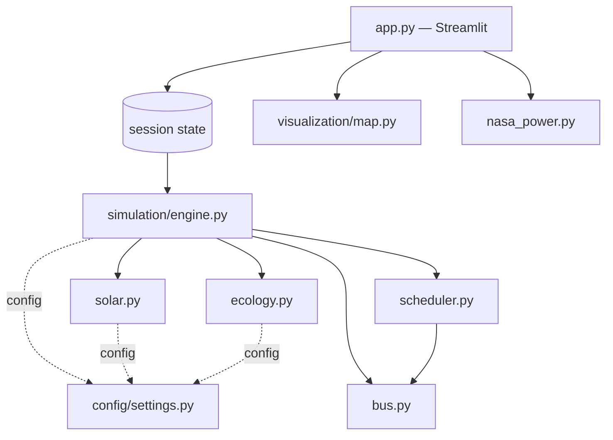

# Project Final Technical Report

## Coimbatore Smart City — Floating Solar, Electric Buses and Battery Swapping

**BCSE355L Smart Cities · VIT Vellore**
**Team:** Aditya Saxena (24BCE1633), Narayanan Subramanian (24BCE1699)

---

## 1. Current architecture

A Streamlit dashboard wrapping a deterministic 30-minute-resolution simulation. One
`SimulationEngine` instance is the single source of truth for operational state and lives
in Streamlit session state; the map consumes a separately computed 48-frame trajectory so
that re-rendering the map cannot disturb the live simulation.



## 2. Technology stack

| Component | Choice |
|---|---|
| UI | Streamlit |
| Data | pandas |
| Charts | Plotly |
| Map | Hand-written Leaflet document rendered in an isolated iframe |
| Numerics | Python standard library only |
| Optional | requests, for the NASA POWER irradiance cross-check |

`folium`, `streamlit-folium` and `numpy` were declared by earlier revisions, are no longer
imported anywhere, and have been removed from `requirements.txt`.

## 3. Project structure

```text
app.py                      Dashboard, caching, exports
src/config/settings.py      Every constant; one dataclass per scenario
src/simulation/engine.py    48-step daily and 365-day annual models
src/models/bus.py           Route geometry, position, SOC, diversion
src/models/ecology.py       Lake dissolved-oxygen budget
src/algorithms/solar.py     PV profile, cloud and temperature modifiers
src/algorithms/scheduler.py Fleet construction, traction energy, swap scheduling
src/visualization/map.py    Self-contained Leaflet component
src/services/nasa_power.py  Optional irradiance cross-check
scripts/validate_results.py Validation gate, 40 invariant checks
tests/                      342 tests
```

## 4. Simulation engine

48 fixed 30-minute steps per day. Each step runs ten stages in a fixed order:

1. Climatology — seeded cloud cover for the hour, seasonal ambient temperature.
2. Solar generation from the embedded profile.
3. Municipal load from the configured daytime window.
4. Fleet — traction energy drawn, SOC reduced, buses moved or diverted.
5. Charging — packs queued earlier charge within finite bays.
6. Energy balance — direct use, curtailment, grid import.
7. Swap scheduling, funded by the surplus left in step 6.
8. Lake ecology, including aeration hysteresis.
9. Cumulative energy and impact, on self-consumed energy only.
10. Emit an immutable `SimulationState`.

The annual model integrates all 8,760 hours with an independent weather draw per hour and
matches generation against demand hour by hour, so curtailment and grid import are
separately meaningful.

## 5. Solar model

Embedded hourly clear-sky profile for the reference 12.95 MWp array, interpolated to
half-hourly resolution and scaled linearly by coverage.

- **Cloud attenuation** capped at 80%: full overcast still yields about 20% of the
  clear-sky curve from diffuse light.
- **Cell-temperature derate** at the standard -0.4 %/degC above 25 degC, with an 8 degC
  cell rise for a floating array against 22 degC for a ground mount. The floating
  advantage is expressed as a roughly 6.3% relative retention versus ground mount, and
  output is always at or below nameplate.
- Clear-sky noon output is 11,616 kW at 25 degC ambient and 10,896 kW at 40 degC.

An earlier revision multiplied output by a factor that *increased* generation as ambient
temperature rose. That inverted sign has been removed.

## 6. Bus model

260 buses across four corridors. Fleet size is redistributed proportionally by the
largest-remainder method, so the allocation sums exactly to the fleet size at any slider
setting and preserves the design ordering.

Each bus carries deterministic progress, a 16-21 km/h cohort speed, a fixed per-vehicle
efficiency factor, and battery-aware SOC depletion. Route geometry — segment lengths and
cumulative distances — is computed once per bus and cached; interpolation is a binary
search. This replaced plain properties that re-walked the waypoint list on every access,
which had produced roughly two million redundant haversine evaluations per simulated day.

Buses below the swap threshold and outside a hub's service radius **divert**, steering
along their own corridor toward the nearest waypoint that passes that hub, rather than
continuing unchanged as in earlier revisions.

## 7. Battery and state-of-charge model

| Parameter | Value |
|---|---|
| Pack capacity | 300 kWh (150-450 kWh adjustable, and it changes behaviour) |
| Daily traction per bus | 219 kWh at traffic factor 1.0 |
| Service window | 05:00 to 22:00 |
| Swap threshold | 30% SOC |
| Critical SOC | 15% |
| Swap duration | ~7 minutes, completing inside one 30-minute step |
| SOC floor | 5% |

The hourly energy profile is normalised so its weights sum to exactly `DAILY_CONSUMPTION_KWH`.
Without that normalisation the peak and off-peak weighting inflated daily consumption by
about 15% relative to the stated figure.

Traction power and SOC drain are derived from a single per-bus energy expression, so the
reported demand and the energy actually consumed cannot diverge. Verified to within
0.001% over a full simulated day.

## 8. Swap scheduler

Eligibility: in service, below 30% SOC, within 2 km of a hub. Candidates are served
lowest-SOC first and funded in two tiers:

- **Solar** — funded from the step's surplus energy, so surplus genuinely limits how many
  swaps the array can pay for.
- **Grid** — reserved for buses below 15% SOC, so scarcity cannot strand a vehicle.

Both tiers are reported. On the default summer day the array funds 77 of 168 swaps, all
between 10:00 and 15:30; the remaining 91 occur between 18:00 and 21:30 as grid-assisted
top-ups. In earlier revisions swaps were gated on neither solar nor inventory timing and
spread from mid-morning to late evening regardless of the energy balance.

Pack inventory is conserved exactly: ready plus charging plus queued equals hub capacity
at every step, asserted by the test suite.

## 9. Ecological model

A standard dissolved-oxygen budget,

```text
dDO/dt = k2 (DO_sat(T) - DO) + P_net(t) + R_resp(T) + A(t)
```

with APHA-form saturation, re-aeration, light-driven photosynthesis, Q10 respiration, an
algae-suppression credit, and mechanical aeration with hysteresis at 3.0 / 4.2 mg/L.

The re-aeration term makes the budget an attractor, so mass conservation is structural
rather than tuned. An uncovered lake converges to a stationary cycle within about ten
days; the daily minimum then moves by less than 0.03 mg/L per day.

This replaced a fixed random per-hour delta table with a net positive daily integral of
about +0.2 mg/L, which caused an uncovered lake to gain oxygen indefinitely and saturate
at the ceiling.

Two further corrections matter:

- **Temperature coupling.** Water temperature drives the saturation target, so the model
  now has a seasonal signal that earlier revisions entirely lacked.
- **Spin-up.** Every reported figure is taken at the diurnal steady state. Because panels
  shade only between 10:00 and 15:00 and the daily minimum occurs near 07:00, a window
  starting at midnight measures the initial condition rather than the coverage effect.

## 10. Energy model

Per step:

```text
direct_use = min(generation, total_demand)
curtailed = max(0, generation - total_demand)
grid_import = max(0, total_demand - generation)
```

with `total_demand = municipal + traction + pack_charging`. Identity
`direct_use + curtailed = generation` and `direct_use + grid_import = demand` hold at
every step to within 0.15 kW and are asserted by both the test suite and the validation
script.

Traction is now derived from the fleet model rather than from an independent demand
curve, so the load-matching argument is computed rather than asserted.

## 11. Carbon model

`0.82 kg CO2/kWh`, the CEA India grid factor, applied to **self-consumed solar energy
only**. Curtailed output displaces nothing.

| Basis | Annual figure |
|---|---:|
| Self-consumed energy (shipped) | 10,881 t |
| All generation (incorrect) | 17,517 t |

The earlier revision applied the factor to total generation, overstating the result by
61%.

## 12. Cost model

Each self-consumed kilowatt-hour is credited **exactly once**, at the value of what it
displaces. Self-consumed solar is split by the load it serves: the traction share
displaces the diesel an all-diesel baseline would have burned and is valued at the implied
fuel cost per kWh (Rs 28.69/kWh at defaults); the municipal share displaces grid purchase
and is valued at retail plus surcharge (Rs 8.54/kWh). Annual benefit is therefore
Rs 29.94 Cr, against Rs 11.33 Cr for the municipal stream and Rs 26.49 Cr for the
traction stream.

Because the fuel value is 3.4x the retail tariff, two earlier revisions overstated the
benefit badly: the first valued all solar at retail **and** counted 100% of displaced
diesel; the second pro-rated only the diesel stream, still crediting solar serving
traction twice. The error was about Rs 19.5 Cr per year, or 65%.

**The simulated fleet is 100% electric.** Diesel exists only as the counterfactual
baseline, and a test asserts that no operational module references it. Grid-displacement
CO2 (10,881 t/yr) and avoided diesel combustion CO2 (7,100 t/yr against a 15,987 t/yr
baseline) are reported as separate scopes and never summed.

CAPEX includes the array, fleet and hub battery packs, and hub civil and electrical works.
Periodic whole-fleet repacks are charged in their replacement years. All inputs are
editable.

## 13. Scenario model

Coverage options are 10%, 15% and 20%, with an optional stress range extending to 40% so
that the mechanical-aeration mitigation path can actually be demonstrated. Each scenario is
evaluated at the diurnal steady state at the engine's own 30-minute resolution, so the
scenario table and the live trace agree to within 0.05 mg/L.

| Coverage | Min DO | Status |
|---:|---:|---|
| 0% | 5.49 | OK |
| 10% | 4.72 | OK |
| 15% | 4.33 | OK |
| 20% | 3.94 | CRITICAL / over cap |
| 30% | 3.17 | CRITICAL / over cap |
| 40% | 2.98 | CRITICAL / over cap, aeration 10 h |

## 14. Sensitivity analysis

The oxygen response is proportional to `EcologyParams.shade_effectiveness = 2.1`, the only
calibrated coefficient in the ecological model. The dashboard varies it explicitly:

| Value | Min DO at 15% | 15% compliant? |
|---:|---:|:--|
| 1.26 (0.6x) | 4.84 | yes |
| 1.68 (0.8x) | 4.58 | yes |
| **2.10 (1.0x)** | **4.33** | **yes** |
| 2.52 (1.2x) | 4.08 | yes |
| 2.94 (1.4x) | 3.82 | **no** |

This converts the project's largest documented weakness into a stated, quantified
dependence.

## 15. Map architecture

Hand-written Leaflet rather than Folium, so that a per-step re-render does not flicker.
The trajectory is emitted columnar with quantised integers, reducing the document from
4.10 MB to 0.91 MB. See `MAP_ARCHITECTURE.md`.

## 16. Animation architecture

Python owns the clock; the map iframe contains no timer. See `ANIMATION_ARCHITECTURE.md`.

## 17. Caching and performance

Every derived computation is a pure function of the scenario tuple and is wrapped in
`@st.cache_data`. Previously each recomputed on every rerun.

| Operation | Before | After |
|---|---:|---:|
| Full 48-step day simulation | 210 ms | 40 ms |
| 48-frame trajectory build | 506 ms | 106 ms |
| Map document render | 22 ms | 10 ms |
| Map payload | 4.10 MB | 0.91 MB |

## 18. Validation results

40 invariant checks in `scripts/validate_results.py`, all passing, plus 342 tests. See
`VALIDATION.md`.

## 19. Known limitations

Summarised in `ASSUMPTIONS_AND_LIMITATIONS.md`. The three that matter most:

1. The lake model is a heuristic budget, never calibrated against Ukkadam Lake data, and
   its conclusion depends on two coefficients that are calibrated rather than measured.
2. Operations data — traffic, demand, arrivals, weather — is synthetic. There is no GTFS,
   GPS or traffic feed.
3. Economics are academic estimates. Each self-consumed kilowatt-hour is credited
   exactly once, at the displaced-fuel or retail value depending on which load it serves.

## 20. Headline results

15% coverage, summer, seed 42:

| Quantity | Value |
|---|---:|
| Installed capacity | 12.95 MWp |
| Daily generation | 68,227 kWh |
| Daily self-consumption | 48,685 kWh (71.4%) |
| Daily curtailment | 19,542 kWh (28.6%) |
| Daily grid import | 53,154 kWh |
| Daily swaps | 168 (77 solar, 91 grid) |
| Annual generation | 21.36 GWh |
| Annual CO2 avoided | 10,881 t |
| Annual tariff saving | Rs 11.33 Cr |
| Annual benefit (single-credit) | Rs 29.94 Cr |
| Fleet + municipal demand | 29.88 GWh against 21.36 GWh generated |

## 21. Presentation talking points

- **Why floating solar here?** Ukkadam Lake is a ~1.295 km2 urban water body beside the
  city's main bus depot, with no competing land use.
- **Why 15%?** It is the ecological policy cap, and it is also where the oxygen model
  retains margin: 4.33 mg/L against a 4.0 threshold, versus 3.94 at 20%.
- **Why battery swapping rather than fast charging?** A 300 kWh pack swap in about seven
  minutes keeps buses available through the day and concentrates charging where solar
  surplus exists.
- **The honest finding.** A 12.95 MWp array cannot power 260 buses plus municipal load. It
  funds 77 of 168 daily swaps and about 64% of fleet traction energy. We report the
  remainder rather than hiding it.
